# FAULTLINE — Master System Documentation & Technical Audit

> **The institutional memory of this codebase.** This document explains what FAULTLINE is, why it exists, how every part of it works, how good each part is, what is broken or missing, and how to run, change, deploy, and rebuild it.

| | |
|---|---|
| **Repository** | `github.com/Harshith029/faultline` (MIT) |
| **Audited commit** | `5f71be6` on `main` (2026-08-15), clean working tree |
| **Audit date** | 2026-09-24 |
| **Scope** | All 135 tracked files: `packages/core`, `packages/agent`, `packages/benchmark`, `frontend/dashboard`, `backend/lambda/timelineHandler`, `scripts/`, CI, Docker, IaC, and docs |
| **Method** | Every architecturally significant source file read in full; every test suite, the reference check, the benchmark, the real-data backtest, lint, dependency audit, and the dashboard build were run; six targeted probe scripts confirmed suspected defects; hot paths were micro-benchmarked. The Docker image, the SAM template lint (cfn-lint), CI history, a real Prometheus pipeline, and real webhook delivery were then exercised end to end. AWS services were not, because the account session had expired |

---

## How to read this document

**Evidence legend.** Every non-trivial claim carries one of these labels, stated inline or implied by its section.

| Label | Meaning |
|---|---|
| ✅ **Implemented** | Code exists, was read, and (where stated) was executed during this audit |
| ⚙️ **Configured** | Exists as configuration or infrastructure-as-code; not deployed or exercised during this audit |
| 🔗 **Referenced, not implemented** | Mentioned in docs, UI copy, or code paths, with no working implementation |
| 🗓️ **Planned** | On the documented roadmap |
| 🔎 **Inference** | Reasoned from evidence and labelled as such; not stated anywhere in the repository |
| ❓ **Unknown** | Not determinable from the repository |
| 🐞 **Confirmed defect** | Reproduced with a probe script during this audit |

**Two words mean something specific here.**

- **"Agent"** means the long-running *monitoring daemon* (`packages/agent`). It is **not** an LLM agent. There is no tool-calling agent, agent loop, or planner anywhere in the repository.
- **"AI"** has three distinct meanings in this project, and conflating them is the main way the project gets misunderstood:
  1. **Detection**: deterministic statistics (z-scores). No machine learning, no training, no model.
  2. **Explanation**: one optional Amazon Bedrock call, in the AWS Lambda variant only.
  3. **Scripted "AI" panels** in the dashboard: fixed, hand-written text, labelled as sample content.

**Section structure.** Sections 1–43 follow the requested outline. The rating system is woven through it: the global scorecard is below; architecture, code-quality, security, AI, feature, technical-debt, and decision-quality ratings live in their topic sections; production readiness, MVP completeness, the remaining-work list, gap analysis, risk scorecard, and development completion form the **Assessment** part (A1–A7) before Section 41. The document ends with documentation completeness and the final health dashboard.

---

## Audit verification log

Everything below was **run during this audit**, on Node v24.14.0 (Windows 11, Intel i7-14650HX). CI runs Node 20.

| Check | Command | Result |
|---|---|---|
| Engine tests | `node --test` in `packages/core` | ✅ 34/34 pass |
| Agent tests | `node --test` in `packages/agent` | ✅ 186/186 pass (docs say 180) |
| Benchmark tests | `node --test` in `packages/benchmark` | ✅ 29/29 pass |
| Dashboard tests | `vitest run` | ✅ 21/21 pass |
| Lambda tests | `node --test` in `backend/lambda/timelineHandler` | ✅ 23/23 pass |
| **Total** | | **293 tests, all passing.** The docs quote 169, 264, and 287 in different places |
| Reference scenario | `npm run verify:engine` | ✅ PASS. Trigger at W8, outage at W12. The static SLO alert fires at W11 (3-window lead for FAULTLINE); a single-metric 3σ alert fires at W8 (0-window lead) |
| Synthetic benchmark | `node packages/benchmark/bin/benchmark.js` (20 seeds) | ✅ Default: 69.4% precision / 100% recall / 82.0% F1. Strict: **82.6%** / 100% / 90.5% |
| Real-data backtest | `npm run backtest` (4 SMD machines, 3 min 24 s) | ✅ **14.1% precision / 80.5% recall / 23.9% F1 / 544 false alerts.** Reproduces `docs/BACKTEST.md` exactly |
| Lint | `npm run lint` | ✅ Clean |
| Dependency audit | `npm audit --omit=dev` / `npm audit` | ✅ 0 production advisories. ⚠️ 7 dev advisories (1 low, 3 moderate, 3 high); `docs/DEPENDENCIES.md` accepts only one of them |
| Dashboard build | `npm run build` | ✅ Builds. `FaultlineDashboard` chunk is 506.6 kB (132 kB gzip), which trips Vite's size warning |
| Defect probes | 6 scripts + 1 inline check | 🐞 6 defects reproduced in-process (F-01 to F-04, F-06, F-13); F-02 and F-14 also reproduced end to end (below). The rest (F-05, F-07 to F-12, F-15, F-16) are confirmed by reading the code or by measurement |
| Performance probes | 41 ticks at 100, 1,000, and 10,000 services; pretty-printed state size | See [§15](#15-performance--scalability). The measured ~10 KB of state per service implies the F-15 ceiling |
| Docker image | `docker build` + the CI `docker` job's assertions, re-run locally | ✅ Builds in ~5 s; 194 MB; runs as `node`; **reports Node v20.20.2** (F-07). Without a token: exit 1, "Refusing to start". With a token: `/health` 200, and anonymous silence POSTs are refused with 401 (both `application/json` and `text/plain`, so F-01 does not affect the container). Detected the demo cascade (R = 4.12, 2 signals); Docker health `healthy`. The image ships the agent's 16 test files (no `.dockerignore`) |
| SAM template lint | `npm run lint:iac` (cfn-lint 1.54.0) | ✅ 0 findings. The wrapper skipped a pip-less virtualenv `python` and used Python 3.11, as designed |
| CI history | `gh run list`, `gh run view` | ✅ All 6 jobs green on the audited commit (`5f71be6`, run 31899311214; backtest 51 s, the slowest). Earlier failures were fixed by follow-up commits: `bccd17a` (dashboard build, fixed by `506974b`) and `713ce2d` (unit tests and backtest, fixed by `d269532`) |
| Real Prometheus, end to end | Exporter built on the repo's synthetic source → `prom/prometheus` → the agent image using the Prometheus source; Prometheus also scrapes the agent | ✅ Collections before the first scrape counted as `collect_empty`, not healthy. Incident opened from real PromQL (R = 4.01, 2 signals). A series that vanished became `incomplete_sample` with `missingMetrics: ["error_rate"]` (not zero), then `/health` 503 `service_telemetry_stale`. One malformed query → `collect_failed` with **0 services evaluated**, even though 2 of the 3 queries were valid |
| `/metrics` against real tooling | Prometheus scrape + `promtool check metrics` | Prometheus scrapes it (`up`, no error). `promtool` exits 3: `faultline_incidents_open no help text` and `faultline_incidents_total non-counter metrics should not have "_total" suffix`. The interleaved families were **not** flagged (F-06 corrected accordingly) |
| Webhook delivery, end to end | Real CLI agent + a local Slack-compatible receiver | 🐞 Receiver returns 500: 3 requests, 3 `notify.failed`, **all 3 incidents marked notified**, no retry (F-02). Receiver hangs while 10 services fail together: the last incident opened **45.3 s** after the first, with **77 skipped ticks**; 10 opens + 6 resolves sent, none delivered, all marked notified (F-14). Identical results on two runs |
| **Not run** | AWS CloudWatch, DynamoDB, Bedrock; a real Slack workspace | ⛔ The AWS CLI session had expired (`aws login` needed; only the account owner can do that). No Slack webhook URL was available, and posting into a real channel needs explicit approval. The Slack-compatible local receiver above stands in for Slack |

---

## Findings raised by this audit

These are **new** relative to the repository's own documentation. Each one is covered in depth in its topic section.

| ID | Severity | Finding | Location | Evidence |
|---|---|---|---|---|
| **F-01** | **High** | **Cross-origin write forgery against the default quickstart agent.** With no token on a loopback bind (the `npm run agent:demo` configuration), any web page the operator visits can send a `text/plain` `POST` (a CORS "simple request" with no preflight) that creates a `match: "*"` silence with no expiry, muting all alerting. The API sends `Access-Control-Allow-Origin: *`, never checks `Content-Type`, and never validates the `Host` header, so DNS rebinding also works | `packages/agent/src/server.js` (`corsOrigin`, `readJson`); `auth.js` (loopback is open) | 🐞 Probe returned `201`; the active silence list became `* until=null` |
| **F-02** | **High** | **A failed alert is recorded as delivered.** `notifiers.notify()` uses `Promise.allSettled` and never throws, so `maybeNotify()` sets `incident.notifiedAt` even when every notifier failed. Nothing retries, and the "announce after the silence ends" path is skipped because the incident looks delivered. The code comment says `notifiedAt` "records successful delivery", which is not true. It also breaks the rule that a resolve is sent only if the open was: an operator can receive RESOLVED for an incident whose opening page never arrived | `agent.js` `maybeNotify()`; `notifiers/index.js` `notify()` | 🐞 In-process probe: a dead webhook returned `true` and set `notifiedAt`. End to end with the real agent: 3 × HTTP 500 → all 3 incidents marked notified, no retry |
| **F-03** | Medium | **Dashboard live mode scores a fabricated zero.** The Lambda renamed `retry_rate` to `client_error_rate`, but the dashboard still analyses `['p99_latency','retry_rate','error_rate']`. `retry_rate` is absent, the engine coerces it to `0`, and the 4XX series is ignored. The UI text still says "retry pressure is proxied by the 4XX client-error rate" | `frontend/dashboard/src/components/FaultlineDashboard.jsx` (`LIVE_PARAMS`) | 🐞 Probe: `retry_rate` baseline `{mean: 0}`, z permanently 0 |
| **F-04** | Medium | **Restored state bypasses the "missing is not zero" rule.** `hydrateBuffers()` pushes saved samples without re-validating them against the current metric list. Add a metric to the config and restart within `restoreMaxAgeSeconds` (900 s by default), and the restored samples zero-fill that metric: σ collapses to 1e-9 and z reaches about 5×10¹⁰. That is a guaranteed false qualified signal | `packages/agent/src/detector.js` `hydrateBuffers()` | 🐞 Probe: `queue_depth_z = 50000000000` |
| **F-05** | Medium | **Decommissioned services are never forgotten.** The buffer, `lastCompleteSampleAt`, and `detections` maps never evict, and `exportBuffers()` persists every service ever seen. Remove a service from the fleet and `/health` returns 503 (`service_telemetry_stale`) indefinitely, across restarts, with no API to clear it. If `/health` is the Kubernetes liveness probe, as `docs/AGENT.md` recommends, the result is a restart loop that cannot fix anything | `detector.js`, `agent.js` `health()` | Code reading; consistent with the test "a restored service that never reports again is reported stale" |
| **F-06** | Low | **`/metrics` fails `promtool` lint.** `faultline_incidents_open` has no `HELP` or `TYPE`; `faultline_incidents_total` is typed `gauge` despite its `_total` suffix; `faultline_up` is hard-coded to `1`. Five families are also interleaved per service rather than grouped. Real Prometheus and `promtool` both tolerate the interleaving (verified), so it matters only for stricter third-party consumers. The test named "emits valid Prometheus exposition format" checks individual lines only | `packages/agent/src/server.js` `renderPrometheusMetrics()` | 🐞 `promtool check metrics` exit 3 with two errors; real Prometheus scrape `up` |
| **F-07** | Medium | **The container and CI run an end-of-life Node.** Node 20 left support on 2026-04-30, as the SAM template's own comment notes. The `Dockerfile` still uses `node:20-alpine`, CI uses Node 20, and `engines` still admits `^20.19` | `Dockerfile`, `.github/workflows/ci.yml`, `package.json` | Read; the built image reports `node -v` = v20.20.2 |
| **F-08** | Low–Med | **Store flush race at shutdown.** A timer-driven `flush()` still in flight and the `flush()` from `close()` write the same temp path `${path}.${pid}.tmp`. Possible outcomes: a second `rename` fails with `ENOENT` (shutdown exits 1), or an older payload overwrites the newer one | `packages/agent/src/store.js` | Code reading; not reproduced (the timing window is milliseconds) |
| **F-09** | Medium | **The Lambda calls Bedrock on every request and ignores its CORS parameter.** A triggered timeline triggers a model call on every page load, with no caching. With `ApiAuthMode=none`, the throttle (10 rps) still allows about 864k billed invocations per day. Responses also hard-code `Access-Control-Allow-Origin: *`, so the `CorsAllowOrigin` template parameter never applies to `GET` responses | `backend/lambda/timelineHandler/handler.js` | Code reading |
| **F-10** | Low | **Documentation drift.** `docs/AGENT.md` says missing metrics "coerce to 0", the opposite of the code. Its auth table says no token means "everything open", although a non-loopback bind now refuses to start. Test counts disagree (169, 264, 287; actual 293). Strict precision is quoted as 83.3% (measured 82.6%). `DEPENDENCIES.md` lists 1 dev advisory (actual 7). `index.html` still advertises "AI root-cause diagnosis" | Docs, `index.html` | Read and measured |
| **F-11** | Low | **An incident on a service that goes silent never resolves or escalates.** Only `evaluated` results reach `AlertManager`, so a firing incident stays `firing` indefinitely and nothing says "no data" | `agent.js` `tick()` | Code reading |
| **F-12** | Low | **Credentials can still sit in config.** Literal tokens are rejected only in `server.auth`. `source.options.headers` (Prometheus/HTTP auth) and webhook `headers` accept secrets inline, with no `*Env` indirection | `config.js` `validateConfig()` | Code reading |
| **F-13** | Medium | **Documented global settings are silently ignored.** `detector.statistic` (for example `median_mad`, recommended in `docs/AGENT.md`) and `detector.zThresholdPerMetric` pass validation but are dropped by `detectorParams()`; they take effect only inside a `services[]` rule. Unknown `detector.*` keys (typos) are not rejected either. This contradicts the "fail loudly" configuration philosophy | `config.js` `detectorParams()`, `validateConfig()` | 🐞 Probe: effective `statistic = undefined`; `typoKey` accepted |
| **F-14** | Medium | **One slow webhook stalls detection during a fleet-wide event.** `tick()` awaits `maybeNotify()` for each incident in turn, each bounded only by the 5 s webhook timeout. When a shared dependency fails and many services open incidents in the same tick, the tick overruns, later ticks are skipped (`agent.tick_skipped`), and detection freezes at exactly the moment it matters | `agent.js` `tick()` | 🐞 End to end: 10 services fail together, the receiver hangs → last incident opened 45.3 s after the first, 77 `agent.tick_skipped` |
| **F-15** | Medium | **Persistence has a hard ceiling of about 53k services.** The store pretty-prints the whole state into one string, about 10 KB per service at defaults. Past V8's ~537M-character string limit, `JSON.stringify` throws on every flush, and *nothing* persists, incidents included. Long before that, each flush blocks the event loop (about 0.9 s at 10k services) | `store.js` `flush()` | Measured size per service; ceiling derived |
| **F-16** | Medium | **The CloudWatch source has no request timeout.** Prometheus and HTTP use `AbortSignal.timeout(10 s)`, but `cw.send()` sets none. A hung call wedges the tick, every later tick is skipped, and the failure shows up only indirectly, as telemetry staleness in `/health` | `sources/cloudwatch.js` | Code reading |

Two further **honesty issues** matter for how the product is presented:

- **"Confidence" is not a probability.** `confidenceFromRisk(R) = 1 − e^(−R/2.5)` is an arbitrary monotone mapping, and the dashboard shows it as a percentage. At a measured real-world precision of 14%, a "79% confidence" badge overstates certainty.
- **The counterfactual's inputs are invented.** The mitigation decay rates in `MITIGATIONS` (for example, a circuit breaker decays latency by 0.62× per window) are hand-picked constants. The panel's claim that the averted outcome is "computed math, not a scripted replay" is technically true of the engine, but it is running on made-up recovered telemetry, so it is illustrative, not predictive.

---

## Rating scale

Used everywhere in this document. **Scores rate actual maturity, not how impressive something looks.**

| Score | Meaning |
|---:|---|
| 0 | **Missing.** Does not exist |
| 1 | **Concept only.** Idea exists; implementation essentially absent |
| 2 | **Very early.** Basic proof of concept |
| 3 | **Prototype.** Works in limited scenarios; highly incomplete |
| 4 | **Functional MVP.** Core works; significant gaps |
| 5 | **Usable.** Reasonably functional, not production-grade |
| 6 | **Solid.** Good implementation with moderate gaps |
| 7 | **Production capable.** Can operate in production with remaining improvements |
| 8 | **Strong production system.** Well engineered; minor weaknesses |
| 9 | **Excellent.** Mature, robust, scalable, secure, maintainable |
| 10 | **Exceptional.** Best-in-class for its intended scope |

Priorities: **P0** critical · **P1** high · **P2** medium · **P3** low · **P4** nice to have.

---

## Global project scorecard

| Category | Score | Status | Reason (repository evidence) | Major gap | Priority |
|---|---:|---|---|---|---|
| Product idea | **6** | Sound, not novel | Multi-signal convergence as an earlier, explainable triage signal is a reasonable, well-understood idea | Undifferentiated against commercial anomaly detection | P2 |
| Problem/solution fit | **4** | Unproven | 14.1% real-world precision (verified). The pivot from "early warning" to "ranking" is honest but unvalidated with users | No user evidence; pager use not viable | P1 |
| UX (operator) | **5** | Usable | Clear CLI, structured logs, explicit refusal messages, `/api/ranking`. But the dashboard cannot read the agent, so the production path has no UI | No UI for the agent's own data | P1 |
| UI (dashboard) | **6** | Polished demo | Strong visual design; scripted content is honestly labelled | 507 kB chunk; mixed styling; live-mode bug (F-03) | P2 |
| Architecture | **7** | Clean for its scope | One engine shared across Node, browser, and Lambda; pluggable sources; clear module boundaries | Single process, single replica, JSON store | P2 |
| Code quality | **7** | Good | Readable, rationale-rich comments, strict validation, small modules | Plain JS (no types); duplicated helpers; module-level mutable state; F-02/F-04 slipped past tests | P2 |
| Backend (agent) | **6.5** | Solid | Careful lifecycle, restart, shutdown, health semantics | F-01, F-02, F-05, F-08 | P0 |
| Frontend | **5** | Demo-grade | Works; lazy-loaded dashboard; provenance labelling is tested | 21 tests, all on one concern; F-03; not wired to the agent | P2 |
| Database / persistence | **4** | Adequate single-node | Atomic JSON file store; restart resume; DynamoDB table for the demo | Full rewrite per flush; not queryable; no migrations; not shared | P2 |
| API design | **6** | Reasonable | JSON, sensible status codes, auth scopes, ranking | No versioning, OpenAPI spec, or cursor pagination; F-06 | P2 |
| AI/ML (detection + explanation) | **4** | Honest, weak signal | Math is sound and auditable; the LLM layer is carefully guarded | 14% precision; the LLM exists only in the Lambda; no evaluation of explanation quality | P1 |
| Agent architecture (monitoring daemon) | **7** | Solid | Tick loop, overlap guard, bounded shutdown, restart resume | No HA or sharding; F-05 | P2 |
| Security | **5** | Good intent, real gaps | Fails closed off loopback; constant-time token compare; TLS fails closed; no literal tokens in config | F-01, F-07, F-09, F-12; no rate limiting; no audit trail | **P0** |
| Privacy | **6** | Low exposure | Operational telemetry only; no PII by design | Unencrypted state file; metric context sent to Bedrock | P3 |
| Testing | **7** | Strong for backend | 293 tests; behaviour-named; end-to-end, restart, and shutdown coverage | No coverage gate; thin frontend tests; tests missed F-01 to F-06 | P1 |
| Performance | **6** | Fine at small scale | Measured: 20 ms per tick at 1k services, 242 ms at 10k | Full recompute every tick; 62 MB JSON snapshot at 10k services | P3 |
| Scalability | **3** | Single node only | One process, one replica, whole-document persistence | No sharding, HA, or external store | P2 |
| Reliability | **5** | Mixed | Graceful degradation, bounded shutdown, state restore | F-02 (lost pages); no HA; single point of failure | **P0** |
| Observability | **6** | Good self-reporting | JSON logs with stable event names; `/health` with reasons; Prometheus metrics | No traces; F-06; no shipped alert rules | P2 |
| DevOps | **5** | Basic | Dockerfile, compose, SAM template, deploy script | No image registry, release process, or K8s manifests; F-07 | P1 |
| CI/CD | **6.5** | Good CI, no CD | Six jobs, including security-default assertions | No CD or releases; actions not SHA-pinned; Node 20 | P2 |
| Documentation | **7.5** | Unusually honest | Measured claims, negative results, design rationale | Drift (F-10) | P2 |
| Maintainability | **7** | Good | Small codebase (~9.5k source lines); clear seams | Hand-maintained doc numbers; no types | P3 |
| Developer experience | **7.5** | Good | `npm install && npm run agent:demo` works; zero runtime dependencies | Four lockfiles; Windows-specific deploy script | P3 |
| Production readiness | **4** | Conditional | See [A1](#a1-production-readiness) | F-01, F-02, F-07; no HA | **P0** |
| Business readiness | **2** | Pre-commercial | An OSS hobby/competition project; no users, pricing, or support evidence | Everything commercial | P3 |
| **Overall project** | **5.5** | **Well-engineered OSS beta with a weak real-world signal** | Engineering discipline well above typical prototypes; measured detection quality well below pager-grade | Fix P0s; validate the triage use case with real users | — |

---

# Part I — Understanding the Product

## 1. Executive summary

### 1.1 What the product is

FAULTLINE is an **open-source, self-hosted monitoring agent** for backend services. It runs as a single Node.js process with **zero runtime dependencies**. On a fixed interval (60 s by default) it pulls a handful of numeric metrics per service from Prometheus, Amazon CloudWatch, or any HTTP endpoint; by default those are p99 latency, retry rate, and error rate. For each service, independently, it asks:

> *Have several of this service's metrics drifted upward **together**, and **stayed** up, relative to the service's own recent baseline?*

When they have, it opens **one incident** (not one alert per minute), tracks it until it clears, and sends it to stdout, a JSONL file, or a Slack-compatible webhook. It also exposes an HTTP API: a **risk ranking** of all services, current state, incident history, silences, and Prometheus metrics about itself.

Around that agent the repository ships:

- **`@faultline/core`**: the detection engine as a pure, dependency-free library. The same file runs in Node, in the browser, and was the source for the Lambda's precomputed data.
- **A React dashboard**: a teaching and postmortem tool that replays a 12-window incident, shows every z-score derivation, runs "what if we had acted at W6?" counterfactuals, and accepts a CSV upload.
- **A benchmark and backtest harness**: synthetic labelled scenarios plus a causal replay of a public, operator-labelled production dataset (SMD).
- **An AWS serverless variant**: a Lambda behind API Gateway that serves precomputed detection windows from DynamoDB, optionally reads live API Gateway metrics from CloudWatch, and optionally asks Amazon Bedrock for a plain-language summary of the detection window.

### 1.2 The problem

Conventional alerting has two failure modes:

- **Static thresholds** on outcome metrics (for example "error rate > 2%") fire when users are *already* failing. They lag.
- **Per-metric anomaly alerts** fire on every blip. They are noisy, and noisy alerting gets muted.

The project's hypothesis (README, `docs/ARCHITECTURE.md`): *cascading failures announce themselves through convergence.* Latency rises, clients retry, and errors follow. Several signals moving together, sustained, is earlier than an SLO breach and more specific than any single metric.

### 1.3 Who has it

On-call engineers and SREs at organisations running request-path services with Prometheus or CloudWatch, and platform teams who own alerting. 🔎 *Inference:* small-to-mid-sized teams without a commercial AIOps product are the natural audience, given the self-hosted, single-binary, config-file design.

### 1.4 Core value proposition, stated as the project now states it

> *"Use it as a ranking signal first."* It answers **"where do I look first?"** with auditable math, earlier than three separate alerts would, and every number can be re-derived by hand.

This positioning was adopted on 2026-08-15 (commit `eec8903`) **after** the real-data backtest showed ~14% precision. It is the project's most important strategic decision (see [ADR-13](#adr-13--triage-first-positioning)).

### 1.5 What is technically interesting

1. **One engine, three runtimes.** `packages/core/detectionEngine.js` is pure ES2023 with no I/O. The agent, the browser dashboard, and the dataset that seeded the Lambda's DynamoDB table all use the same code, so "the dashboard disagrees with the agent" cannot happen.
2. **A strict data-quality contract.** A sample is accepted only if *every* configured metric is present and finite. Missing is never coerced to zero, because a lost error-rate series would otherwise read as a perfect 0% error rate and silently mute an incident. `/health` distinguishes "process up" from "telemetry trustworthy".
3. **Empirical honesty.** A causal backtest on 28 days of real, operator-labelled server telemetry, with three improvement ideas **implemented, measured, and rejected**, all documented. That is rare in any project, let alone a prototype.
4. **Fail-closed security posture.** The agent refuses to start on a non-loopback address without a token, refuses to start if a TLS certificate is unreadable, and rejects literal tokens in config files.
5. **An LLM guardrail pattern.** "AI may explain a detection, never cause or suppress one." Bedrock output is schema-validated, must name only the evaluated service, and every evidence line must cite a metric that actually qualified. Anything else falls back.

### 1.6 What is implemented

✅ Engine; rolling detector; four telemetry sources; incident state machine with dedup, resolve streak, and cooldown; three notifiers; silences (one-off and recurring, UTC); per-service parameter profiles; HTTP API with two token scopes and optional TLS; Prometheus self-metrics; atomic JSON persistence with restart resume; bounded graceful shutdown; dashboard; benchmark; backtest; Lambda with DynamoDB pagination, a CloudWatch live path, and a Bedrock explanation with fallback; SAM template; Dockerfile and compose; a six-job CI pipeline; 293 passing tests.

### 1.7 Maturity

**Late prototype / open-source beta.** The package version says `1.0.0`; `SECURITY.md` says "pre-1.0". Engineering hygiene is well above typical prototypes. **Detection quality on real data is well below what unattended paging needs**, and the project says so itself. ❓ There is no evidence of any production deployment or external user.

### 1.8 Current limitations (headline)

- 14.1% precision on real telemetry: about six false alerts per true one (verified).
- Per-service only: no dependency graph, traces, or deploy events, so no cross-service causality.
- Single process, single replica, local JSON file. No HA; horizontal scaling means manual sharding by config.
- The dashboard does **not** connect to the agent. It reads a bundled fixture, a CSV upload, or the Lambda.
- Two high-severity defects found in this audit (F-01, F-02) and an end-of-life runtime (F-07).

### 1.9 In one paragraph — for the CEO

FAULTLINE is a free, self-hosted tool that watches your services and flags the ones whose key health numbers are all getting worse at the same time. That is usually an earlier warning than a standard alert. It is well built, cheap to run, and unusually honest about its own accuracy: on real production data, only about 1 in 7 of its alerts corresponds to an incident operators cared about. That makes it useful today as a "look here first" list, not yet as something that should wake an engineer at night. It is a strong engineering foundation and a credible open-source project, but not yet a product. There are no users, no business model, and the accuracy problem is fundamental to the approach, not a tuning issue.

### 1.10 In one paragraph — for the CTO

A ~9.5k-line JavaScript monorepo (npm workspaces). A pure statistical engine (rolling mean/σ z-scores, sustained-run qualification, `R = mean_z · ln(1+n) · W` convergence scoring) is embedded in a zero-dependency Node daemon with pluggable pull sources, an incident state machine, atomic JSON persistence, and a token-scoped HTTP API. A React/Vite dashboard and an AWS SAM Lambda (DynamoDB, CloudWatch, Bedrock) reuse the engine. Test discipline is strong (293 tests, CI with security-default assertions, a real-data backtest in CI). Architectural ceilings: single process, whole-document persistence, full recomputation every tick, no HA. The two P0s are a cross-origin forgery hole in the default local configuration and alert-delivery failures recorded as successes. The runtime is past end of life. Most importantly, the backtest shows the detection *signal* is under-specified, and three statistical refinements did not move it. Further investment should go to correlation structure and user validation, not arithmetic.

### 1.11 In one paragraph — for a developer

Start at `packages/agent/src/agent.js` → `tick()`. A source's `collect()` returns `[{service, timestamp, ...metrics}]`. `RollingDetector.ingest()` validates each sample (all metrics present and finite, or it is rejected), appends it to a per-service ring buffer, and re-runs `runDetection()` from `@faultline/core` over the whole buffer. The baseline is the oldest `baselineWindows` samples. The newest window's verdict goes to `AlertManager.evaluate()`, which opens, updates, resolves, or suppresses an incident. `maybeNotify()` fans out to notifiers unless a silence matches, and `Store` persists everything to one JSON file with atomic, debounced writes. `server.js` is a hand-rolled `node:http` router over `agent.snapshot()`. Tests use `node:test`; run `npm test`. Everything is plain ESM JavaScript with no build step outside the dashboard.

> **Section assessment.** Score **5.5/10** overall · Priority **P0** for the defects, **P1** for validation
>
> | Good | Weak | Missing | Why it matters | Next step |
> |---|---|---|---|---|
> | Clear scope, honest claims, strong engineering hygiene | Real-world precision; UI disconnected from the agent | User validation, HA, reliable delivery | A monitoring tool that loses pages or can be muted by a web page fails at its one job | Fix F-01/F-02/F-07, then run a triage pilot with real users |

---

## 2. Project origin & ideation

### 2.1 Known history (from git; 36 commits, 2026-03-20 → 2026-08-15)

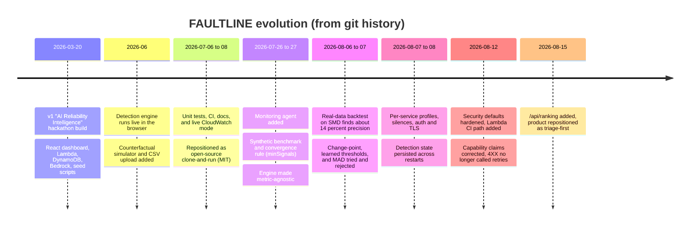

**Known facts:**

| Fact | Evidence |
|---|---|
| The project began as an entry to the **AWS 10,000 AIdeas Competition 2026** and was a Top 300 semi-finalist in its community-voted round | README footer; `LandingPage.jsx` badge |
| v1 (`30a2c2d`, 2026-03-20) was a **demo system**: a dashboard over a precomputed 12-window scenario in DynamoDB, with Bedrock (Claude 3 Haiku, `ap-south-1`) generating a "root cause hypothesis" | v1 file list; `iam-policy.json`; `scripts/seed.js`; `scripts/verify.js` |
| v1 marketed "AI root-cause diagnosis" | `frontend/dashboard/index.html` meta description (still present: F-10) |
| The product was **repositioned** on 2026-07-08 as open source, "clone-and-run", MIT | Commit `949cfae` |
| The **agent** (the real product) arrived on 2026-07-26 | Commit `fd85ef4` |
| The real-data backtest (2026-08-06) found ~14% precision, and three follow-up ideas were rejected by measurement | `docs/BACKTEST.md`; commits `6197d10`, `d9c7b49`, `212c370` |
| Capability claims were corrected on 2026-08-12 (API Gateway 4XX is no longer called a retry rate; single-service scope is stated) | Commit `713ce2d` |
| Primary positioning changed to "ranking/triage first" on 2026-08-15 | Commit `eec8903` |
| There is one author (two git identities for the same person) | `git shortlog` |

### 2.2 Reasonable reconstruction of the product reasoning

> 🔎 Everything in this subsection is **reconstruction**, not documented history.

The project went through three identities:

1. **"AI predicts outages" (March).** A hackathon narrative: a visually striking dashboard, an LLM "diagnosing root cause", and a scripted three-service cascade (B → D → F). The detection numbers were precomputed.
2. **"Deterministic early warning; AI only explains" (June–July).** The author moved detection into real, testable code, made the AI strictly subordinate ("explains, never decides"), and built an actual agent. The benchmark was designed to show that convergence beats single-metric thresholds.
3. **"Honest triage signal" (August).** Real data showed the early-warning claim does not hold at pager-grade precision. Rather than tune until the numbers looked good, the author documented the negative result and repositioned the product around ranking, which tolerates false positives.

This arc explains several design choices that otherwise look odd: why the dashboard contains so much scripted narrative (legacy of identity 1, now labelled), why a Lambda/DynamoDB/Bedrock stack exists beside a zero-dependency agent (identity 1's infrastructure, retained as "the reference for adding an LLM layer"), and why the documentation is so insistent on caveats (identity 3).

### 2.3 Problem statement

> Engineers learn about a degrading service too late (from lagging outcome SLOs) or too often (from noisy per-metric alerts). They need an early, low-noise, **explainable** signal of which service is going wrong, one they can audit and tune without trusting a black box.

### 2.4 Target users and personas (reconstructed)

| Persona | Context | Pain | What they want from FAULTLINE |
|---|---|---|---|
| **On-call SRE** | Holds the pager for 20–200 services | Alert fatigue; late SLO pages; "which dashboard do I open?" | A ranked "look here first" list; one incident per problem, not one per minute |
| **Platform engineer** | Owns monitoring infrastructure | Configuring and tuning alert rules per service is laborious | A config-file agent that plugs into Prometheus/CloudWatch, is tunable per service, and can be muted during deploys |
| **Incident/postmortem lead** | Writes postmortems | Hard to show when signals first diverged | Window-by-window replay, lead time versus a static SLO, counterfactuals |
| **Evaluator** (OSS user, hackathon judge) | Has 5 minutes | Most tools need infrastructure to try | `npm run agent:demo` and a visible detection within ~15 seconds |

### 2.5 Jobs to be done

- *When a service starts degrading, I want to know which one and which signals, so I can intervene before users notice.*
- *When I am paged, I want the incident to carry its evidence (which metrics, how far, since when), so I don't start from zero.*
- *When I deploy, I want to mute alerts without losing the record, so the postmortem still has the data.*
- *When I evaluate a detector, I want to re-derive its numbers by hand, so I can trust or tune it.*

### 2.6 Core assumptions, and their current status

| Assumption | Status |
|---|---|
| Cascades show up as correlated, sustained upward drift in a few metrics | ✅ True on synthetic data (by construction); **partially true** on real data (80.5% recall) |
| Convergence separates incidents from noise | ⚠️ **Weakly.** Precision roughly doubles versus a single-metric threshold (7.3% → 14.1%) but stays low. Most false positives are real multi-channel excursions (deploys, batch jobs) that operators did not label as incidents |
| Operators value explainability over accuracy | ❓ Untested; no user research in the repository |
| A ranked list tolerates false positives | 🔎 Plausible; untested |
| Zero dependencies matters to adopters | 🔎 Plausible for security-conscious teams; untested |

### 2.7 Key use cases

1. Continuous monitoring with webhook alerts (the documented primary deployment).
2. Triage ranking: `GET /api/ranking` answers "where do I look first?" (the current recommended primary use).
3. Maintenance muting: config windows plus ad-hoc API silences.
4. Postmortem analysis: dashboard replay or CSV upload.
5. Detector research: benchmark and backtest against SMD.
6. Library use: `import { runDetection } from '@faultline/core'`.

### 2.8 MVP definition (reconstructed from the README's own claim)

> "A real monitoring agent: it runs continuously, pulls metrics from Prometheus / CloudWatch / any HTTP endpoint, scores multi-signal drift risk with auditable math, manages incident lifecycle with dedup and cooldown, and alerts your webhook."

**Inside the MVP:** the agent, its sources, the engine, incident lifecycle, webhook alerting, health, safe defaults, persistence, a runnable demo, and documentation.
**Outside the MVP:** the dashboard, the Lambda/Bedrock variant, the benchmark and backtest (supporting evidence, not product), HA, multi-tenant use, and a UI for the agent.

MVP completion is scored in [A2](#a2-mvp-completeness).

### 2.9 Critical user journeys

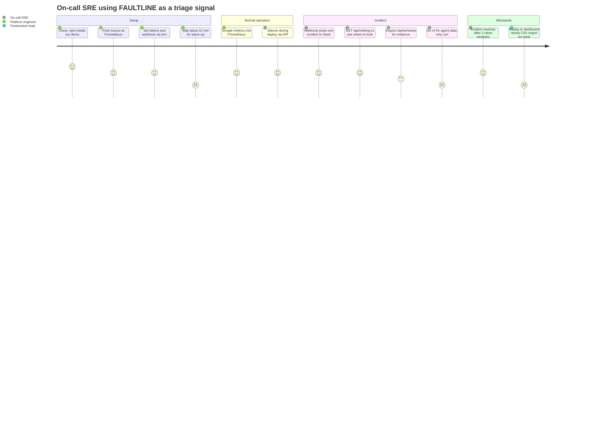

The scores are the audit's estimate of each step's friction (5 = smooth). The journey is smooth until the operator needs to *look* at something; that is where the missing agent UI shows.

> **Section assessment.** Score **6/10** (product reasoning) · Priority **P1**
>
> | Good | Weak | Missing | Why it matters | Next step |
> |---|---|---|---|---|
> | The pivot was driven by measurement, not marketing | Core value is still hypothesised, not validated | User research; defined success metrics | Without users, "triage value" is an assertion | Instrument a pilot and track time-to-first-look and precision@k |

---

## 3. Product requirements

> No formal requirements document exists in the repository. ❓ The requirements below are **reverse-engineered** from the code, tests, and docs. Each one is traceable to where it is enforced, and its status reflects this audit's verification.

### 3.1 Functional requirements

| ID | Requirement | Why it exists | User | System behaviour | Implementation | Edge cases / failure scenarios | Status |
|---|---|---|---|---|---|---|---|
| FR-01 | Collect telemetry on a fixed interval from a configured source | Continuous monitoring | Platform eng. | `setInterval(tick, intervalSeconds)`; the first tick is awaited in `start()` | `agent.js` `start()`, `tick()` | Slow source → overlapping ticks are skipped (`agent.tick_skipped`); source throws → `collect_failed`, tick aborted | ✅ |
| FR-02 | Support Prometheus-compatible, CloudWatch, generic HTTP, and synthetic sources | Meet teams where their metrics are | Platform eng. | Factory registry keyed by `source.type` | `sources/index.js` + 4 modules | One failing Prometheus query fails the whole tick (no partial results); CloudWatch without the SDK → clear install error | ✅ |
| FR-03 | Reject incomplete samples; never coerce missing to zero | A zero-filled metric can mute an incident | All | Any absent, null, empty, or non-finite metric, or an unparseable timestamp → sample rejected and counted | `detector.js` `normalizeSample()` | 🐞 Bypassed on restore (F-04); the engine itself still coerces (`Number(x) \|\| 0`) for library users | 🟡 Partial |
| FR-04 | Maintain a rolling per-service history and baseline | Services change; a frozen baseline alerts forever after a deploy | — | Ring buffer of `historyWindows`; baseline = oldest `baselineWindows` entries | `buffer.js`, `detector.js` | An incident longer than the buffer is absorbed into its own baseline (documented) | ✅ |
| FR-05 | Score multi-signal drift with auditable math | Explainability and trust | SRE | z → sustained qualification → `R = mean_z·ln(1+n)·W` → trigger if `n ≥ minSignals` and `R ≥ triggerThreshold` | `core/detectionEngine.js` `runDetection()` | Upward drift only; near-constant baselines need `sigmaFloorAbs` | ✅ |
| FR-06 | Per-service parameter overrides with predictable matching | Heterogeneous fleets | Platform eng. | Exact match beats glob; first glob wins; whole effective profile validated at startup | `serviceConfig.js` | Glob patterns with many `*` are potential ReDoS (operator-supplied only) | ✅ |
| FR-07 | One incident per cascade; resolve after N clean windows; cooldown after resolve | Alert fatigue | SRE | State machine per service | `alerts.js` `AlertManager.evaluate()` | Re-trigger during cooldown is suppressed with no record (logs only); a silent service's incident never resolves (F-11) | ✅ |
| FR-08 | Deliver alerts to stdout, webhook (Slack-compatible), and file | Integration | SRE | `Promise.allSettled` fan-out; failures logged | `notifiers/index.js` | 🐞 A failure is recorded as delivered; no retry (F-02) | 🟡 Partial |
| FR-09 | Silence alerting for matching services without stopping detection | Deploys and maintenance | SRE | Config windows (daily/days/from/until, UTC) + runtime API silences; persisted; late announce if still firing when the silence ends | `silences.js`, `agent.js` `maybeNotify()` | Unbounded `*` silences with no `until` are allowed; `createdBy` is self-reported | ✅ (with gaps) |
| FR-10 | Rank services by current risk; warming-up services last with a `null` score | Triage use case | SRE | Sort evaluated services by `R` descending, then append warming ones | `agent.js` `ranking()` | Incomplete-sample services also rank as "warming" (status preserved) | ✅ |
| FR-11 | Expose state, incidents, windows, and silences over HTTP | Integration and inspection | SRE / tools | Hand-rolled router | `server.js` | No pagination beyond `limit`; negative `limit` on incidents slices from the end | ✅ |
| FR-12 | Health that reflects telemetry validity, not just liveness | Silent exporter failure must not look healthy | Ops / LB | `ok`/`degraded` with reasons: `agent_stopped`, `collection_failing` (3+ errors), `no_telemetry_since_start`, `telemetry_stale`, `service_telemetry_stale`; 503 when degraded | `agent.js` `health()` | A decommissioned service degrades health forever (F-05) | ✅ (with gap) |
| FR-13 | Prometheus self-metrics | Meta-monitoring | Ops | Text exposition at `/metrics` | `server.js` `renderPrometheusMetrics()` | 🐞 Format issues (F-06) | 🟡 Partial |
| FR-14 | Authenticated API with read and read-write scopes | The API can suppress alerting | Ops | Bearer or `X-API-Key`; SHA-256 digests + `timingSafeEqual`; `/health` anonymous | `auth.js` | 🐞 The open loopback mode is forgeable cross-origin (F-01) | 🟡 Partial |
| FR-15 | Refuse an unsafe exposure: no token on a non-loopback bind → do not start | Fail closed | Ops | `assertSafeExposure()` throws | `agent.js` | Verified by CI (`security-defaults` and `docker` jobs) | ✅ |
| FR-16 | Optional built-in TLS; fail closed on an unreadable certificate | Tokens must not cross the network in clear | Ops | `https.createServer` with cert, key, and optional CA | `server.js` | No certificate hot reload; no mTLS client verification (the CA is loaded but `requestCert` is not set) | ✅ |
| FR-17 | Persist incidents, silences, and detection state; resume after restart if fresh | Avoid a 12-minute blind warm-up and double pages | Ops | Atomic temp+rename JSON; snapshot every N ticks and at shutdown; restore if younger than `restoreMaxAgeSeconds` | `store.js`, `agent.js` | 🐞 F-04 (no revalidation), F-08 (flush race) | 🟡 Partial |
| FR-18 | Bounded graceful shutdown | SIGTERM must not hang or lose work | Ops | Stop timer → await in-flight tick up to `graceMs` → close server → close source → snapshot once → flush | `agent.js` `stop()` | An abandoned tick can still write after close (the CLI exits, so it is moot there) | ✅ |
| FR-19 | Validate configuration completely at startup, reporting all errors at once | Misconfiguration must fail loudly, not silently never detect | Platform eng. | Numeric rules, enums, cross-field checks, effective-profile validation | `config.js` `validateConfig()`, `serviceConfig.js` `validateAllProfiles()` | Secrets in `source.options.headers` are not rejected (F-12) | ✅ |
| FR-20 | Fault injection for demo and testing | Evaluate without infrastructure | Evaluator | `POST /api/inject?service=` (synthetic source only) | `server.js`, `sources/synthetic.js` | Write-scoped; returns 400 for real sources | ✅ |
| FR-21 | Engine usable as a library in Node and the browser | Reuse, postmortems | Developer | Pure ESM exports | `packages/core/index.js` | Not published to npm (❓ intent unknown) | ✅ |
| FR-22 | Dashboard: replay a scenario window by window with derivations | Teaching, postmortems | Postmortem lead | React SPA; engine runs client-side | `frontend/dashboard` | Scenario content is scripted and labelled | ✅ |
| FR-23 | Dashboard: counterfactual mitigation simulation | Illustrate the value of early action | Postmortem lead | Decay excess toward baseline from window W; re-run the engine | `core` `runCounterfactual()`, `CounterfactualPanel.jsx` | Decay constants are invented (illustrative only) | ✅ (illustrative) |
| FR-24 | Dashboard: analyse an uploaded CSV | Bring your own data | Postmortem lead | `parseTelemetryCsv()` with header aliases; ≥5 rows | `core/parseTelemetry.js`, `BringYourOwnPanel.jsx` | No quoted-field CSV support; silently drops incomplete rows; fixed to 3 metrics | ✅ |
| FR-25 | Dashboard: live CloudWatch mode via the Lambda | Real data in the UI | Evaluator | `GET /timeline?source=live` then run the engine in the browser | `FaultlineDashboard.jsx`, `handler.js` `liveTelemetry()` | 🐞 F-03 (retry_rate zero-filled) | 🟡 Partial |
| FR-26 | Lambda: serve precomputed windows from DynamoDB with full pagination | Demo backend | Dashboard | `Query` loop following `LastEvaluatedKey`, capped at 20 pages, reports `truncated` | `handler.js` `queryAllWindows()` | Input validated by a regex | ✅ |
| FR-27 | Lambda: optional, guarded Bedrock explanation with deterministic fallback | "AI explains, never decides" | Dashboard | 2.5 s timeout; strict validation; fallback to the stored `hypothesis_fallback` | `handler.js` `explainWithBedrock()`, `isValidHypothesis()` | No caching (F-09); the "deterministic" fallback is static text | ✅ |
| FR-28 | Measure detection quality against baselines (synthetic and real data) | Evidence over assertion | Maintainers | Benchmark (12 scenarios × seeds) and causal backtest (SMD) | `packages/benchmark` | The synthetic suite is circular by design (documented) | ✅ |

### 3.2 Non-functional requirements

| NFR | Target (documented or 🔎 inferred) | Current state | Evidence | Gap |
|---|---|---|---|---|
| **Performance** | 🔎 One tick must finish well inside `intervalSeconds` | 3 ms / 20 ms / 242 ms per tick at 100 / 1k / 10k services (measured) | Performance probe | Full recompute every tick: O(services × history × metrics) |
| **Detection latency** | Earlier than static SLO alerts (README) | +3 windows on the reference scenario; median +7 windows on the synthetic suite; on real data the median delay after incident onset is 0–6.5 windows | Verify, benchmark, backtest | Warm-up is `baselineWindows + minSustain` = 12 windows (12 min at defaults) |
| **Accuracy** | 🔎 Implicitly "better than baselines" | Real data: 14.1% precision, 80.5% recall; best F1 of the tested detectors in aggregate, but it loses on 2 of 4 machines | Backtest | Far below pager grade |
| **Availability** | "Monitoring that dies during an outage is worthless" (README) | Survives source and notifier failure; single process; no HA | Tests: `e2e`, `noData` | Single point of failure |
| **Scalability** | Not stated | Single replica per config (`docs/AGENT.md`); sharding is manual | Docs | No horizontal scale |
| **Security** | Fail closed; no secrets in config | Mostly met; F-01 and F-12 are gaps | `auth.js`, `config.js` | See §13 |
| **Privacy** | No phone-home (`SECURITY.md`) | Met. Outbound calls are only the configured source and notifiers | Code | Unencrypted state file |
| **Reliability** | One incident per cascade; no double pages across restarts | Met, except that delivery failure is invisible (F-02) | `restart.test.mjs` | Delivery retries |
| **Maintainability** | Zero runtime dependencies; small modules | Met: ~2.9k agent lines, ~440 engine lines | `wc` | No static types |
| **Observability** | Distinguish "up" from "trustworthy" | Met in `/health` and metrics | `server.js` | No tracing; metric format issues |
| **Accessibility** | ❓ Not stated | 🔎 Charts are colour-coded with limited text alternatives; not audited with assistive technology | Dashboard source | No a11y testing |
| **Cost** | 🔎 Near-zero for the self-hosted agent | One small Node process; Lambda variant is pay-per-use | Architecture | Bedrock cost is unbounded without auth (F-09) |
| **Extensibility** | "Adding a source means implementing `collect()`" | Met for sources and notifiers (registries) | `sources/index.js` | Registries are closed maps (no plugin loading) |
| **Portability** | Runs anywhere Node runs | Met; Windows is covered by a deploy script and lint helper | Scripts | Node 20 is EOL (F-07) |

> **Section assessment.** Score **6/10** · Priority **P2**
>
> | Good | Weak | Missing | Why it matters | Next step |
> |---|---|---|---|---|
> | Requirements are implicit but consistently enforced by tests and startup validation | No written requirements or SLOs for the agent itself | A formal NFR set (max tick time, alert-delivery SLO, RTO/RPO) | Unwritten targets cannot be tested or regressed against | Write an `agent SLO` section: delivery success ≥ 99.9%, tick p99 < 25% of interval, restart RPO ≤ `snapshotEveryTicks` |

---

## 4. Product features — A to Z

The inventory has 29 features. Each card follows the same template; "Status" uses the evidence legend.

### 4.1 Feature inventory

| # | Feature | Component | Status |
|---|---|---|---|
| A | Agent CLI (`start`, `once`, `--help`, `--version`) | agent | ✅ |
| B | Synthetic telemetry source with injected cascades | agent | ✅ |
| C | Prometheus source | agent | ✅ |
| D | Generic HTTP source with field mapping | agent | ✅ |
| E | CloudWatch source (lazy SDK) | agent | ✅ |
| F | Complete-sample contract and data-quality accounting | agent | 🟡 (F-04) |
| G | Rolling detection engine | core + agent | ✅ |
| H | Per-service profiles | agent | ✅ |
| I | Incident lifecycle | agent | ✅ (F-11) |
| J | Notifiers: stdout, webhook, file | agent | 🟡 (F-02) |
| K | Silences and maintenance windows | agent | ✅ (F-01 amplifies) |
| L | Risk ranking API | agent | ✅ |
| M | State, incidents, and windows API | agent | ✅ |
| N | Health endpoint | agent | ✅ (F-05) |
| O | Prometheus self-metrics | agent | 🟡 (F-06) |
| P | Fault injection API | agent | ✅ |
| Q | Authentication, exposure guard, TLS | agent | 🟡 (F-01) |
| R | Persistence and restart resume | agent | 🟡 (F-04, F-08) |
| S | Graceful shutdown | agent | ✅ |
| T | Configuration loading, validation, env overrides | agent | ✅ (F-12) |
| U | Engine as a library | core | ✅ |
| V | Dashboard: scenario replay and engine panels | dashboard | ✅ |
| W | Dashboard: counterfactual simulator | dashboard + core | ✅ (illustrative) |
| X | Dashboard: bring-your-own CSV | dashboard + core | ✅ |
| Y | Dashboard: live CloudWatch mode | dashboard + Lambda | 🟡 (F-03) |
| Z | Dashboard: scripted insight and chat panels | dashboard | ✅ (not AI) |
| AA | Lambda timeline API (DynamoDB) | Lambda | ⚙️ (tested with mocks) |
| AB | Bedrock explanation layer | Lambda | ⚙️ (tested with mocks) |
| AC | Benchmark and real-data backtest | benchmark | ✅ |

### 4.2 Feature cards

#### A — Agent CLI
- **What / why:** The entry point `faultline start|once` loads config, builds the agent, installs signal handlers, and keeps the process alive. `once` runs a single tick and prints the snapshot, which CI uses as a smoke test.
- **Who / flow:** A platform engineer runs `node packages/agent/bin/faultline.js start --config x.json [--source --interval --port --no-server --pretty --log-level]`.
- **Backend flow:** `parseArgs()` → `buildOverrides()` → `loadConfig({path, overrides})` (file → defaults → overrides → env → validate) → `new FaultlineAgent()` → `start()`. `SIGINT`/`SIGTERM` → `stop()` → `process.exit(0|1)`. An `unhandledRejection` is logged, not fatal.
- **Validation / errors:** A config error prints the full multi-line list to stderr with exit code 1; an unknown command prints help with exit code 1; a fatal startup error prints the stack with exit code 1.
- **Security:** Secrets only via env (enforced for `server.auth`).
- **Edge cases:** `--port 0` means an ephemeral port. Without `--config`, `./faultline.config.json` is used if present. A keep-alive `setInterval(() => {}, 1 << 30)` exists because the tick timer is `unref`'d.
- **Files:** `packages/agent/bin/faultline.js`.
- **Status:** ✅. `VERSION` is hard-coded in `agent.js` rather than read from `package.json` (minor debt).

#### B — Synthetic source
- **What / why:** Deterministic telemetry (seeded mulberry32 PRNG) for three default services with an optional scheduled or injected cascade. Latency ramps first, retries 2 windows later, errors 4 windows later. It exists so the agent can be demonstrated and tested with no infrastructure.
- **Flow:** `collect()` produces one sample per service per tick. Intensity follows ramp → hold → recover (`rampWindows`, `holdWindows`, `recoverWindows`); a full-intensity incident is about 5–6σ per metric.
- **Files:** `sources/synthetic.js` → `createSyntheticSource()`, `inject()`, `clear()`, `state()`.
- **Status:** ✅. Timestamps come from the wall clock, so a 1-second demo interval yields 1-second "windows".

#### C — Prometheus source
- **What / why:** Runs one instant PromQL query per metric against `/api/v1/query` and groups results by `serviceLabel`. Works with Prometheus, Thanos, Mimir, and VictoriaMetrics.
- **Flow:** Queries run **sequentially**, each with a `timeoutMs` timeout (10 s default). A NaN value is left absent, so the detector rejects that sample.
- **Errors:** A non-2xx response, `status != success`, or a non-vector result → throws → the tick fails for **all** services (no partial results).
- **Security:** `options.headers` can carry auth, inline in config only (F-12).
- **Files:** `sources/prometheus.js`.
- **Status:** ✅. Worst-case collection time is `metrics × timeoutMs` (30 s at defaults).

#### D — HTTP source
- **What / why:** Pulls a JSON array or `{samples: [...]}` from any endpoint. `mapping` renames fields, so existing internal endpoints work without new code.
- **Validation:** Absent, null, or empty values stay absent. A per-row `timestamp` is honoured; otherwise the collection time is used.
- **Edge cases:** Duplicate rows for one service in a single response are **both** buffered (two windows in one tick), which distorts timing. Not deduplicated.
- **Files:** `sources/http.js`. **Status:** ✅.

#### E — CloudWatch source
- **What / why:** One `GetMetricData` call per tick for all `targets × metrics`. The AWS SDK is imported lazily (and the import promise memoised) to keep zero required dependencies.
- **Validation:** At startup it refuses to run if `detector.metrics` or any per-service `metrics` asks for something it cannot supply. Emits `client_error_rate` (4XX), deliberately not `retry_rate`.
- **Behaviour:** Takes the most recent datapoint in a 3-period lookback; a missing value stays missing.
- **Files:** `sources/cloudwatch.js`. **Status:** ✅, tested with an injected fake client. ⚙️ Never exercised against real AWS in this audit.

#### F — Complete-sample contract and data-quality accounting
- **What / why:** The project's signature data rule, described in §1.5 point 2.
- **Flow:** `normalizeSample()` rejects the sample → `incomplete_sample` result, `incompleteSamples++`, `lastIncomplete` recorded, `sample.incomplete` warn log. Freshness uses the sample's own timestamp, capped at receipt time.
- **Surfaces:** `/health` (`incompleteSamples`), `/api/state` `dataQuality`, and the `faultline_incomplete_samples_total` metric.
- **Gap:** 🐞 F-04, restored samples are not revalidated. `runDetection()` in core still coerces with `Number(x) || 0`, so library users do not get the guarantee.
- **Files:** `detector.js`. **Status:** 🟡.

#### G — Rolling detection engine
- **What / why:** The core algorithm, detailed in [§12.2](#122-the-detection-pipeline-deterministic-not-ml).
- **Flow:** For each evaluated service on each tick, the whole buffer (up to `historyWindows`) is rebuilt into windows and `runDetection()` runs over it; only the **newest** window's verdict is used.
- **Files:** `core/detectionEngine.js`; `agent/src/detector.js` `RollingDetector.ingest()`. **Status:** ✅.

#### H — Per-service profiles
- **What / why:** Override any of 11 detector parameters for services matching an exact name or glob, so tier-1 APIs and batch jobs can differ.
- **Validation:** Unknown keys are rejected; the **effective** profile is validated, catching combinations that could never leave warm-up or never trigger.
- **Observability:** `profile` is shown per service in `/api/state` and `/api/ranking`, and `serviceProfiles` lists the compiled rules.
- **Files:** `serviceConfig.js` (`compileServiceRules`, `matchRule`, `createParamsResolver`, `validateEffectiveProfile`). **Status:** ✅.

#### I — Incident lifecycle
- **What / why:** Converts per-window verdicts into incidents. See the state machine in [§35](#35-state-management).
- **Record fields:** `id, service, status, startedAt, lastSeenAt, endedAt, triggerR, peakR, lastR, triggerSignalCount, peakSignalCount, signals, windowsFiring, metrics, durationMs, notifiedAt, silencedBy`.
- **Gaps:** F-11 (a silent service's incident never closes). A re-trigger inside the cooldown is not recorded as an incident at all, which is a trade-off.
- **Files:** `alerts.js`. **Status:** ✅.

#### J — Notifiers
- **What / why:** Fan-out sinks. `stdout` logs a formatted line; `webhook` POSTs `{text, event, severity, agent, incident}` (the `text` field makes it Slack, Mattermost, and Discord compatible) with a 5 s timeout; `file` appends JSONL.
- **Severity:** `critical` if `peakR ≥ 6`, otherwise `warning`; a resolve has severity `resolved`.
- **Gaps:** 🐞 F-02. No retry, backoff, or dead-letter; no PagerDuty or Opsgenie native payloads; no per-service routing (every notifier receives every event).
- **Files:** `notifiers/index.js`. **Status:** 🟡.

#### K — Silences
- **What / why:** Suppress paging, not detection. Config silences (`cfg:` IDs, cannot be deleted at runtime) and runtime silences (persisted, pruned when expired). Support one-off `from`/`until`, recurring `daily` (wraps midnight), and `days`. All times are UTC by design (DST safety).
- **Late announce:** An incident opened while silenced and still firing after the silence ends is paged at that point; a resolve is sent only if the open was.
- **Gaps:** No maximum duration; `*` is allowed; there is no `until` requirement; `createdBy` is not bound to a token identity; a past `until` returns 201 and is then pruned immediately; F-01 makes forged silences possible on open loopback agents.
- **Files:** `silences.js`; `agent.js` `maybeNotify()`, `syncSilences()`. **Status:** ✅.

#### L — Risk ranking API
- **What / why:** `GET /api/ranking?limit=` returns services by current `R`, with warming or incomplete services last with `null` scores. It is the product's current primary use.
- **Files:** `agent.js` `ranking()`; `server.js`. **Status:** ✅ (6 tests).

#### M — State, incidents, and windows API
- **What / why:** `GET /api/state` (full snapshot), `/api/incidents` (filters: `status`, `service`, `limit` ≤ 500), `/api/incidents/:id`, and `/api/windows?service=` (full engine output with baselines and params, for charting).
- **Files:** `server.js`, `store.js`. **Status:** ✅.

#### N — Health endpoint
- **What / why:** Anonymous; `200 ok` or `503 degraded` with reasons, freshness, and counters. See FR-12.
- **Gaps:** F-05. It serves as both the liveness and the telemetry-validity signal, which conflates "restart me" with "my upstream is broken".
- **Files:** `agent.js` `health()`; `server.js`. **Status:** ✅.

#### O — Prometheus self-metrics
- **What / why:** 15 series, including `faultline_risk_score{service}`, `faultline_service_firing`, `faultline_service_silenced`, `faultline_service_stale_seconds`, `faultline_telemetry_healthy`, and `faultline_seconds_since_data`.
- **Gaps:** 🐞 F-06.
- **Files:** `server.js` `renderPrometheusMetrics()`. **Status:** 🟡.

#### P — Fault injection
- **What / why:** `POST /api/inject?service=` starts a cascade on the synthetic source (write scope). Returns 400 for real sources.
- **Status:** ✅. 🔎 On a production agent with a real source this route is inert, but it is still a write route; consider removing it outside `synthetic`.

#### Q — Authentication, exposure guard, TLS
- **What / why:** Two static tokens from env (`FAULTLINE_API_TOKEN` for read-write, `FAULTLINE_READ_TOKEN` for read); `allowAnonymousRead`; refuses non-loopback binds without a token; optional TLS that fails closed.
- **Gaps:** 🐞 F-01; no rate limiting; no rotation (restart required); no per-user identity or audit.
- **Files:** `auth.js`, `agent.js` `assertSafeExposure()`, `server.js`. **Status:** 🟡.

#### R — Persistence and restart resume
- **What / why:** One JSON document (`version: 3`) with incidents (capped at `maxIncidents`), runtime silences, and `detectionState` (buffers + alert states). Snapshots every `snapshotEveryTicks` (10) and at shutdown; restored if younger than `restoreMaxAgeSeconds` (900).
- **Gaps:** 🐞 F-04; F-08; no schema migration logic despite the `version` field; `maxIncidents` truncation can evict a still-firing incident from history if more than 200 newer ones exist.
- **Files:** `store.js`; `agent.js` `restoreDetectionState()`, `snapshotDetectionState()`. **Status:** 🟡.

#### S — Graceful shutdown
- **What / why:** An ordered, idempotent `stop({graceMs = 5000})`, covered by 10 dedicated tests.
- **Files:** `agent.js` `stop()`. **Status:** ✅.

#### T — Configuration
- **What / why:** Defaults → JSON file → CLI overrides → env overrides → validation. All errors are reported at once.
- **Env:** `FAULTLINE_PORT`, `_HOST`, `_LOG_LEVEL`, `_LOG_PRETTY`, `_INTERVAL_SECONDS`, `_STORAGE_PATH`, `_SOURCE_TYPE`, `_WEBHOOK_URL` (plus the token variables read by `auth.js`).
- **Gaps:** F-12; no hot reload (a restart is required).
- **Files:** `config.js`. **Status:** ✅.

#### U — Engine as a library
- **What / why:** `runDetection`, `compareDetectors`, `runCounterfactual`, `parseTelemetryCsv`, `computeBaseline`, and related exports.
- **Gaps:** Coerces missing values to 0 (see F); not published to a registry.
- **Files:** `packages/core/index.js`. **Status:** ✅.

#### V — Dashboard: scenario replay and engine panels
- **What / why:** Runs the engine on `RAW_TELEMETRY` (12 windows) with a scrubber, drift chart, "detection engine" derivation panel, convergence gauge, lead-time counter, signal panel, heatmap, risk timeline, and confidence trend.
- **Files:** `FaultlineDashboard.jsx` and about 15 components. **Status:** ✅.

#### W — Dashboard: counterfactual simulator
- **What / why:** Choose a window (W5–W9) and a mitigation (circuit breaker, pool scale-out, load shedding); the excess over baseline decays geometrically from that window and the engine re-runs. Verdict: averted, mitigated, or failed.
- **Caveat:** The decay constants are invented, so this is illustrative (see the honesty issues after the findings table).
- **Files:** `core` `applyMitigation()`, `runCounterfactual()`; `CounterfactualPanel.jsx`. **Status:** ✅.

#### X — Dashboard: bring-your-own CSV
- **What / why:** Paste or upload a CSV; header aliases are accepted (`p99`, `latency_ms`, `retries`, `err_rate`, …); comma or tab delimited; at least 5 valid rows; processed client-side only ("nothing leaves the browser" holds, since the panel makes no network calls).
- **Gaps:** No quoted-field parsing; incomplete rows are skipped silently; fixed to the default 3 metrics; runs with core `DEFAULT_PARAMS` (`baselineWindows: 4`) rather than agent defaults.
- **Files:** `core/parseTelemetry.js`, `BringYourOwnPanel.jsx`. **Status:** ✅.

#### Y — Dashboard: live CloudWatch mode
- **What / why:** Shown only when `VITE_API_URL` is set. Fetches the Lambda's last 60 one-minute windows and runs detection in the browser.
- **Gaps:** 🐞 F-03; uses `sigmaFloorAbs: {p99_latency: 100, retry_rate: 2, error_rate: 2}`, hard-coded for one specific API.
- **Status:** 🟡.

#### Z — Dashboard: scripted insight and chat panels
- **What / why:** `AIInsightPanel` (per-window narrative) and `IncidentChatAgent` (7 canned Q&A pairs). **No model is called.** Both carry a `SampleDataNotice` and are hidden in live mode.
- **Risk:** The component names ("AI", "ChatAgent") and some copy ("Service B is the root cause") still read like analysis. The labelling mitigates this but does not remove it.
- **Status:** ✅, as a scripted demo.

#### AA — Lambda timeline API
- **What / why:** `GET /timeline?service_id=` → DynamoDB `Query` (paginated, projection, ascending) → sorted windows + `meta` (`pages_fetched`, `truncated`, `window_count`). `GET /timeline?source=live` → CloudWatch last 60 minutes with gap reporting.
- **Validation:** `service_id` must match `^[A-Za-z0-9_-]{1,64}$`. Errors map to 400, 404, and 502.
- **Status:** ⚙️. Tested with mocks (23 tests); not deployed in this audit.

#### AB — Bedrock explanation
- See [§12.3](#123-the-llm-explanation-layer-lambda-only). **Status:** ⚙️.

#### AC — Benchmark and backtest
- **Benchmark:** 12 scenarios (5 must fire, 7 must stay quiet) × N seeds; 6 detectors; precision, recall, F1, median delay, and lead-time comparison. The deployed rolling detector is benchmarked, not the flattering fixed-baseline variant.
- **Backtest:** SMD, 4 machines × 38 channels, 5-minute aggregation, causal 120-window replay, segment-wise scoring; `--sweep`, `--json`, `--machine`, `--aggregate`, `--history`, and parameter overrides.
- **Files:** `packages/benchmark/src/*`, `bin/*`. **Status:** ✅ (both re-run in this audit).

### 4.3 Feature-by-feature ratings

| Feature | Implementation | UX | Reliability | Security | Testing | Prod. readiness | **Overall** |
|---|---:|---:|---:|---:|---:|---:|---:|
| A CLI | 8 | 7 | 8 | 8 | 5 | 7 | **7** |
| B Synthetic source | 8 | 8 | 9 | 9 | 7 | n/a | **8** |
| C Prometheus source | 7 | 7 | 5 | 5 | 6 | 6 | **6** |
| D HTTP source | 7 | 8 | 6 | 5 | 7 | 6 | **6.5** |
| E CloudWatch source | 7 | 7 | 6 | 7 | 7 | 5 | **6.5** |
| F Complete-sample contract | 8 | 8 | 6 | n/a | 9 | 6 | **7** |
| G Rolling detection | 8 | 7 | 8 | n/a | 9 | 6 | **7** |
| H Per-service profiles | 9 | 8 | 9 | 7 | 9 | 8 | **8.5** |
| I Incident lifecycle | 8 | 7 | 7 | n/a | 8 | 7 | **7.5** |
| J Notifiers | 6 | 7 | **3** | 6 | 5 | **4** | **5** |
| K Silences | 8 | 8 | 7 | **4** | 8 | 6 | **7** |
| L Ranking | 8 | 7 | 8 | 7 | 7 | 7 | **7.5** |
| M State/incidents/windows API | 7 | 6 | 8 | 6 | 6 | 6 | **6.5** |
| N Health | 8 | 8 | 6 | 7 | 9 | 6 | **7** |
| O Self-metrics | 6 | 6 | 7 | 7 | **4** | 5 | **5.5** |
| P Fault injection | 8 | 8 | 8 | 6 | 7 | n/a | **7.5** |
| Q Auth/TLS/exposure | 7 | 7 | 8 | **5** | 8 | 6 | **6.5** |
| R Persistence/resume | 7 | 8 | **5** | 6 | 8 | 5 | **6** |
| S Graceful shutdown | 9 | 8 | 8 | n/a | 9 | 8 | **8.5** |
| T Config | 9 | 8 | 9 | 7 | 8 | 8 | **8** |
| U Engine library | 8 | 7 | 8 | n/a | 9 | 6 | **7.5** |
| V Scenario replay | 7 | 8 | 8 | 9 | 4 | n/a | **7** |
| W Counterfactual | 6 | 8 | 8 | 9 | 7 | n/a | **6** (model validity 3) |
| X CSV upload | 6 | 7 | 7 | 9 | 7 | n/a | **6.5** |
| Y Live mode | **4** | 6 | 5 | 6 | **2** | 3 | **4** |
| Z Scripted panels | 5 | 7 | 9 | 9 | 3 | n/a | **5** |
| AA Lambda timeline | 8 | 6 | 7 | 5 | 8 | 6 | **6.5** |
| AB Bedrock layer | 8 | 6 | 7 | 5 | 8 | 5 | **6.5** |
| AC Benchmark/backtest | 9 | 7 | 9 | n/a | 8 | n/a | **8.5** |

**Why the notable scores:**

- **Notifiers, reliability 3.** Delivery failure is invisible and never retried (F-02). For an alerting product, delivery is the product.
- **Silences, security 4.** Mechanically excellent (UTC, late announce, persistence), but it is the highest-value target for an attacker (mute everything), is unbounded, and is forgeable on open loopback agents (F-01).
- **Self-metrics, testing 4.** The only format test checks lines by regex, so structural problems (F-06) went unnoticed.
- **Live mode, 4 overall.** The one path that runs the engine on real production data in the UI analyses a zero-filled series (F-03), and nothing tests it.
- **Per-service profiles and graceful shutdown, 8.5.** Carefully specified, cross-field validated, and heavily tested. They reflect the codebase at its best.
- **Counterfactual.** Well engineered, but its predictive validity is 3: the mitigation model is assumed, not measured.

> **Section assessment.** Score **6.5/10** (feature set) · Priority **P0** for J/K/Q, **P2** otherwise
>
> | Good | Weak | Missing | Why it matters | Next step |
> |---|---|---|---|---|
> | Broad, coherent feature set; each feature has a stated reason | Alert delivery; silence abuse; live mode | Delivery retries; bounded silences; agent UI | Alerting products are judged on their worst path | Fix F-01, F-02, F-03 first |

---

# Part II — Architecture

## 5. Complete system architecture

### 5.1 High-level system architecture

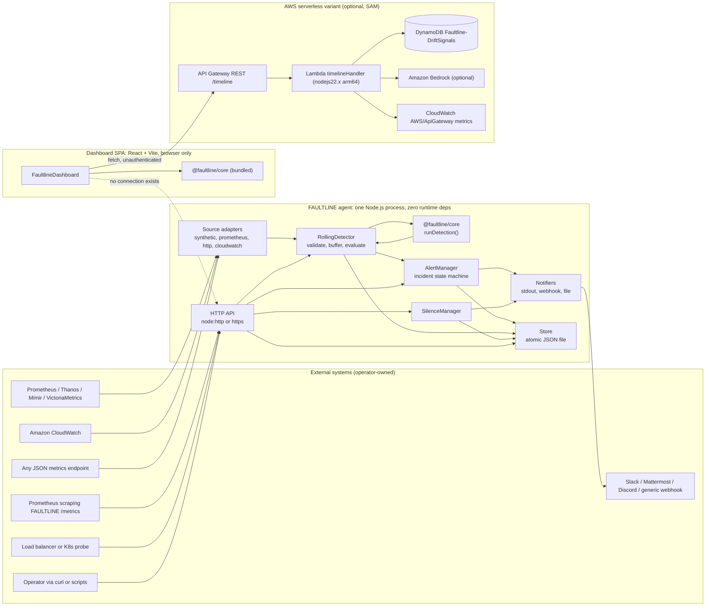

**What this shows.** There are **three independent runtime systems** that share only one library:

1. **The agent** (left, centre) is the production path. It pulls from the operator's metrics backend, evaluates each service, pages a webhook, and serves an API.
2. **The dashboard** (bottom) is a static SPA that runs the same engine in the browser. It talks **only** to the optional Lambda, or to nothing (bundled fixture or CSV).
3. **The AWS variant** (right) is a Lambda that serves a precomputed scenario from DynamoDB, optionally live CloudWatch data, and optionally a Bedrock summary.

The dotted "no connection exists" edge is the most important architectural fact for a newcomer. **The dashboard cannot display anything the agent detected.** ✅ Verified: `frontend/dashboard/src/timelineApi.js` calls only `${VITE_API_URL}/timeline`, and the agent serves no `/timeline` route.

### 5.2 Detailed agent architecture

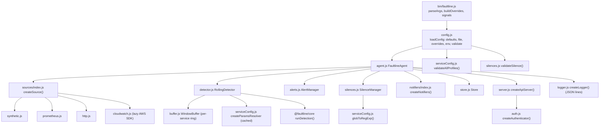

**What this shows.** `FaultlineAgent` is a **composition root**: it constructs every collaborator from config in its constructor and owns the tick loop. Dependencies point one way. Nothing imports `agent.js` except the CLI and tests, and the only upward reference is `server.js`, which receives the agent instance as a parameter. `serviceConfig.js` is shared by config validation, detector parameter resolution, and silence matching (via `globToRegExp`), so all three agree on what `checkout-*` means.

### 5.3 Component catalogue

| Component | Responsibility | Why it exists | Inputs | Outputs | Dependencies | Failure modes | Scaling | Security boundary |
|---|---|---|---|---|---|---|---|---|
| **Engine** (`packages/core`) | Pure detection math, baseline comparators, counterfactuals, CSV parsing | One implementation everywhere | Window arrays + params | Per-window verdicts, baselines | None | NaN on bad params (validated upstream); coerces missing to 0 | O(windows × metrics) per call; stateless | None (pure) |
| **Source adapters** | Normalise external telemetry into `{service, timestamp, …metrics}` | Pluggable backends | Config; network | Sample arrays | `fetch`, optional AWS SDK | Throws → tick fails; NaN → metric absent | One call per metric (Prometheus, sequential) or one batched call (CloudWatch) | Outbound network egress, operator-configured |
| **RollingDetector** | Validate, buffer, and evaluate per service | Bridges streaming data to a batch engine | Samples | Per-service results, freshness, data quality | Engine, buffer, resolver | F-04, F-05 | Recomputes the whole buffer every tick | In-process |
| **WindowBuffer** | Bounded per-service history | Memory bound, rolling baseline | Samples | Arrays | None | `splice` eviction (O(n), fine at n=40) | O(services × history) memory | In-process |
| **AlertManager** | Incident open, update, recover, resolve, cooldown | One page per cascade | Evaluations | Outcomes, incidents | None | F-11 | O(1) per service | In-process |
| **SilenceManager** | Match active silences | Maintenance muting | Config + API input | Matching silence or null | `globToRegExp` | Regex recompiled on every match; unbounded silences | O(silences) per match | Write-scoped API |
| **Notifiers** | Fan-out delivery | Integration | Events | Side effects | `fetch`, `fs` | F-02 | Sequential per event, parallel across sinks | Outbound egress (webhook is a secret URL) |
| **Store** | Durable incidents, silences, detection state | Survive restarts | Mutations | JSON file | `fs/promises` | F-08; full rewrite per flush | Whole document per flush (62 MB at 10k services) | Local disk; unencrypted |
| **HTTP API** | Read and control plane | Integration, ops | HTTP requests | JSON / text | `node:http(s)`, auth | F-01, F-06 | Single-threaded; `snapshot()` is O(services) per request | Network ingress; token scopes |
| **Authenticator** | Token scopes | Protect the control plane | Headers, env | Allow or refuse | `node:crypto` | Open on loopback without a token (F-01) | O(1) | Trust boundary |
| **CLI** | Process entry, signals | Operability | argv, env | Process lifecycle | Config, agent | Exits 1 on shutdown failure | n/a | Env holds secrets |
| **Dashboard** | Visual analysis and teaching | Explain the math; demo | Fixture, CSV, Lambda JSON | UI | React, Recharts, engine | F-03; swallowed fetch errors | Client-side | Public static site; `VITE_API_URL` baked into the bundle |
| **Lambda** | Timeline API, live telemetry, LLM summary | Hackathon backend, LLM reference | API GW events | JSON | AWS SDK v3 | 502 on AWS errors; F-09 | Serverless; throttled at 10 rps / 20 burst | IAM least privilege; `ApiAuthMode` |
| **Benchmark/backtest** | Evidence | Measure, don't assert | Generated or SMD data | Reports | Engine, agent detector | Needs `fetch:dataset` | Backtest takes about 3.5 min for 4 machines | Downloads from GitHub raw |

### 5.4 Technical layers

| Concern | Where it lives | Notes |
|---|---|---|
| Frontend | `frontend/dashboard` | Optional. Not connected to the agent |
| Backend | `packages/agent` (production), `backend/lambda` (demo) | Two unrelated backends |
| Database | None in the agent (JSON file); DynamoDB in the Lambda variant | See §9 |
| APIs | Agent HTTP API (11 routes); Lambda `/timeline` (2 modes) | See §10 |
| AI/ML | Statistical engine (all runtimes); Bedrock (Lambda only) | See §12 |
| External services | Prometheus, CloudWatch, HTTP, webhooks, Bedrock, DynamoDB | See §36 |
| Storage | `storage.path` JSON; the `file` notifier's JSONL | Local volume |
| Queues | ❌ None. Alerts are sent inline in the tick | 🔎 An outbox or queue is the natural fix for F-02 |
| Caches | Per-service parameter resolution cache; memoised CloudWatch client promise | No response caching (F-09 for Bedrock) |
| Authentication | Static bearer tokens (agent); API GW IAM or API key (Lambda) | See §13 |
| Monitoring | JSON logs, `/health`, `/metrics` (agent); CloudWatch Logs and X-Ray tracing on API GW (Lambda) | See §19 |
| Infrastructure | Dockerfile, compose, SAM template, Amplify deploy script | No K8s manifests (🔗 docs describe K8s use) |

### 5.5 External integrations

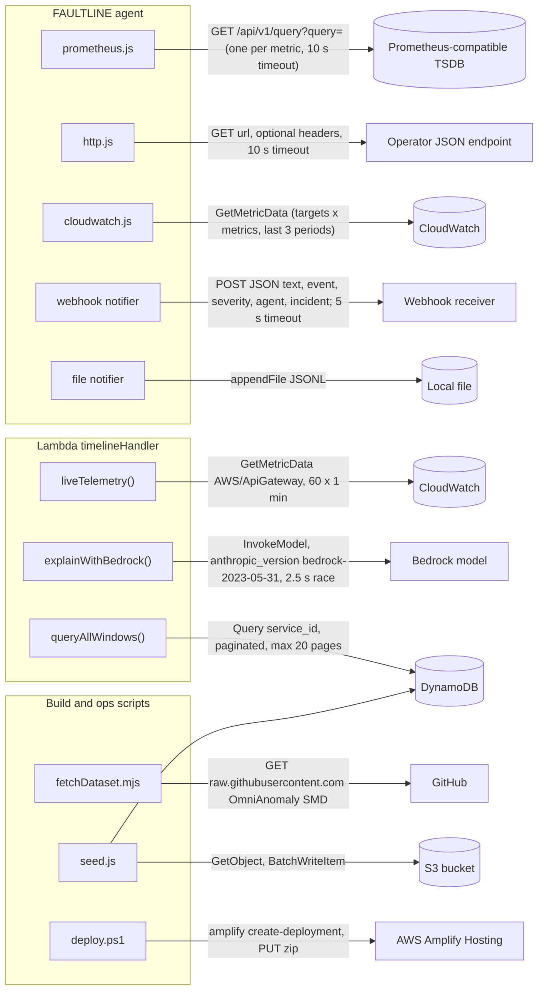

**What this shows.** Every outbound call and its timeout. The agent's egress is limited to the configured source and notifiers; nothing phones home (✅ verified by reading every `fetch` call site). The scripts have wider egress (GitHub, S3, Amplify) but run only on a developer's machine or in CI.

### 5.6 Architecture rating

**Architecture score: 7/10** for the intended scope (a single-team, single-node OSS monitoring agent). **3/10** as a basis for a multi-tenant or high-scale product without significant change.

| Dimension | Score | Rationale |
|---|---:|---|
| Overall architecture | 7 | Right-sized; coherent; clear production path |
| Modularity | 8 | 17 agent modules averaging ~160 lines; registries for sources and notifiers |
| Separation of concerns | 8 | Pure engine / imperative shell; transport separated from domain |
| Coupling | 7 | Low. `server.js` reaches into `agent.store` and `agent.detector` directly rather than through an interface |
| Cohesion | 8 | Each module has one reason to change |
| Extensibility | 7 | New sources and notifiers are easy; new detection signals are harder (the engine signature is window-shaped) |
| Scalability | 3 | Single process; whole-document persistence; no sharding primitives |
| Reliability | 5 | Excellent degradation design; delivery not guaranteed (F-02); no HA |
| Failure isolation | 7 | Notifier and source failures are isolated; one bad Prometheus query fails all services |
| Security boundaries | 6 | Clean trust boundary at the API; flawed default (F-01) |
| Data architecture | 5 | Contract-driven samples (good); JSON blob persistence (limited) |
| API architecture | 6 | Pragmatic; unversioned; no spec |
| AI architecture | 7 | Excellent separation ("explains, never decides"); lives in the wrong runtime for the product |

**Architecturally strong:** the pure shared engine; the complete-sample contract; the composition root; per-service effective-profile validation; fail-closed guards; bounded shutdown.

**Questionable:** two unrelated backends (the agent and the Lambda) that do not share data; the dashboard being unable to talk to the production backend; recomputing the whole buffer every tick instead of maintaining incremental statistics.

**Fragile:** inline alert delivery inside the tick (F-02); whole-file persistence with a shared temp path (F-08); services never evicted (F-05); the CORS `*` default (F-01).

**Should be redesigned:** alert delivery (outbox with retries); persistence at scale (append-only or embedded DB); the health endpoint split into `/livez` and `/readyz` plus a telemetry status.

**Should not be changed unnecessarily:** the pure engine; zero runtime dependencies in the agent; env-only secrets; fail-closed exposure; the complete-sample contract; UTC silences; "AI explains, never decides".

> **Section assessment.** Score **7/10** · Priority **P1**
>
> | Good | Weak | Missing | Why it matters | Next step |
> |---|---|---|---|---|
> | One engine, clean composition, pluggable edges | Single node; inline delivery; disconnected UI | Outbox, HA story, agent-backed UI | Architecture decides whether the tool is trustworthy at 3 AM | Add an alert outbox and an agent-backed dashboard mode |

---

## 6. Technology stack

Versions are from the manifests and lockfiles at the audited commit.

### 6.1 Languages, runtimes, package management

| Technology | Version | Purpose / where | Why chosen (🔎 unless documented) | Alternatives | Advantages | Disadvantages / risks | Migration implications |
|---|---|---|---|---|---|---|---|
| **JavaScript (ESM)** | ES2023 (`ecmaVersion` in ESLint) | Everything | One language across Node, browser, and Lambda; the engine is shared verbatim | TypeScript; Go for the agent | No build step outside the dashboard; readable | No static types, so contract bugs (F-03) are caught only by tests | TypeScript can be introduced incrementally via JSDoc + `checkJs` |
| **Node.js** | `engines`: `^20.19.0 \|\| >=22.12.0`; Docker `node:20-alpine`; CI 20; Lambda `nodejs22.x`; audit machine 24.14 | Agent, benchmark, Lambda, scripts | Ubiquitous; native `fetch`, `node:test`, `AbortSignal.timeout` | Deno, Bun | Zero-dependency HTTP, crypto, fs | **Node 20 is EOL (F-07)**; versions are inconsistent across targets | Move to Node 22 or 24 LTS everywhere; test on both |
| **npm workspaces** | npm (lockfile v3) | Monorepo: core, agent, benchmark, dashboard | Built in; no extra tooling | pnpm, Yarn, Nx, Turborepo | Simple | The Lambda and scripts are separate trees (intentional), so there are **4 lockfiles** to audit | Low |

### 6.2 Agent and engine (runtime)

| Technology | Purpose | Notes |
|---|---|---|
| `node:http` / `node:https` | API server | Hand-rolled router (~200 lines). **Why:** zero dependencies (documented). **Alternatives:** Fastify, Express. **Risk:** hand-rolled parsing (body limit, JSON) is easy to get subtly wrong (F-01's missing `Content-Type` check) |
| global `fetch` + `AbortSignal.timeout` | Prometheus, HTTP source, webhook | Built into Node ≥ 18 |
| `node:crypto` | SHA-256 digests + `timingSafeEqual` token compare | Correct constant-time pattern |
| `node:fs/promises` | Store, file notifier | Atomic temp + rename |
| `node:test` + `node:assert` | Tests for core, agent, benchmark, Lambda | Zero-dependency testing |
| `@aws-sdk/client-cloudwatch` (optional, lazy) | CloudWatch source | Installed by the user on demand. It is not declared in `optionalDependencies` even though the source comment says it is an "optional peer" (minor inconsistency) |

### 6.3 Dashboard

| Technology | Version | Purpose | Notes / risks |
|---|---|---|---|
| React / React DOM | ^18.3.1 | UI | React 19 exists; 18 is fine |
| Recharts | ^2.15.4 | Charts | Main contributor to the 507 kB chunk |
| Vite | ^8.0.0 (Rolldown-based) | Dev server and bundler | Native Rolldown and LightningCSS bindings are pinned as `optionalDependencies` for cross-platform CI (commit `506974b`) |
| @vitejs/plugin-react | ^6.0.0 | JSX/HMR | |
| Tailwind CSS | ^3.4.17 | Styling | Pulls in the picomatch dev advisory; Tailwind 4 migration pending (`docs/DEPENDENCIES.md`) |
| PostCSS / Autoprefixer | ^8.5.8 / ^10.4.27 | CSS pipeline | |
| Vitest | ^3.2.7 | Tests | `@vitest/mocker` now carries a dev advisory |
| jsdom | ^25.0.1 | DOM for tests | |
| @testing-library/react / jest-dom | ^16.3.2 / ^6.9.1 | Component tests | |

### 6.4 AWS variant

| Technology | Version | Purpose | Notes |
|---|---|---|---|
| AWS Lambda | `nodejs22.x`, arm64, 256 MB, 10 s timeout | Handler | Graviton for cost |
| API Gateway (REST) | stage `prod`, X-Ray tracing on, throttle 10 rps / 20 burst | `GET /timeline` | Auth mode: `none`, `api-key` (10k/day quota), or `iam` |
| DynamoDB | On-demand, PITR on, SSE on, `DeletionPolicy: Retain` | Detection windows | Partition key `service_id` (S), sort key `window_number` (N) |
| Amazon Bedrock | `anthropic_version: bedrock-2023-05-31` Messages API; model from the `BedrockModelId` parameter (`iam-policy.json` names `anthropic.claude-3-haiku-20240307-v1:0`) | Summary | 🔎 An older model generation; check availability in the target region before deploying |
| CloudWatch | `GetMetricData`, `AWS/ApiGateway` | Live telemetry | Namespace-scoped IAM condition |
| AWS SDK for JS v3 | ^3.699.0 (client-dynamodb, client-bedrock-runtime, client-cloudwatch, util-dynamodb); scripts ^3.0.0 (+ client-s3) | Clients | Modular v3 SDK |
| AWS SAM / CloudFormation | Transform `AWS::Serverless-2016-10-31` | IaC | Linted with cfn-lint in CI |
| AWS Amplify Hosting | via AWS CLI in `scripts/deploy.ps1` | Dashboard hosting | PowerShell only; manual |

### 6.5 Tooling, CI, containers

| Technology | Version | Purpose | Notes |
|---|---|---|---|
| ESLint (flat config) | ^9.39.5 + `eslint-plugin-react` ^7.37.5 + `react-hooks` ^5.2.0 + `globals` ^15.15.0 | Defect-focused lint | No formatter (deliberate: "a lint run that mostly reports formatting is a lint run people stop reading") |
| GitHub Actions | `checkout@v4`, `setup-node@v4`, `upload-artifact@v4` | CI (6 jobs) | Tag-pinned, not SHA-pinned |
| cfn-lint (Python) | latest via pip | SAM template lint | Wrapped by `scripts/lintTemplate.mjs`, which finds whichever interpreter has it |
| Docker | `node:20-alpine` | Agent image | Non-root user, `HEALTHCHECK`, no `.dockerignore` |
| Docker Compose | v2 syntax | Local container | Publishes to `127.0.0.1` only; requires a token |
| Prometheus exposition | text 0.0.4 | Self-metrics | See F-06 |

### 6.6 What is deliberately absent

No ORM, no database driver, no HTTP framework, no logging library, no metrics client library, no auth library, no ML framework, no queue, no cache, no state-management library in the dashboard (React state only). Each absence is consistent with the zero-dependency principle. The costs are hand-rolled edge handling (F-01, F-06) and no ecosystem features (tracing, retries).

> **Section assessment.** Score **7/10** · Priority **P1** (runtime EOL)
>
> | Good | Weak | Missing | Why it matters | Next step |
> |---|---|---|---|---|
> | Minimal, well-justified stack; zero runtime deps | EOL Node; inconsistent runtime versions; 7 dev advisories | A runtime support policy | An unpatched runtime is a supply-chain risk the zero-dependency posture cannot offset | Standardise on Node 22 LTS (Docker, CI, engines); refresh `DEPENDENCIES.md` |

---

## 7. Repository / codebase architecture

### 7.1 Tree (tracked files, vendored and generated content collapsed)

```text
faultline/
├── package.json                 # root: npm workspaces (core, agent, benchmark, dashboard) + scripts
├── package-lock.json            # lockfile #1 (workspaces)
├── eslint.config.js             # flat config: node, browser, and test globals
├── Dockerfile                   # agent image (node:20-alpine, non-root, HEALTHCHECK)
├── docker-compose.yml           # loopback-published container, token required
├── iam-policy.json              # hand-managed IAM policy for the Lambda (legacy; prefer template)
├── README.md  CONTRIBUTING.md  SECURITY.md  LICENSE
├── .github/
│   ├── workflows/ci.yml         # 6 jobs: verify, lambda, security-defaults, audit, backtest, docker
│   ├── ISSUE_TEMPLATE/          # bug_report, detection_quality, config (links)
│   └── pull_request_template.md # includes the "matched alert volume" and "per machine" checklist
├── assets/                      # SVG brand + README figures (banner, logo, detection, terminal, architecture)
├── docs/
│   ├── ARCHITECTURE.md          # component map + design decisions
│   ├── AGENT.md                 # operations manual (partly stale: F-10)
│   ├── BACKTEST.md              # real-data results + 3 rejected ideas
│   ├── DEPENDENCIES.md          # 4 dependency trees, audit policy
│   └── MASTER_DOCUMENTATION.md  # this document
├── packages/
│   ├── core/                    # @faultline/core, the engine (zero deps)
│   │   ├── detectionEngine.js   # baseline, z, qualify, risk, detectors, counterfactual
│   │   ├── parseTelemetry.js    # CSV parser with header aliases
│   │   ├── fixtures/rawTelemetry.js  # 12-window reference cascade
│   │   ├── index.js             # public exports
│   │   └── test/                # 34 tests
│   ├── agent/                   # @faultline/agent, the product
│   │   ├── bin/faultline.js     # CLI
│   │   ├── src/
│   │   │   ├── agent.js         # composition root, tick loop, health, ranking, shutdown
│   │   │   ├── config.js        # defaults, merge, env, validation
│   │   │   ├── serviceConfig.js # per-service rules, glob matching, effective-profile validation
│   │   │   ├── detector.js      # RollingDetector: contract, buffer, evaluate
│   │   │   ├── buffer.js        # WindowBuffer ring
│   │   │   ├── alerts.js        # AlertManager state machine
│   │   │   ├── silences.js      # SilenceManager
│   │   │   ├── notifiers/index.js  # stdout, webhook, file
│   │   │   ├── sources/         # index (registry), synthetic, prometheus, http, cloudwatch
│   │   │   ├── store.js         # atomic JSON persistence
│   │   │   ├── server.js        # HTTP API + Prometheus exposition
│   │   │   ├── auth.js          # token scopes, loopback detection
│   │   │   └── logger.js        # JSON or pretty line logger
│   │   ├── faultline.config.example.json  # production-shaped example (Prometheus)
│   │   ├── faultline.demo.json  # 1 s synthetic demo
│   │   └── test/                # 186 tests in 15 files
│   └── benchmark/               # @faultline/benchmark (private)
│       ├── bin/benchmark.js  bin/backtest.js
│       ├── src/scenarios.js detectors.js evaluate.js backtest.js datasets/smd.js
│       └── test/                # 29 tests
├── frontend/dashboard/          # faultline-dashboard (React + Vite + Tailwind + Recharts)
│   ├── index.html  vite.config.js  tailwind.config.cjs  postcss.config.cjs  .env.example
│   ├── src/
│   │   ├── main.jsx  App.jsx    # hash routing: landing or #demo
│   │   ├── timelineApi.js       # fetch wrappers for the Lambda
│   │   ├── lib/hypothesis.js    # path parsing + provenance labelling
│   │   ├── components/          # 21 components (~3.9k lines)
│   │   └── styles/dashboard.css
│   └── test/                    # 21 tests (vitest + jsdom)
├── backend/lambda/timelineHandler/   # OUTSIDE workspaces; own lockfile (#2)
│   ├── handler.js  template.yaml  DEPLOY.md
│   ├── scripts/package.mjs      # reproducible zip + SHA-256
│   └── test/handler.test.mjs    # 23 tests
├── scripts/                     # own lockfile (#3) for AWS scripts
│   ├── verifyEngine.mjs         # reference cascade assertions (CI)
│   ├── fetchDataset.mjs         # SMD download
│   ├── generateDataset.mjs      # fixture → dataset/faultline_windows.json
│   ├── seed.js  verify.js       # legacy: S3 → DynamoDB seeding and check
│   ├── auditAll.mjs             # audits all dependency trees
│   ├── lintTemplate.mjs         # cfn-lint wrapper
│   ├── buildWordmark.mjs        # generates brand SVGs
│   └── deploy.ps1               # Amplify deployment (PowerShell)
└── dataset/faultline_windows.json    # 12 precomputed windows for DynamoDB
```

Untracked but present locally: `node_modules/`, `data/` (runtime state + SMD dataset), `frontend/dashboard/.env.local`, `response.json`, and the Lambda `dist/`. All are correctly gitignored.

### 7.2 Directory responsibilities

| Directory | Responsibility | Depends on | Depended on by | Key decisions |
|---|---|---|---|---|
| `packages/core` | Detection math | nothing | agent, benchmark, dashboard, `scripts/*` | Pure, isomorphic; `metricMeta()` makes it metric-agnostic |
| `packages/agent` | Production daemon | core | benchmark (imports `RollingDetector` via a deep path) | Zero deps; config-driven; fail closed |
| `packages/benchmark` | Evidence | core, agent | CI | Benchmarks the *deployed* rolling detector, not a flattering variant |
| `frontend/dashboard` | Visual analysis | core, React, Recharts | none | Client-side engine; honest provenance labels |
| `backend/lambda/timelineHandler` | Serverless API | AWS SDK | dashboard (over HTTP) | Separate lockfile; injectable clients for testing |
| `scripts` | Tooling | core (some), AWS SDK (some) | CI, humans | Mixed: CI-critical scripts beside legacy hackathon scripts |
| `docs` | Knowledge | — | humans | Measured claims; negative results recorded |

### 7.3 Module dependency map

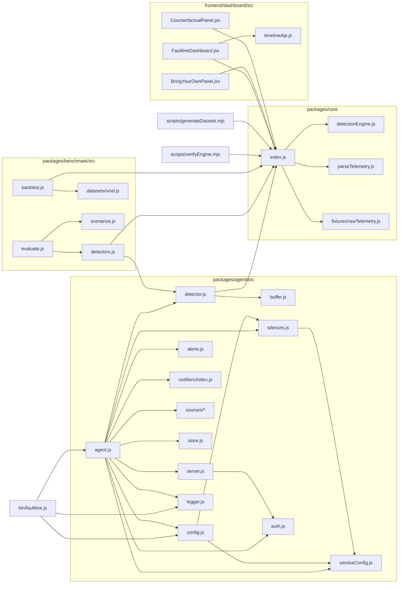

**What this shows.** Every arrow points toward `core`; nothing points out of it. There are **no circular dependencies** (✅ verified by reading every import). One coupling smell: `packages/benchmark/src/detectors.js` imports `@faultline/agent/src/detector.js`, a deep import into another package's internals. It is deliberate (benchmark the deployed detector), but `RollingDetector` is not part of the agent's declared public surface (`main: ./src/agent.js`).

> **Section assessment.** Score **7.5/10** · Priority **P3**
>
> | Good | Weak | Missing | Why it matters | Next step |
> |---|---|---|---|---|
> | Intuitive layout; acyclic dependencies; clear package roles | Legacy hackathon scripts beside CI-critical ones; deep import | An `exports` map for the agent; a `scripts/legacy/` split | Newcomers can't tell `seed.js` (legacy) from `verifyEngine.mjs` (CI gate) | Move the legacy AWS scripts and document their status |

---

## 8. Complete code architecture

### 8.1 Layers

| Layer | Agent | Dashboard | Lambda |
|---|---|---|---|
| **Entry / transport** | `bin/faultline.js` (CLI, signals); `server.js` (HTTP routing) | `main.jsx`, `App.jsx` (hash routing) | `handler` export (API GW proxy event) |
| **Application / orchestration** | `agent.js` `FaultlineAgent` (tick, notify, snapshot, ranking, stop) | `FaultlineDashboard.jsx` (mode, active window, fetches) | `createHandler()` (routing between live and timeline) |
| **Domain** | `detector.js`, `alerts.js`, `silences.js`, `serviceConfig.js` | Components rendering engine output | `isValidHypothesis()`, `buildPrompt()` |
| **Pure core** | `@faultline/core` | `@faultline/core` (bundled) | (precomputed by `scripts/generateDataset.mjs`) |
| **Infrastructure / adapters** | `sources/*`, `notifiers/*`, `store.js`, `logger.js`, `auth.js` | `timelineApi.js` | `queryAllWindows()`, `liveTelemetry()`, `explainWithBedrock()` |
| **Configuration** | `config.js` | `import.meta.env.VITE_API_URL` | `process.env` (`TABLE_NAME`, `BEDROCK_MODEL_ID`, `LIVE_API_NAME`) |

There is **no dependency-injection container**. Dependencies are injected through **constructor and factory parameters**: `FaultlineAgent(config, {logger, env})`, `createSource(config, ctx)`, `createHandler({dynamo, bedrock, cloudwatch, commands, env, now, log})`, and `createCloudWatchSource({client})`. This is what makes the tests hermetic: fake clients, fake env, and a fake clock.

### 8.2 Class structure

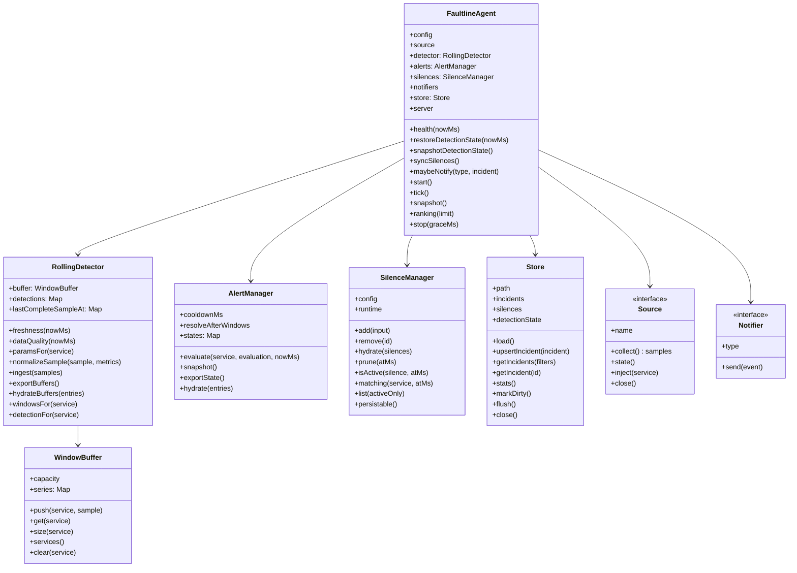

**What this shows.** Five stateful classes and two duck-typed interfaces. `Source` (with optional `inject` and `close`) and `Notifier` are informal interfaces with no base class or type declaration. The registries in `sources/index.js` and `notifiers/index.js` are the only enforcement.

### 8.3 Design patterns actually in use

| Pattern | Where | How it works here | Why it is useful | Alternative |
|---|---|---|---|---|
| **Functional core, imperative shell** | `@faultline/core` vs the agent | The engine is pure (arrays in, verdicts out); all I/O lives in the agent | Deterministic tests; runs in any runtime | An OO engine holding state |
| **Composition root** | `FaultlineAgent` constructor | Builds every collaborator from config | One place to see wiring | A DI container (overkill here) |
| **Factory + registry** | `sources/index.js` `FACTORIES`; `notifiers/index.js` `BUILDERS` | Map from `type` to constructor function | Adding a source is local | Plugin loading via dynamic `import()` |
| **Strategy** | `computeBaseline()` `statistic: 'mean_sigma' \| 'median_mad'`; per-metric thresholds | Swappable centre and spread estimator | Research without forking the engine | A class hierarchy |
| **State machine** | `AlertManager.evaluate()` | `ok ↔ firing` with a clear streak and cooldown | Deduplication, hysteresis | Stateless alerting (one page per window) |
| **Ring buffer** | `WindowBuffer.push()` | Array + `splice` beyond capacity | Bounded memory; rolling baseline | A true circular array (O(1) eviction) |
| **Adapter** | HTTP source `mapping`; CloudWatch metric specs | Renames foreign fields to canonical metrics | No code needed for new endpoints | Per-endpoint code |
| **Guard clause / fail closed** | `assertSafeExposure()`, TLS load, literal-token rejection, CloudWatch metric check | Throw at startup | Misconfiguration cannot run silently | Warn and continue (explicitly rejected in comments) |
| **Memoisation** | `createParamsResolver()` cache; CloudWatch client promise | Map or promise cache | Avoids repeated work; avoids double client construction | None |
| **Debounced atomic write** | `Store.markDirty()` → `flush()` via temp + rename | Coalesces writes within 2 s; atomic replace | Crash-safe file, no write storm | WAL / embedded DB |
| **Idempotent async lifecycle** | `stop()` stores and returns one promise; `stopRequested` promise raced in `start()` | Concurrent `stop()` calls share one shutdown | Safe signal handling | Flags and polling |
| **Timeout via `Promise.race`** | `explainWithBedrock()`, `stop()` grace, `start()` first tick | Race the work against a timer | Bounded latency | `AbortSignal` (used for `fetch`) |
| **Dependency injection by parameter** | `createHandler({...})`, `FaultlineAgent(config, {env, logger})` | Tests pass fakes | Hermetic tests without mocking libraries | Module mocking |
| **Null object** | `silentLogger` | No-op logger for tests and benchmarks | Removes conditionals | Optional chaining everywhere |
| **Provenance tagging** | `generated_by`, `scope`, `evidence_source` on hypotheses; `provenanceOf()` in the UI | Data carries where it came from | Honest labelling of AI and sample content | Trusting the renderer |

### 8.4 Component audit cards

Each card answers: what it does, how, why it works, why it was built this way, whether it is good, the rating, what is fragile, what is missing, what to change, what not to change, the production-grade target, priority, dependencies, and future requirements.

#### 8.4.1 Engine — `packages/core/detectionEngine.js` — **8/10**
- **Does:** `computeBaseline`, `zScore`, `qualifyMetric`, `riskScore`, `confidenceFromRisk`, `runDetection`, `runBaselineDetectors`, `compareDetectors`, `applyMitigation`, `runCounterfactual`.
- **How:** For each metric, compute the baseline from the first `baselineWindows` values (mean/σ or median/1.4826·MAD); floor σ at `max(raw, |μ|·sigmaFloorRatio, 1e-9)`, then optionally at `sigmaFloorAbs[metric]`; z for every window; a run-length counter marks `qualified` once `run ≥ minSustain`; `R = mean(qualified z) · ln(1+n) · W`; `triggered = n ≥ minSignals && R ≥ triggerThreshold`.
- **Why it works:** Normalising by the metric's own spread puts heterogeneous units on one scale. Sustain filters single-window noise. `ln(1+n)` rewards breadth over depth: three metrics at 3σ give R ≈ 4.16, while one metric at 9σ gives R ≈ 6.24 but cannot trigger at all with `minSignals: 2`.
- **Why built this way:** Auditability ("every alert can be re-derived by hand").
- **Is it good?** Yes, for what it claims. It is simple, correct, and well tested (25 engine tests).
- **Fragile:** `Number(x) || 0` coercion (contradicts the agent contract); `confidence` is uncalibrated; the qualified z used in R is rounded to one decimal before scoring; one-sided (upward only); `outageThreshold` is a scenario-only concept living in library defaults; `runCounterfactual`'s `averted` expression has a redundant clause, and `tooLate` compares `window >= null` when the baseline never triggered.
- **Missing:** Incremental (streaming) statistics; seasonality; correlation weighting (the only roadmap item that changes the signal).
- **Change:** Treat missing values as `NaN` and skip or flag them; rename `confidence` to `riskIndex` or calibrate it against backtest precision; move `MITIGATIONS` and counterfactuals to a `scenario` module.
- **Do not change:** The purity; the formula without backtest evidence (the repo's own rule: compare at matched alert volume, per machine).
- **Production-grade:** A versioned `detector.v1` spec document, property-based tests (monotonicity, scale invariance), and an incremental O(metrics) per-window update.
- **Priority:** P2. **Dependencies:** none. **Future:** correlation-weighted convergence (🗓️ roadmap item 4), seasonality (🗓️ item 5).

#### 8.4.2 CSV parser — `packages/core/parseTelemetry.js` — **6/10**
- **Does:** Header aliasing, comma or tab delimiter, `#` comments, at least 5 rows, sequential window numbering fallback.
- **Fragile:** Naive `split(',')` (no quoted fields); malformed rows dropped silently (the count is not reported); `parseFloat('12abc')` accepts trailing junk.
- **Change:** Report skipped-row counts; accept any metric set; handle RFC 4180 quoting. **Priority:** P3.

#### 8.4.3 RollingDetector — `packages/agent/src/detector.js` — **7/10**
- **Does:** Enforces the sample contract, buffers, resolves per-service params, runs the engine over the buffer, reports freshness and data quality, exports and hydrates state.
- **Why it works:** Re-running the pure engine over a bounded buffer gives the rolling baseline "for free".
- **Is it good?** Mostly. The contract and freshness semantics (sample time, future-capped) are thoughtful.
- **Fragile:** 🐞 F-04 (no revalidation on hydrate); F-05 (no eviction); duplicate samples per service per tick are all buffered; `paramsFor()` is called twice per incomplete sample.
- **Missing:** `forget(service)` or a TTL; revalidation on hydrate; incremental stats.
- **Change:** Run `normalizeSample()` on hydrated samples against current metrics; evict services unseen for N × grace; expose `DELETE /api/services/:name`.
- **Do not change:** Missing-is-not-zero; freshness from sample timestamps.
- **Priority:** P1. **Future:** a streaming engine for large fleets.

#### 8.4.4 WindowBuffer — `buffer.js` — **8/10**
Simple and correct. `splice` eviction is O(n) but n ≤ historyWindows. Missing: a `delete(service)` used by eviction (`clear(service)` exists but is never called by the agent). **P3.**

#### 8.4.5 AlertManager — `alerts.js` — **7.5/10**
- **Good:** A clear state machine, cooldown, hysteresis, state export and hydrate; 9 tests.
- **Fragile:** F-11 (no staleness path); the module-level ID counter resets on restart (collision practically impossible given the millisecond timestamp prefix); `incident.metrics` is captured only at open.
- **Missing:** Severity escalation events (warning → critical); a "no data" state; acknowledgement and ownership.
- **Change:** Add `stale` handling: after `noDataGraceSeconds`, emit `incident.stale` and optionally auto-resolve as `unknown`. **P2.**

#### 8.4.6 SilenceManager — `silences.js` — **7/10**
- **Good:** UTC; midnight wrap; config vs runtime separation; late announce; pruning; 14 tests.
- **Fragile:** Regex recompiled on every `matching()` call (O(silences) compilations per service per snapshot); `*` and indefinite silences allowed; `until < from` accepted.
- **Change:** Precompile globs; require `until` (or cap duration, for example 24 h) for runtime silences; reject `until` in the past; bind `createdBy` to the authenticated scope; emit a metric for the longest active silence. **P1** (security relevance).

#### 8.4.7 Service rules — `serviceConfig.js` — **9/10**
The best-specified module. Exact-before-glob precedence, effective-profile validation catching "never leaves warm-up" and "never triggers", and 34 tests across two files. Minor: `globToRegExp` with many `*` can backtrack heavily (operator input only). **Do not change** the precedence rules. **P4.**

#### 8.4.8 Config — `config.js` — **8/10**
- **Good:** Defaults → file → overrides → env → validate; reports every error at once; rejects literal auth tokens.
- **Fragile:** `deepMerge` replaces arrays wholesale (intended but undocumented); `applyEnvOverrides` silently ignores a non-numeric `FAULTLINE_PORT` (falls back to the file value instead of erroring).
- **Missing:** Secret indirection for source and webhook headers (F-12); `server.corsOrigin` validation; a JSON Schema for editor support.
- **P2.**

#### 8.4.9 Sources — `sources/*` — **6.5/10**
- **Good:** Missing-stays-missing everywhere; CloudWatch startup metric check; lazy SDK.
- **Fragile:** Prometheus runs queries sequentially and one failing query fails everything; no retry or backoff; the HTTP source does not deduplicate; no `close()` implementations.
- **Change:** Query Prometheus in parallel with per-metric failure isolation (return partial samples, which the contract then rejects per service); add `headersEnv`. **P2.**

#### 8.4.10 Notifiers — `notifiers/index.js` — **4/10**
- **Good:** Failure isolation; Slack-compatible `text`.
- **Broken:** 🐞 F-02.
- **Missing:** Retry with backoff, a durable outbox, delivery status per notifier, routing by service or severity, native PagerDuty/Opsgenie payloads, and HMAC signing of webhook bodies.
- **Production-grade:** A persisted outbox (`pending → delivered | failed`) processed off the tick, with exponential backoff and a `faultline_notify_failures_total{notifier}` metric; `notifiedAt` set only when at least one "paging" notifier succeeded.
- **Priority:** **P0.**

#### 8.4.11 Store — `store.js` — **6/10**
- **Good:** Atomic rename; debounced; tolerant load (a corrupt file does not block startup).
- **Fragile:** F-08; full-document rewrite; the corrupt file is not quarantined (it is simply overwritten on the next flush, losing forensic evidence); no fsync before rename (on power loss the rename can persist before the data on some filesystems).
- **Change:** Serialise flushes through a promise chain; use unique temp names; `fsync` the file and directory; rename a corrupt file to `.corrupt-<ts>`. **P1.**

#### 8.4.12 HTTP API — `server.js` — **6/10**
- **Good:** Uniform JSON; `Cache-Control: no-store`; the authorisation decision precedes routing; 64 KB body cap.
- **Fragile:** 🐞 F-01 (`corsOrigin` defaults to `*`; `Content-Type` never checked; no `Host` or `Origin` validation); module-level `corsOrigin` shared across server instances; F-06; `limit` on incidents lacks a lower bound; an oversized body destroys the socket, so the intended 400 is never delivered.
- **Change:** Default `corsOrigin` to none; require `application/json` on writes; validate `Host` against the bind address on loopback; group the exposition by family. **P0.**

#### 8.4.13 Auth — `auth.js` — **7/10**
- **Good:** Constant-time digest comparison; 401 vs 403 semantics; `WWW-Authenticate`; loopback detection.
- **Fragile:** "Open on loopback" trusts every local process *and every browser tab* (F-01).
- **Change:** Generate a random token on first run and print it (Jupyter-style), or require an `Origin`-less request or matching `Host` for unauthenticated loopback writes. **P0.**

#### 8.4.14 Agent orchestrator — `agent.js` — **7/10**
- **Good:** Overlap guard; the no-data clock; restore guard; bounded, ordered, idempotent shutdown; comments that explain past bugs.
- **Fragile:** F-02, F-05, F-11; `maybeNotify` awaits delivery inside the tick (a slow webhook delays detection of other services by up to 5 s per event).
- **Change:** Move delivery to an outbox worker; split health into liveness and readiness; add eviction. **P0.**

#### 8.4.15 CLI — `bin/faultline.js` — **7.5/10**
Minimal and correct. Missing: `validate` (config lint without starting), `version` from `package.json`, and `--config -` for stdin. **P3.**

#### 8.4.16 Dashboard — `frontend/dashboard` — **5/10**
- **Good:** Lazy-loaded dashboard route; engine in the browser; provenance labelling with tests; `ErrorBoundary`.
- **Fragile:** 🐞 F-03; failed fetches swallowed (`.catch(() => {})`); hard-coded scenario narratives keyed to window indices (they break if the fixture changes); mixed styling (Tailwind vs inline styles in `HypothesisCard`); a 507 kB chunk.
- **Missing:** An agent data source (`/api/state`, `/api/windows`, `/api/ranking`); tests beyond hypothesis labelling; accessibility review.
- **Production-grade:** An "Agent" mode that reads the agent API with a token; code-split Recharts; component tests per panel.
- **P1** (agent mode), **P2** (the rest).

#### 8.4.17 Lambda — `handler.js` — **7/10**
- **Good:** Injectable clients; pagination; strict LLM output validation; gaps reported, never filled; 23 tests.
- **Fragile:** F-09; `LIVE_API_NAME` falls back to `'Faultline-API'` even when the template disables live mode (an IAM denial surfaces as 502 instead of "disabled"); `hypothesis_fallback` is static text that names a three-service cascade, contradicting the single-service scope that `isValidHypothesis` enforces on the model.
- **Change:** Cache the hypothesis per `(service_id, window_number, model_id)` in DynamoDB; honour `CORS_ALLOW_ORIGIN` from env; return 404 when live mode is disabled. **P1.**

#### 8.4.18 SAM template — `template.yaml` — **8/10**
Least-privilege IAM; `ApiAuthMode` with no default (a thoughtful forcing function); retained table with PITR and SSE; log retention; X-Ray. Missing: an alarm on Bedrock invocation count or cost; reserved concurrency; a WAF option. **P2.**

#### 8.4.19 Benchmark and backtest — `packages/benchmark` — **8.5/10**
Methodologically careful: causal replay, segment-wise scoring, the deployed detector benchmarked, per-machine reporting, negative results preserved. Missing: confidence intervals; seasonality-bearing datasets; a smaller CI-sized real-data regression with asserted bounds (the CI backtest only checks that it runs). **P2.**

#### 8.4.20 CI — `.github/workflows/ci.yml` — **7/10**
Six meaningful jobs; security defaults asserted at the process and container level. Missing: SHA-pinned actions; a Node version matrix (20 is EOL, 22 and 24 are untested); a coverage report; CD. **P1** (runtime), **P2** (others).

### 8.5 Code quality rating

**Code quality: 7/10**

| Dimension | Score | Evidence |
|---|---:|---|
| Readability | 8 | Small functions; descriptive names (`assertSafeExposure`, `restoreDetectionState`); comments explain *why* and record past bugs |
| Naming | 8 | Consistent; a few misnomers (`confidence`, `AIInsightPanel`, `IncidentChatAgent`, `outage` in the engine) |
| Structure | 8 | One concern per module; acyclic |
| Duplication | 6 | `mulberry32` ×2 (`sources/synthetic.js`, `benchmark/scenarios.js`); `median` ×3; `isPlainObject` ×2; `silentLogger` ×2 (`logger.js`, `benchmark/detectors.js`); `DEFAULT_METRICS` constants ×5 |
| Complexity | 8 | The largest function is `tick()` (~90 lines) with flat branching |
| Abstractions | 7 | Right-sized; `Source` and `Notifier` interfaces are implicit |
| Error handling | 6 | Excellent at startup (fail closed); weak at delivery (F-02) |
| Type safety | 3 | Plain JS, no JSDoc types, no `checkJs`. Every cross-component contract (sample shape, window shape, hypothesis shape) is by convention; F-03 is exactly this failure |
| Maintainability | 7 | Tests make refactors safe; numbers in docs are hand-maintained |
| Testability | 9 | Clock, env, and clients injectable throughout |
| Documentation (in code) | 9 | Rationale comments are among the best seen in a codebase this size |
| Dependency management | 7 | Zero runtime deps; four lockfiles audited; dev advisories drifting |

**Most problematic areas, in order:** `notifiers/index.js` + `agent.js` `maybeNotify()` (F-02); `server.js` CORS and body handling (F-01, F-06); `detector.js` `hydrateBuffers()` (F-04); `store.js` `flush()` (F-08); `FaultlineDashboard.jsx` `LIVE_PARAMS` (F-03); the missing type contracts between the Lambda and the dashboard.

> **Section assessment.** Score **7/10** · Priority **P1**
>
> | Good | Weak | Missing | Why it matters | Next step |
> |---|---|---|---|---|
> | Clean patterns, injectable seams, excellent comments | No types; a few load-bearing bugs | JSDoc typedefs + `checkJs` for shared shapes | Contract drift between components is the recurring defect class (F-03, F-04) | Add `// @ts-check` + typedefs for `Sample`, `Window`, `Incident`, `Hypothesis` |

---

## 9. Database architecture

### 9.1 What exists

| Store | Where | Kind | Status |
|---|---|---|---|
| **Agent state file** | `storage.path` (default `./data/faultline-state.json`; Docker `/app/data/faultline-state.json`) | A single JSON document, atomically replaced | ✅ Implemented |
| **Alert JSONL** | The `file` notifier's `path` | Append-only JSON lines | ✅ Implemented (optional) |
| **DynamoDB `Faultline-DriftSignals`** | AWS (Lambda variant) | Key-value / wide-column | ⚙️ Configured (SAM); tested with mocks |
| **SMD dataset** | `data/datasets/smd/*.txt` | CSV-like text, gitignored | ✅ Downloaded on demand |
| **Precomputed windows** | `dataset/faultline_windows.json` | JSON, tracked | ✅ Source for DynamoDB seeding |

There is **no relational database, ORM, migration framework, or query language** in the agent.

### 9.2 Entity model

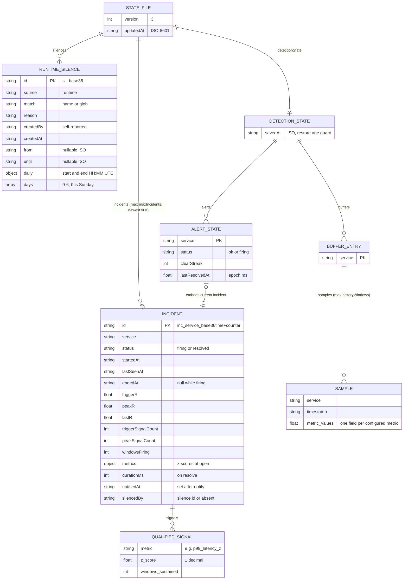

**What this shows.** The state file is one aggregate document. `INCIDENT` records appear **twice** while firing: once in `incidents[]` (history) and once embedded in `detectionState.alerts[].incident` (lifecycle). They are kept consistent by `upsertIncident()` after every outcome, but they are separate copies (`structuredClone`). Config-defined silences are **not** persisted; they are rebuilt from the config file with IDs `cfg:<name|match>:<index>`.

### 9.3 DynamoDB table (Lambda variant)

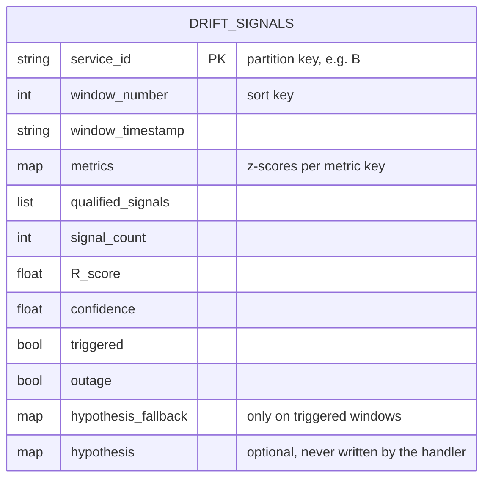

| Aspect | Detail |
|---|---|
| Purpose | Serve a precomputed detection timeline to the dashboard |
| Keys | PK `service_id` (S), SK `window_number` (N). No GSIs |
| Writers | `scripts/seed.js` only (BatchWriteItem from `s3://$DATASET_BUCKET/faultline_windows.json`). **The Lambda never writes** |
| Readers | `handler.js` `queryAllWindows()` (`Query`, projection, ascending, ≤ 20 pages) |
| Constraints | None beyond the key schema |
| Lifecycle | Static demo data; `DeletionPolicy: Retain`; PITR enabled |
| Sensitive data | None (synthetic scenario) |
| Scaling | Trivial at 12 items. A real per-window write rate would need a TTL and time-bucketed partition keys to avoid hot partitions |

### 9.4 Important operations

| Operation | Code | Complexity | Notes |
|---|---|---|---|
| Upsert incident | `Store.upsertIncident()` | O(n) `findIndex`, n ≤ `maxIncidents` | `unshift` for new; truncates to cap (can drop an old *firing* record) |
| List incidents | `Store.getIncidents({status, service, limit})` | O(n) filter | Newest first; no cursor |
| Flush | `Store.flush()` | O(total state) serialise + write | 0.6 / 6.1 / 61.6 MB at 100 / 1k / 10k services (measured detection-state portion) |
| Restore | `agent.restoreDetectionState()` | O(state) | Guarded by `savedAt` age; `disabled` when `restoreMaxAgeSeconds = 0` |
| DynamoDB timeline | `queryAllWindows()` | Pages of ≤ 1 MB | Returns `truncated: true` if the 20-page cap is hit |

### 9.5 Transactions, consistency, concurrency

- **Transactions:** None needed. The agent is single-threaded; each flush writes a consistent snapshot of in-memory state at that moment.
- **Consistency:** Crash consistency comes from temp-file + `rename` (atomic on POSIX within one filesystem). 🔎 No `fsync`, so durability on power loss depends on filesystem ordering.
- **Concurrency:** One process per state file is assumed and **not enforced**. There is no lock file, and two agents pointed at the same `storage.path` would silently overwrite each other. Within one process, F-08 is the only race.
- **RPO:** Detection state is lost for at most `snapshotEveryTicks` ticks on a hard crash (10 min at defaults). Incidents and silences are flushed within ~2 s of change (debounce).

### 9.6 Migrations, seeding, integrity, backups

| Topic | Current state |
|---|---|
| Migrations | ❌ None. `version: 3` is written but never read. An older-version file is loaded field by field (`Array.isArray` guards), which is tolerant but not a migration |
| Seeding | `scripts/generateDataset.mjs` (fixture → JSON) → upload to S3 (manual; ❓ not scripted) → `scripts/seed.js` → DynamoDB → `scripts/verify.js` (asserts 12 records, W8 triggered, W12 outage) |
| Integrity | Validation on load is shallow (arrays and object presence). Silences are re-validated on hydrate; samples are **not** (F-04) |
| Backups | ❌ None for the agent. Operators must back up the volume. DynamoDB has PITR |
| Encryption at rest | Agent: ❌ (`SECURITY.md` acknowledges it). DynamoDB: ✅ SSE |

> **Section assessment.** Score **4/10** · Priority **P2**
>
> | Good | Weak | Missing | Why it matters | Next step |
> |---|---|---|---|---|
> | Crash-safe atomic replace; honest restore guard | Whole-document rewrite; no locking, migrations, or fsync | Schema migration; single-writer lock; incremental persistence | At 10k services a flush writes ~62 MB every 10 ticks | Add a lock file and flush serialisation now; evaluate SQLite (`node:sqlite`) or an append-only log later |

---

## 10. API documentation

### 10.1 Overall API architecture

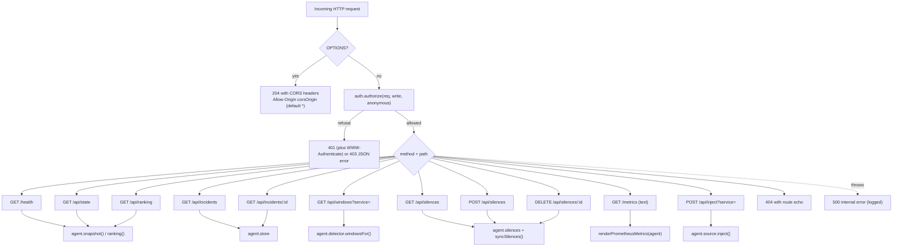

**What this shows.** Authorisation happens **before** routing, so an unknown route with no token returns 401, not 404. Every route reads live in-memory state; there is no caching layer. Write routes are exactly three: `POST /api/silences`, `DELETE /api/silences/:id`, and `POST /api/inject`.

**Common response headers (JSON):** `Content-Type: application/json; charset=utf-8`, `Content-Length`, `Access-Control-Allow-Origin: <corsOrigin>`, `Access-Control-Allow-Headers: Content-Type, Authorization, X-API-Key`, `Cache-Control: no-store`. Bodies are pretty-printed (2-space indent).

**Auth headers accepted:** `Authorization: Bearer <token>` (case-insensitive scheme, tolerant spacing) or `X-API-Key: <token>`.

**Authorisation matrix** (`auth.js` `authorize()`):

| Configuration | `/health` | Read routes | Write routes |
|---|---|---|---|
| No token, loopback bind | open | open | **open** (F-01) |
| No token, non-loopback bind | — | — | — (**agent refuses to start**) |
| Token set | open | full or read token | full token only (read token → 403) |
| Token set + `allowAnonymousRead` | open | open | full token only |

### 10.2 Agent endpoints

#### `GET /health`
- **Purpose:** Liveness plus telemetry validity. **Auth:** none (always anonymous).
- **Processing:** `agent.snapshot().health` → `ok` or `degraded`.
- **Responses:** `200` when ok; `503` when degraded.

```json
{
  "status": "degraded",
  "reasons": ["telemetry_stale"],
  "agent": "faultline-prod", "version": "1.0.0", "uptimeSeconds": 3605,
  "source": "prometheus", "intervalSeconds": 60, "ticks": 60,
  "lastCollectAt": "2026-08-10T05:09:00.000Z",
  "consecutiveCollectErrors": 0, "consecutiveEmptyCollections": 7,
  "lastDataAt": "2026-08-10T05:02:00.000Z", "secondsSinceData": 420,
  "noDataGraceSeconds": 300, "staleServices": ["payments"],
  "incompleteSamples": 3, "servicesTracked": 3
}
```

- **Reasons:** `agent_stopped`, `collection_failing` (≥ 3 consecutive errors), `no_telemetry_since_start`, `telemetry_stale`, `service_telemetry_stale`.
- **Security:** Anonymously discloses service names (`staleServices`), the agent name, the version, and the source type. The comment in `auth.js` says it "exposes no telemetry", which is true of values but not of names. Low risk.

#### `GET /api/ranking?limit=N`
- **Purpose:** Services by current risk. **Auth:** read.
- **Validation:** `limit` is clamped to [1, 500], default 50; a non-numeric value falls back to 50.
- **Response `200`:**

```json
{
  "generatedAt": "2026-08-15T10:00:00.000Z",
  "triggerThreshold": 3,
  "evaluated": 3, "warmingUp": 0,
  "services": [
    { "rank": 1, "service": "checkout-api", "status": "evaluated", "R_score": 7.16, "signal_count": 3,
      "qualified_signals": [{ "metric": "retry_rate_z", "z_score": 6.9, "windows_sustained": 6 }],
      "firing": true, "silenced": false, "profile": "tier-1" },
    { "rank": 2, "service": "inventory", "status": "evaluated", "R_score": 0, "signal_count": 0,
      "qualified_signals": [], "firing": false, "silenced": false, "profile": null }
  ]
}
```

- **Note:** Warming-up and incomplete-sample services come last with `R_score: null`.

#### `GET /api/state`
- **Purpose:** The full agent snapshot. **Auth:** read.
- **Response:** `{name, version, running, uptimeSeconds, source, sourceState, intervalSeconds, triggerThreshold, serviceProfiles[], ticks, collectErrors, consecutiveCollectErrors, lastCollectAt, emptyCollections, consecutiveEmptyCollections, health{}, dataQuality{completeSamples, incompleteSamples, lastIncomplete, lastIngest, oldestServiceStaleSeconds, freshness[]}, services[], stateRestored{}, silences (count), incidents{total, firing, resolved}}`.
- **Per-service entries** carry `service, profile, status, windowsBuffered, firing, incidentId, silencedBy` plus either `missingMetrics` (incomplete), `windowsRequired` (warming), or `timestamp, R_score, confidence, signal_count, qualified_signals, metrics, raw` (evaluated).
- **Cost:** O(services + silences × services) per call.

#### `GET /api/incidents?status=&service=&limit=`
- **Auth:** read. **Validation:** `limit` default 50, max 500; ⚠️ no lower bound, so `limit=-5` returns all but the last five.
- **Response:** `{ "incidents": [Incident, ...] }` (newest first).

#### `GET /api/incidents/:id`
- **Auth:** read. **Responses:** `200` Incident; `404 {"error":"incident not found"}`.

#### `GET /api/windows?service=NAME`
- **Purpose:** Full engine output for charting. **Auth:** read.
- **Responses:** `200 {service, windows[], baselines{}, params{}}`; `400` if `service` is missing; `404` if there are no windows (warming, or unknown service).

#### `GET /api/silences?active=true`
- **Auth:** read. **Response:** `{ "silences": [{...silence, "active": bool}] }`, config and runtime together.

#### `POST /api/silences`
- **Auth:** **write**. **Body** (JSON, ≤ 64 KB, `Content-Type` not checked):

```json
{ "match": "checkout-*", "until": "2026-03-05T14:00:00Z", "reason": "deploy 42", "createdBy": "harsh" }
```

- **Validation:** `validateSilence()`: `match` is a non-empty string; `from`/`until` must be parseable dates; `daily.start`/`end` must be `HH:MM`; `days` must be integers 0–6.
- **Processing:** `silences.add()` → `syncSilences()` (prune + persist).
- **Responses:** `201` with the silence object (including `id: "sil_…"`); `400 {"error":"Invalid silence: ..."}` or `{"error":"body must be valid JSON"}`.
- **Security:** Highest-value write (it mutes alerting). See F-01 and the missing duration cap.

#### `DELETE /api/silences/:id`
- **Auth:** **write**. **Responses:** `200 {"removed": id}`; `400` for `cfg:` IDs; `404` when unknown.

#### `GET /metrics`
- **Auth:** read (so Prometheus needs the read token or `allowAnonymousRead`). **Content-Type:** `text/plain; version=0.0.4`.
- **Series:** see §19.2. **Issues:** F-06.

#### `POST /api/inject?service=NAME`
- **Auth:** **write**. **Responses:** `202 {service, startsAtTick}`; `400` if the source is not synthetic.

#### Fallbacks
- `OPTIONS *` → `204` with CORS headers. Any other route → `404 {"error":"not found","route":"GET /x"}`. An uncaught exception → `500 {"error":"internal error"}` (message logged, not returned).

### 10.3 Lambda endpoints (API Gateway REST, stage `prod`)

#### `GET /timeline?service_id=ID`
- **Auth:** per `ApiAuthMode` (`none`, `api-key` via `x-api-key`, or `iam` via SigV4).
- **Validation:** `service_id` must match `^[A-Za-z0-9_-]{1,64}$`, otherwise `400`.
- **Processing:** `queryAllWindows()` → unmarshall → sort → find the first `triggered` window → if a model is configured, `explainWithBedrock()` → attach a validated `hypothesis` or `hypothesis_fallback`.
- **Responses:** `200 {service_id, windows[], meta{pages_fetched, truncated, window_count}}`; `404` (no items); `502 {"error":"timeline unavailable"}` (DynamoDB failure).
- **Logs:** `DETECTION_TRIGGER`, `BEDROCK_RESPONSE`, `FALLBACK_ACTIVATED{reason}`, `TIMELINE_TRUNCATED`, `TIMELINE_QUERY_ERROR`.

#### `GET /timeline?source=live`
- **Processing:** `GetMetricData` for `Latency` p99, `4XXError` Average, and `5XXError` Average over the last 60 one-minute periods for `ApiName = LIVE_API_NAME`; any minute missing any metric goes to `gaps`.
- **Response `200`:**

```json
{
  "service_id": "live", "source": "cloudwatch", "api_name": "Faultline-API",
  "metrics": ["p99_latency", "client_error_rate", "error_rate"],
  "metric_mapping": { "client_error_rate": "4XX client-error rate (%). ... Not a retry count." },
  "data_quality": { "windows_requested": 60, "windows_complete": 57, "windows_incomplete": 3, "gaps": [] },
  "raw": [{ "window_number": 1, "window_timestamp": "...", "p99_latency": 212.4, "client_error_rate": 1.2, "error_rate": 0.1 }]
}
```

- **Errors:** `502 {"error":"live telemetry unavailable"}`.
- **CORS:** Always `Access-Control-Allow-Origin: *` from the handler (F-09).

> **Section assessment.** Score **6/10** · Priority **P1**
>
> | Good | Weak | Missing | Why it matters | Next step |
> |---|---|---|---|---|
> | Small, consistent, correctly status-coded surface | CORS/CSRF default; unversioned; no spec | OpenAPI document; `/v1` prefix; cursor pagination; a `services` DELETE for eviction | Integrators need a stable contract | Publish `openapi.yaml` generated from the route table; fix F-01 |

---

## 11. Complete request lifecycle

Two traces follow. The first is the agent's most consequential **user-initiated** request: creating a silence, which changes whether anyone gets paged. The second is the only path where a **UI** calls a backend and an **AI** model: the dashboard fetching a timeline from the Lambda. The core *background* flow (a tick that detects and pages) is traced end to end in [§31](#31-end-to-end-example).

### 11.1 `POST /api/silences`: operator mutes a service during a deploy

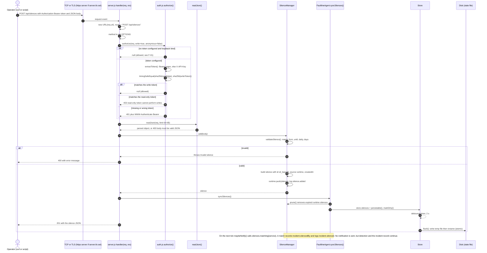

**Step by step:**

| # | Layer | What happens | Code |
|---|---|---|---|
| 1 | User | There is **no UI** for this. The operator uses `curl` or a script (`docs/AGENT.md` shows the command) | — |
| 2 | Frontend | None. The dashboard cannot call the agent | — |
| 3 | Network | Plain HTTP on loopback by default; HTTPS if `server.tls` is configured (certificates read at startup, fail closed) | `server.js` `createApiServer()` |
| 4 | Route parsing | `new URL(req.url, 'http://' + host)`; `route = "${method} ${pathname}"` | `handler` |
| 5 | Middleware | There is no middleware chain. CORS preflight is answered inline for `OPTIONS` | `handler` |
| 6 | Authentication | Token extraction (`Bearer` or `X-API-Key`) and a constant-time digest comparison | `auth.js` `extractToken()`, `matches()` |
| 7 | Authorisation | `isWrite()` marks the route as write; a read-only token gets 403 | `server.js` `WRITE_ROUTES`; `auth.js` `authorize()` |
| 8 | Validation | Body ≤ 64 KB and valid JSON (**`Content-Type` is not checked**, F-01); schema via `validateSilence()` | `readJson()`, `silences.js` |
| 9 | Controller | Inline in `handler`: add, sync, respond | `server.js` |
| 10 | Service | `SilenceManager.add()` creates the record; `syncSilences()` prunes and marks the store dirty | `silences.js`, `agent.js` |
| 11 | Database | Debounced (2 s) atomic JSON rewrite of the whole state document | `store.js` `flush()` |
| 12 | External / AI | None | — |
| 13 | Response | `201` + silence JSON, `Cache-Control: no-store`, `Access-Control-Allow-Origin: <corsOrigin>` | `json()` |
| 14 | Effect | The next tick suppresses notifications for matching services. If a matched incident is still firing when the silence ends, it is announced then | `agent.js` `maybeNotify()`, `tick()` `updated` branch |

**Failure points:** 401, 403, 400 (JSON), 400 (schema), 500 (unexpected exception, logged as `server.request_failed`), a debounced flush failure (logged as `store.flush_failed`; the HTTP response has already returned 201, so **a silence can be acknowledged but not persisted** if the disk is full).

### 11.2 Dashboard → Lambda → DynamoDB → Bedrock

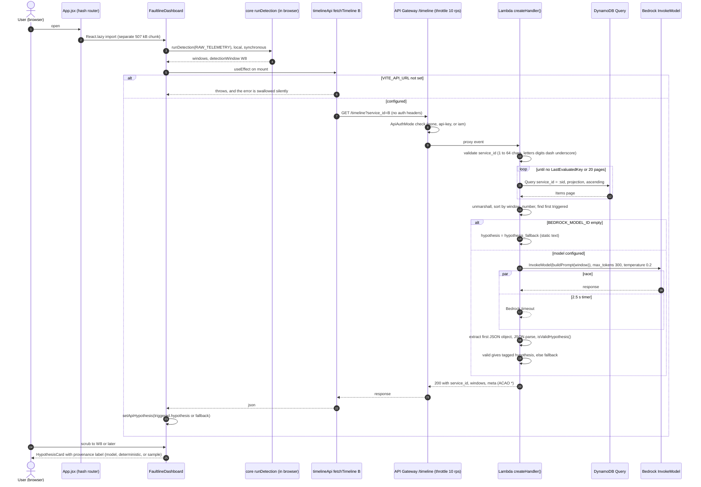

**A detail that matters:** the dashboard **discards the windows** returned by the Lambda. It keeps only the `hypothesis` of the first triggered window and always renders its charts from the locally computed `RAW_TELEMETRY` result (`FaultlineDashboard.jsx`, `useEffect`). The DynamoDB table therefore exists, in practice, as a carrier for one explanation. ✅ Verified by reading the component.

> **Section assessment.** Score **6/10** · Priority **P1**
>
> | Good | Weak | Missing | Why it matters | Next step |
> |---|---|---|---|---|
> | Short, legible request paths; auth before routing | No UI for agent writes; 201 before persistence; the dashboard ignores the Lambda's windows | Correlation or request IDs; an access log | Operators cannot audit who silenced what | Add a `requestId`, an access log line per write, and identity binding for `createdBy` |

---

## 12. AI / LLM / agent architecture

### 12.1 What "AI" is, and is not, in this repository

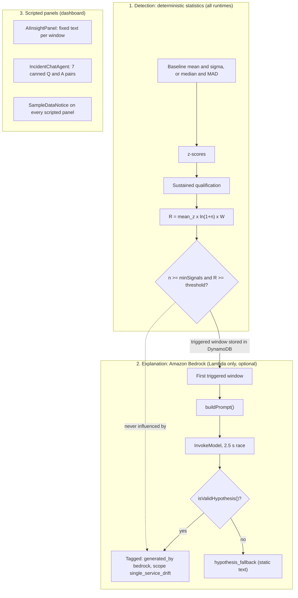

**What this shows.** AI never feeds back into detection. The dotted edge is the project's central invariant (`CONTRIBUTING.md`: "AI may explain a detection; it must never cause or suppress one"). ✅ Verified structurally: nothing in `packages/core` or `packages/agent` imports a model client, and the Lambda only *reads* precomputed verdicts.

**There is no LLM agent.** No tools, function calling, agent loop, planner, router, memory, retrieval, or multi-turn conversation exist anywhere in the repository. The "Incident Chat Agent" component is a scripted FAQ with fixed answers.

### 12.2 The detection pipeline (deterministic, not ML)

**Algorithm** (`packages/core/detectionEngine.js` `runDetection()`), per metric *m* over the window array:

```text
baseline:   μ_m, σ_raw = mean, population-stdev of the first baselineWindows values
            (or median and 1.4826·MAD when statistic = 'median_mad')
floors:     σ_m = max(σ_raw, |μ_m| · sigmaFloorRatio, 1e-9)
            σ_m = max(σ_m, sigmaFloorAbs[m])            if configured
z:          z_m,t = (x_m,t − μ_m) / σ_m
qualify:    run_m,t = (z_m,t ≥ θ_m) ? run_m,t−1 + 1 : 0,   θ_m = zThresholdPerMetric[m] ?? zThreshold
            qualified_m,t = run_m,t ≥ minSustain
score:      Q_t = { round1(z_m,t) : qualified_m,t }
            R_t = mean(Q_t) · ln(1 + |Q_t|) · criticalityWeight
trigger:    triggered_t = |Q_t| ≥ minSignals  AND  R_t ≥ triggerThreshold
confidence: 1 − e^(−R_t / 2.5), capped at 0.99    (display only; not calibrated)
```

**Parameters and their values in each context:**

| Parameter | Core `DEFAULT_PARAMS` | Agent default (`config.js`) | Demo config | Benchmark | Backtest (SMD) |
|---|---:|---:|---:|---:|---:|
| `baselineWindows` | 4 | 10 | 8 | 12 | 30 |
| `historyWindows` (agent) | — | 40 | 60 | 40 | 120 |
| `zThreshold` | 2.0 | 2.0 | 2.0 | 2.0 | 2.0 |
| `minSustain` | 2 | 2 | 2 | 2 (strict 3) | 2 |
| `minSignals` | 2 | 2 | 2 | 2 | 2 |
| `triggerThreshold` | 3.0 | 3.0 | 3.0 | 3.0 | 3.0 |
| `sigmaFloorRatio` | 0.1 | 0.1 | 0.1 | 0.05 | 0.05 |
| `sigmaFloorAbs` | — | null | — | — | 0.01 per channel |
| `statistic` | mean_sigma | mean_sigma | — | — | mean_sigma (MAD variant tested) |
| `outageThreshold` | 9.0 | ∞ (disabled) | ∞ | ∞ | ∞ |

**Worked example** (reference cascade, verified by `npm run verify:engine`). The baseline over W1–W4 gives latency μ = 105, σ = 17. At **W6**, latency has z = 2.35 at W5 and 2.88 at W6, so its run is 2 and it qualifies: n = 1, R = 2.9 · ln 2 = **2.01**. That is below the trigger, and n < `minSignals` anyway. At **W8**, latency (3.8) and retries (3.4, with a run of 2 after 2.38 at W7) qualify; errors (2.63, run 1) do not yet. So n = 2 and R = 3.6 · ln 3 = **3.96 ≥ 3.0 → TRIGGER**. A static 2% error-rate SLO first fires at W11.

**Why these choices** (documented in `ARCHITECTURE.md` and `BACKTEST.md`): z-scores are auditable; the sustain rule removes the single-window false positives that dominate single-metric alerting; `ln(1+n)` makes breadth of evidence count more than depth; `minSignals` enforces convergence as a hard rule.

**Why not ML** (reconstructed from `CONTRIBUTING.md`'s invariant): every alert must be reproducible by hand. A learned model would need training data per service, drift monitoring, and an explanation layer of its own.

**Measured quality:**

| Suite | Precision | Recall | F1 | Source |
|---|---:|---:|---:|---|
| Synthetic, default | 69.4% | 100% | 82.0% | re-run in this audit |
| Synthetic, strict (`minSustain: 3`) | 82.6% | 100% | 90.5% | re-run in this audit |
| **Real (SMD, 4 machines, 38 channels)** | **14.1%** | **80.5%** | **23.9%** | re-run in this audit |
| Real, best sweep point (`trigger: 8`) | 16.5% | 68.3% | 26.5% | `docs/BACKTEST.md` |

**Known failure modes of the math:** step changes (deploys) fire before the rolling baseline absorbs them; seasonal cycles look like drift; long incidents are absorbed into their own baseline after roughly `historyWindows − baselineWindows` windows; the detection is one-sided, so "lower is worse" metrics must be inverted at the source; near-constant baselines need `sigmaFloorAbs`.

### 12.3 The LLM explanation layer (Lambda only)

Each question from the brief, answered for the single AI interaction that exists (`backend/lambda/timelineHandler/handler.js` `explainWithBedrock()`):

| # | Question | Answer |
|---|---|---|
| 1 | What triggers it? | A `GET /timeline?service_id=…` request whose stored windows include at least one `triggered: true`, **and** a non-empty `BEDROCK_MODEL_ID`. It fires on **every such request** (no caching; F-09) |
| 2 | What input? | Only the **first** triggered window: `service_id`, `window_number`, `qualified_signals[]` (metric, z, windows sustained), and the `metrics` z-score map |
| 3 | How is context built? | `buildPrompt(w)` renders the signals and z-scores as bullet lists into a fixed template. No retrieval, history, or other services |
| 4 | What prompt? | A single **user** message (no system prompt): "You are a reliability engineer summarising a drift detection for one service", the signals, then explicit constraints (ONE service only; no dependency graph, traces, or deploy history; do not name any other service; do not claim upstream or downstream effects; every evidence string must cite a qualified signal) and an exact JSON template: `root_service`, `mechanism`, `cascade_path`, `evidence[3]` |
| 5 | Which model? | Whatever `BedrockModelId` is set to at deploy time. `iam-policy.json` names `anthropic.claude-3-haiku-20240307-v1:0`; the template's parameter description gives the same example. Parameters: `anthropic_version: bedrock-2023-05-31`, `max_tokens: 300`, `temperature: 0.2` |
| 6 | Why that model? | ❓ Not documented. 🔎 A small, fast, cheap model fits a 2.5 s budget and a one-sentence output. 🔎 It is an older generation today; a newer small model should be evaluated (see §21 ADR-11) |
| 7 | What tools? | None |
| 8 | How is output validated? | `content[0].text` → first `{…}` via regex → `JSON.parse` → `isValidHypothesis()`: all four fields present and non-empty; `evidence` has exactly 3 non-empty strings; `root_service` **and** `cascade_path` must equal `service_id`; every evidence string must contain (case-insensitively) at least one qualified metric key (e.g. `p99_latency_z`); there must be at least one qualified signal |
| 9 | If the model fails? | Timeout (2.5 s), SDK error, malformed JSON, or missing text → `{ok: false, reason}` → the stored `hypothesis_fallback` is served; `FALLBACK_ACTIVATED{reason}` is logged. The request still returns 200 |
| 10 | If the output is wrong? | Structural errors are caught. **Semantic errors in `mechanism` are not**: it is unconstrained free text, so a model can still assert a root cause ("caused by a bad deploy") while passing validation, as long as its evidence lines mention the right metric names. The UI labels it "Model-generated summary" with the model ID |
| 11 | If an external API fails? | DynamoDB failure → `502`. CloudWatch (live path) → `502`. Bedrock failure → fallback (never an error) |
| 12 | How is the result returned? | Attached as `windows[i].hypothesis` on the first triggered window, with `generated_by: "bedrock"`, `model_id`, `scope: "single_service_drift"`, `evidence_source: "qualified_signals"`. The dashboard's `provenanceOf()` turns that into a violet "Model-generated summary · Amazon Bedrock · <model>" badge |

**Further AI-specific concerns:**

| Concern | Assessment |
|---|---|
| Memory | None (stateless per request) |
| Token management | 🔎 Fixed small prompt (a few hundred input tokens); output capped at 300 |
| Context window | Irrelevant at this size |
| Retries | None (by design: one attempt, then fallback) |
| Timeout semantics | `Promise.race` stops *waiting* but does **not abort** the Bedrock call. The invocation completes and is billed; its result is discarded |
| Cost management | None beyond API Gateway throttling and the optional API-key quota (10k/day). No caching, budget alarm, or per-caller limit (F-09) |
| Latency | Adds up to 2.5 s to a request for a triggered timeline |
| Hallucination risk | Reduced by schema, service-name, and evidence-citation checks; **not eliminated** in `mechanism` (see row 10) |
| Prompt injection | Low. All prompt inputs come from the operator's own DynamoDB table (written only by `seed.js`), and `service_id` is regex-restricted. If the table ever held externally sourced strings (for example metric names from user telemetry), those would flow into the prompt unescaped |
| Data leakage | The service ID, metric names, and z-scores are sent to Bedrock. No raw telemetry values and no PII. 🔎 Subject to the AWS account's Bedrock data-handling terms; verify for your compliance context |
| Guardrails (Bedrock Guardrails feature) | Not used; validation is application-side |
| Observability | Log events only; no token or latency metrics; X-Ray on API Gateway (not on the Bedrock call specifically) |
| Evaluation | ❌ None. Tests check schema handling with mocked responses, but there is no dataset of detections with reference explanations and no quality scoring |
| The "deterministic fallback" | Static text written in `scripts/generateDataset.mjs`. It names a three-service cascade (`service-b → service-d → service-f`) and a mechanism ("connection pool exhaustion"), exactly what the model is forbidden to claim. It is labelled "Sample scenario content" in the UI (because it lacks `generated_by`), which is honest, but the Lambda docs call it "deterministic", which overstates it. `provenanceOf()`'s `deterministic` branch (`generated_by: 'fallback'`) is 🔗 **referenced but never produced** by any code |

### 12.4 Agent/tool interaction

🔗 **Not applicable.** No tool-calling or agentic LLM architecture exists. The closest analogue is the guardrail pipeline in §12.1: *model output → parse → validate → accept or fallback*. The README's roadmap mentions an "optional LLM explanation layer in the agent (already present in the AWS Lambda variant)" (🗓️ planned, not started).

### 12.5 AI / detection rating

| Area | Score | Why |
|---|---:|---|
| Model selection | 4 | Undocumented choice; an older-generation example ID; no comparison |
| Prompt engineering | 7 | Tight, scoped, explicit constraints and output schema; low temperature. No system prompt; no few-shot example |
| Context management | 6 | Minimal and sufficient; uses only the first triggered window (ignores escalation) |
| Tool architecture | n/a | No tools |
| Agent design | n/a | No LLM agent (the monitoring daemon is scored separately at 7) |
| Reliability | 7 | Always returns; timeout; fallback |
| Output validation | 8 | Unusually strong for a prototype: grounding checks against qualified signals |
| Hallucination resistance | 6 | Structural hallucinations blocked; free-text `mechanism` unconstrained |
| Security | 5 | Injection risk low; cost abuse possible with `none` auth (F-09) |
| Cost efficiency | 3 | No caching: the same explanation is regenerated on every page view |
| Latency | 6 | 2.5 s budget is acceptable; not parallelised with the DynamoDB read (it cannot be) |
| Observability | 4 | Events only; no token, cost, or latency metrics |
| Evaluation | 1 | None |
| **Detection math (auditability)** | 9 | Fully reproducible by hand |
| **Detection quality (real data)** | 3 | 14.1% precision |
| **Overall AI system** | **4.5** | Excellent discipline around a weak signal and an unevaluated, off-path LLM feature |

**What works:** the invariant; grounding validation; provenance tagging and UI labelling; deterministic fallback on every failure.
**What is fragile:** the free-text `mechanism`; the static fallback that contradicts the scope rule; the per-request invocation.
**What needs evaluation:** explanation faithfulness (does the text match the signals?), usefulness to operators, and the rejection rate of the validator per model.
**What should be automated:** caching explanations by `(service_id, window_number, model_id, prompt_version)`; recording the validator's rejection reasons as metrics; a regression eval of the prompt against a fixed set of windows.
**Highest-value future AI work:** (1) move the explanation into the **agent** as an optional notifier enrichment, so incidents carry a human-readable summary where operators actually see them; (2) generate the deterministic fallback *from* the qualified signals (the provenance branch already expects `generated_by: 'fallback'`); (3) use an LLM to *label* backtest false positives (deploy, batch, capacity) in order to research the correlation-structure hypothesis, offline and never in the detection path.

> **Section assessment.** Score **4.5/10** · Priority **P1** (detection signal), **P2** (LLM)
>
> | Good | Weak | Missing | Why it matters | Next step |
> |---|---|---|---|---|
> | "Explains, never decides" is enforced structurally | Weak real-world signal; LLM off the product path | Explanation evaluation; caching; correlation-weighted convergence | The AI feature cannot add value where operators are not looking | Prototype correlation weighting in `packages/benchmark` first, measured per machine at matched alert volume |

---

## 13. Security architecture

### 13.1 Trust boundaries

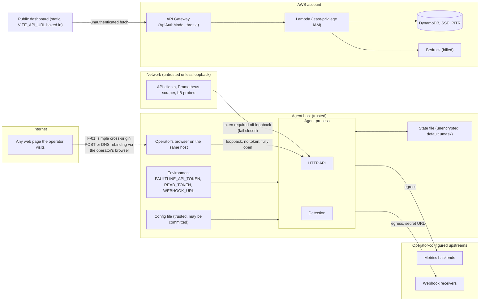

**What this shows.** The agent's security model is: **loopback = trusted, everything else = token**. That assumption breaks because the operator's browser is on the loopback side of the boundary while executing untrusted internet content (F-01). The AWS side's boundary is `ApiAuthMode`, and the dashboard as shipped can only use `none`.

### 13.2 Controls that exist (and are good)

| Control | Where | Assessment |
|---|---|---|
| Refuse to start unauthenticated off loopback | `agent.js` `assertSafeExposure()`; CI `security-defaults` + `docker` jobs | ✅ Excellent: fail closed, asserted in CI at the process and container level |
| Defence in depth: writes refused off loopback even if the guard is bypassed | `auth.js` `authorize()` | ✅ |
| Constant-time token comparison (fixed-length SHA-256 digests) | `auth.js` `matches()` | ✅ Correct pattern |
| Two scopes; 401 vs 403 semantics; `WWW-Authenticate` | `auth.js`, `server.js` | ✅ |
| Literal tokens in config rejected at startup | `config.js` | ✅ (scope limited: F-12) |
| TLS fails closed on an unreadable certificate | `server.js` | ✅ |
| Plaintext-off-loopback and unauthenticated warnings | `agent.js` `start()` | ✅ |
| Compose publishes to `127.0.0.1` only and requires a token | `docker-compose.yml` (`:?` guard) | ✅ |
| Non-root container user | `Dockerfile` `USER node` | ✅ |
| Request body cap (64 KB) | `server.js` `readJson()` | ✅ |
| `Cache-Control: no-store` on JSON | `server.js` | ✅ |
| Least-privilege Lambda IAM; `GetMetricData` scoped by namespace condition | `template.yaml` | ✅ |
| `ApiAuthMode` has no default (forces a decision); outputs expose `ApiAuthModeOut` and `BedrockEnabled` | `template.yaml` | ✅ Thoughtful |
| Input validation on `service_id` | `handler.js` | ✅ |
| DynamoDB parameterised expressions | `handler.js` | ✅ (no injection surface) |
| React escaping; no `dangerouslySetInnerHTML`, `innerHTML`, `eval`, or `new Function` | dashboard | ✅ Verified by grep |
| No phone-home | whole repo | ✅ Verified |
| Production dependency audit is blocking in CI across 4 trees | `scripts/auditAll.mjs` | ✅ |

### 13.3 Findings

| ID | Severity | Issue | Location | Why it matters | Exploit scenario | Current mitigation | Recommended fix |
|---|---|---|---|---|---|---|---|
| S-01 (F-01) | **High** | Cross-origin forgery and DNS rebinding against an unauthenticated loopback agent | `server.js` `corsOrigin` default `*`, `readJson()`; `auth.js` loopback-open | Silences suppress **all** paging indefinitely; `/api/state` is readable cross-origin | A developer runs `npm run agent:demo` (or a systemd unit per `docs/AGENT.md`, which sets no token) and visits a page that runs `fetch('http://127.0.0.1:8787/api/silences',{method:'POST',body:'{"match":"*"}'})`. The response is `201` and every service is muted with no expiry. 🐞 Reproduced | Docker requires a token; Chrome's Private/Local Network Access checks block some public→loopback requests in recent versions, but that is not universal and should not be relied on | (1) Default `corsOrigin` to **no CORS header**; (2) require `Content-Type: application/json` on writes (which forces a preflight); (3) validate `Host` ∈ {`127.0.0.1:port`, `localhost:port`, `[::1]:port`} when unauthenticated; (4) better still, auto-generate a token on first run and print it |
| S-02 (F-09) | **Medium** | Billed Bedrock invocations per anonymous request | `handler.js`; `template.yaml` `ApiAuthMode=none` | Cost abuse | A deployed demo with `none` + a model ID. At the 10 rps throttle that is up to ~864k invocations per day (see §37 for cost) | Documented warning; `BedrockEnabled` output; throttle | Cache hypotheses; reserved concurrency; a budget alarm; refuse `none` + Bedrock in the template via a `Rules` assertion |
| S-03 (F-07) | **Medium** | End-of-life Node 20 in the container and CI | `Dockerfile`, `ci.yml`, `engines` | No upstream security patches | Any future Node CVE stays unpatched in shipped images | None | `node:22-alpine` (or 24) pinned by digest; CI matrix 22/24; `engines >=22` |
| S-04 | **Medium** | Silence abuse by write-scope holders: `*`, no expiry, no identity | `silences.js`, `server.js` | A single leaked write token mutes the fleet silently | An attacker with the token creates `{match:"*"}` | `faultline_service_silenced` metric; `silencedBy` in state | Require `until` with a max duration (for example 24 h); forbid bare `*` without an explicit flag; derive `createdBy` from the token scope; log an access line per write |
| S-05 (F-12) | **Medium** | Secrets can be inline in `source.options.headers` and webhook `headers` | `config.js` | Committed config files leak metrics-backend or webhook credentials | A config with `"headers": {"Authorization": "Bearer …"}` checked into git | Docs advise env for the webhook URL | Support `headersEnv` / `${ENV}` interpolation; reject literal `Authorization` headers like literal tokens |
| S-06 | **Medium** | No rate limiting or concurrency limit on the agent API | `server.js` | CPU exhaustion: `/metrics` costs 173 ms and `/api/state` is O(services) at 10k services (measured) | A scraper storm or hostile client with the read token | None | A per-IP token bucket; cache the snapshot per tick (it only changes once per tick) |
| S-07 | **Low** | `/health` (anonymous) discloses service names in `staleServices`, plus agent name, version, and source type | `server.js` | Reconnaissance | An unauthenticated probe enumerates services | Health is a deliberate exception | Return counts anonymously; names only with a token |
| S-08 | **Low** | Webhook payloads are unsigned | `notifiers/index.js` | Receivers cannot verify the sender; the URL is the only credential | A leaked webhook URL allows forged alerts (a receiver-side concern) | None | Optional HMAC `X-Faultline-Signature` with a secret from env |
| S-09 | **Low** | State file written with the default mode (typically `0644`), unencrypted | `store.js` | Contains incident history and buffered telemetry | A local user reads operational data | `SECURITY.md` advises volume permissions | `writeFile(..., {mode: 0o600})`; document encryption-at-rest via the volume |
| S-10 | **Low** | Glob-to-regex with many `*` can backtrack heavily | `serviceConfig.js` `globToRegExp()` | CPU spike per match | A write-token holder posts `match: "*a*a*a*…*b"` | Only write-scope input | Collapse consecutive `*`; cap the number of wildcards; or match with a linear-time glob algorithm |
| S-11 | **Low** | `server.tls.caFile` is loaded but `requestCert` is never set | `server.js` | Operators may believe mTLS is active | A misunderstanding, not an exploit | None | Implement `requestCert` + `rejectUnauthorized` or remove the option |
| S-12 | **Low** | GitHub Actions pinned by tag, not SHA; Docker base not pinned by digest; no `.dockerignore` | `ci.yml`, `Dockerfile` | Supply chain; a local `packages/agent/data/` directory can be baked into a locally built image. Verified: the built image (194 MB) ships the agent's 16 test files | A compromised action tag | None | SHA-pin actions; digest-pin the base; add `.dockerignore` (`**/data`, `**/test`, `node_modules`) |
| S-13 | **Low** | 7 dev-dependency advisories, only 1 assessed | `docs/DEPENDENCIES.md` | Policy drift | Build-time only | Non-blocking audit step | Assess or upgrade each (Vitest, Tailwind 4, js-yaml) and update the exceptions list |
| S-14 | **Low** | The Lambda ignores its `CorsAllowOrigin` parameter for `GET` responses | `handler.js` `JSON_HEADERS` | Operators believe they restricted origins | Any origin can read timeline data | Data is non-sensitive demo data | Read an allowed origin from env; echo it only if it matches |
| S-15 | **Low** | The HTTP source logs its `url` on an empty response | `sources/http.js` | A URL carrying credentials (query token, basic auth) lands in logs | Logs shipped to a shared system | None | Redact the query string and userinfo before logging |
| S-16 | **Info** | Loopback-open mode trusts every local process | Design | Any local user can mute alerting | A shared host | Documented in `SECURITY.md` | Same fix as S-01 (token by default) |

**Categories reviewed with no finding:** SQL injection (no SQL); NoSQL injection (parameterised DynamoDB); XSS (React escaping; no raw-HTML sinks; the model's `mechanism` text is rendered as text); SSRF (every outbound URL comes from operator config or env, never from requests); command injection (scripts use `spawnSync`/`execFileSync` with fixed argument arrays); authentication bypass (none beyond the loopback-open design); privilege escalation (the read token cannot write, which is tested); logging of secrets (tokens and webhook URLs are never logged; S-15 is the exception); tool abuse (no tools); prompt injection (low; §12.3).

### 13.4 Security rating

**Security score: 5/10.** Strong intent and several excellent fail-closed controls, undermined by a forgeable default in the most common configuration, an end-of-life runtime, and no abuse controls on the highest-impact write.

| Area | Score | Area | Score |
|---|---:|---|---:|
| Authentication | 6 | Dependency security | 7 |
| Authorisation | 6 | Data privacy | 6 |
| Secrets | 6 | Logging | 8 |
| Input validation | 7 | Rate limiting | 1 |
| Output validation | 8 | Abuse prevention | 3 |
| API security | 4 | AI security | 6 |
| Database security | 6 | Prompt injection | 8 |
| Runtime currency | 3 | Tool security | n/a |

**Classification:**

- **Critical (must fix before production):** none in the strict sense for a token-protected deployment.
- **High (fix before promoting the quickstart or any loopback-without-token deployment):** S-01.
- **Medium (fix before serious scale):** S-02, S-03, S-04, S-05, S-06.
- **Low (hardening):** S-07 to S-15.

> **Section assessment.** Score **5/10** · Priority **P0**
>
> | Good | Weak | Missing | Why it matters | Next step |
> |---|---|---|---|---|
> | Fail-closed exposure, constant-time auth, least-privilege IAM, CI-asserted defaults | CORS/CSRF default, EOL runtime, unbounded silences | Rate limiting, write audit trail, token rotation | The API can silence the whole alerting pipeline | Ship S-01's four fixes and bounded silences in one release |

---

# Part III — Quality Attributes & Operations

## 14. Error handling & failure modes

### 14.1 Error-handling flow inside a tick

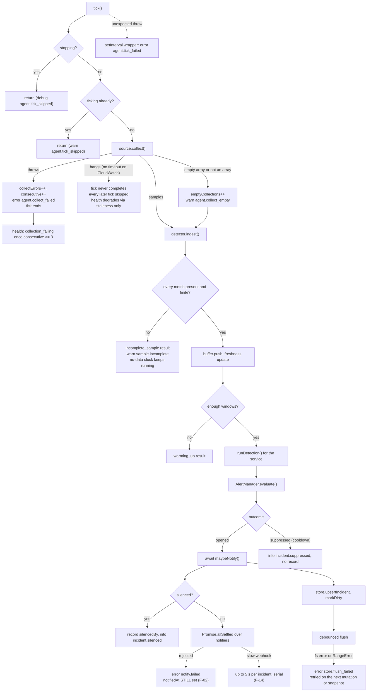

**What this shows.** Every external failure is **contained**: the agent keeps ticking, and `/health` or the logs expose the problem. The weak points are where containment hides a failure instead of surfacing it (F-02), where one slow dependency serialises everything (F-14), and where no timeout exists (F-16).

### 14.2 Failure catalogue

Each row reads: **what happens → why → what the user sees → how the system recovers.**

| Failure | What happens | Why (design) | How the user sees it | Recovery |
|---|---|---|---|---|
| Invalid config | Process exits 1 before binding anything; all errors listed | Misconfiguration must never run silently | stderr: `Invalid FAULTLINE configuration:` plus a bullet list | Fix and restart. ⚠️ Unknown keys and global `statistic`/`zThresholdPerMetric` are **silently ignored** (F-13) |
| Unsafe exposure (no token, non-loopback) | Refuses to start | Fail closed | stderr: `Refusing to start: …` naming both remedies | Set a token or bind loopback |
| Unreadable TLS certificate | Refuses to start | Never downgrade to plaintext | `TLS is configured but the certificate could not be read` | Fix the path or permissions |
| Port in use | `listen` error → `start()` rejects → `fatal:` exit 1 | — | Stack trace on stderr | Change the port |
| Source throws (5xx, DNS, bad shape) | Tick aborted; no samples ingested | One bad cycle is not fatal | `agent.collect_failed`; after 3 in a row `/health` returns 503 `collection_failing` | Automatic on the next successful tick |
| One Prometheus query fails | The **whole** tick fails (all services). ✅ Verified against real Prometheus: one malformed query (HTTP 400) → 0 services evaluated, although 2 of 3 queries were valid | Simplicity | Same as above | Automatic |
| Source hangs | Prometheus/HTTP abort after `timeoutMs` (10 s). **CloudWatch has no explicit timeout** (F-16): a hung call wedges the tick, and every later tick is skipped | Overlap guard | `agent.tick_skipped` every interval; `/health` → `telemetry_stale` after the grace period | Only when the hung promise settles, or a restart |
| Empty collection | Counted; the no-data clock keeps running | Empty ≠ healthy | `agent.collect_empty`; 503 after `noDataGraceSeconds` | Automatic when data returns |
| Missing or NaN metric | Sample rejected for that service | Missing ≠ zero | `sample.incomplete`; `missingMetrics` in `/api/state` | Automatic |
| Service disappears | Per-service staleness → `service_telemetry_stale` → 503 | A partial outage must not look healthy | 503 with `staleServices` | **None for decommissioned services** (F-05) |
| Webhook down | Error logged; **incident marked notified anyway** | Isolation | `notify.failed` log only | **No retry; the page is lost** (F-02) |
| Webhook slow (5 s timeout) | Each incident's notify is awaited serially inside the tick | Inline delivery | Late alerts for *other* services; possible `tick_skipped` | Automatic, but detection stalls during correlated storms (F-14) |
| Disk full or read-only | `store.flush_failed`; the API may already have returned 201 for a silence | Debounced writes | Log line only | Retried on the next mutation or periodic snapshot |
| State exceeds the V8 string limit (~53k services at defaults) | `JSON.stringify` throws `RangeError` on **every** flush | Whole-document persistence | `store.flush_failed` forever; nothing persists, incidents included (F-15) | None without code change |
| Corrupt state file | Warn and start empty; the corrupt file is overwritten on the next flush | Never block startup | `store.load_failed` | Automatic; forensic copy lost |
| Stale state on restart | Discarded; warm-up | Old baselines are untrustworthy | `state.warming_up reason=stale` | ~12 min to first evaluation |
| Config changed between restarts (new metric) | Restored samples zero-filled (F-04) | Hydrate does not revalidate | Spurious incident | Set `restoreMaxAgeSeconds: 0` for that restart, or delete the state file |
| SIGTERM during a slow collection | Waits up to `graceMs` (5 s), then abandons the tick and saves | Bounded shutdown | `agent.shutdown_tick_abandoned` | Clean exit 0 |
| Unhandled rejection | Logged; the process continues | Availability over purity | `agent.unhandled_rejection` | — |
| Exception in a request | `500 {"error":"internal error"}`; message logged | Never leak internals | 500 | — |
| Lambda: DynamoDB error | `502 timeline unavailable` | — | Dashboard: hypothesis silently absent | Retry the request |
| Lambda: Bedrock error, timeout, or invalid output | Fallback hypothesis | "Explains, never decides" | Label says sample or deterministic | Automatic |
| Dashboard: render error | `ErrorBoundary` full-screen "Something went wrong" + Reload | — | Reload button | Manual reload |
| Dashboard: API unreachable | Swallowed (timeline); shown (live mode) | Optional backend | Live: red banner | Manual retry |
| Dashboard: bad CSV | Parser returns a message | — | Inline error | Fix the CSV |

### 14.3 Retries and fallbacks summary

| Mechanism | Present? |
|---|---|
| Source retry | Implicit only (the next tick). No backoff; no jitter |
| Notifier retry | ❌ None (F-02) |
| Persistence retry | Implicit (the next dirty mark) |
| Bedrock retry | ❌ By design (fallback instead) |
| Circuit breaker around sources or notifiers | ❌ None |
| Timeouts | Prometheus/HTTP 10 s; webhook 5 s; Bedrock 2.5 s (race, not abort); **CloudWatch none** (F-16); shutdown grace 5 s |

> **Section assessment.** Score **6/10** · Priority **P0** (delivery), **P1** (timeouts)
>
> | Good | Weak | Missing | Why it matters | Next step |
> |---|---|---|---|---|
> | Containment everywhere; failures surface in `/health` | Hidden delivery failure; serial notification; no CloudWatch timeout | Outbox, retries, per-dependency timeouts, a persistence ceiling guard | During a real outage many services degrade at once, which is exactly when F-02 and F-14 bite | Outbox worker + `requestTimeout` on the AWS client + per-service partial collection |

---

## 15. Performance & scalability

### 15.1 Measured characteristics

Measured in this audit with the real `FaultlineAgent` and `RollingDetector`, 3 metrics, default `historyWindows: 40`, 20 config silences, after 40 warm-up ticks. Node 24.14, i7-14650HX. **Indicative only**; production hardware and data shapes will differ.

| Services | One tick (evaluate all) | `/metrics` render | `ranking()` | Detection-state JSON (compact) | Heap growth |
|---:|---:|---:|---:|---:|---:|
| 100 | 3 ms | 22 ms* | 1 ms | 0.6 MB | ~5 MB |
| 1,000 | 20 ms | 9 ms | 7 ms | 6.1 MB | ~76 MB |
| 10,000 | 242 ms | 173 ms (2.4 MB body) | 82 ms | 61.6 MB | ~258 MB |

\*First-call JIT warm-up. Pretty-printed as the store writes it, state is **~10 KB per service**, and `JSON.stringify` takes 87 ms per 1,000 services.

### 15.2 Where the time and memory go

| Hot spot | Complexity | Why |
|---|---|---|
| `RollingDetector.ingest()` | O(S · H · M) per tick | The whole buffer is re-scored for every service on every tick; nothing is incremental |
| `snapshot()` (behind `/health`, `/api/state`, `/metrics`, `/api/ranking`) | O(S · (silences + 1)) | Silence globs are recompiled into regexes on every match; no per-tick caching |
| `Store.flush()` | O(total state), pretty-printed | Whole-document rewrite; blocks the event loop during `stringify` |
| Notification | Serial `await` per incident | Inline in the tick |
| Prometheus source | M sequential HTTP calls | No parallelism |
| Dashboard | 507 kB chunk | Recharts + all panels in one lazy chunk |

### 15.3 "What happens if…"

The agent is single-tenant, so its load is driven by **monitored services** and **API clients**, not by end users. The dashboard is static; the Lambda is serverless.

| Scenario | Agent (services monitored) | Agent API (clients) | Lambda / dashboard (visitors) |
|---|---|---|---|
| **10** | Trivial: <1 ms per tick | Trivial | Trivial; each visit to a triggered timeline costs one Bedrock call |
| **1,000** | Fine: 20 ms per tick, 10 MB state file, ~234 KB per scrape | Fine | Fine within throttle (10 rps); Bedrock ≈ 1 call per visit, so cost scales with traffic |
| **100,000** | **Breaks.** Persistence fails outright (~53k ceiling, F-15); heap in the gigabytes; `/metrics` ~24 MB per scrape | A burst of `/api/state` calls monopolises the single thread (no rate limit, no snapshot cache) | API Gateway throttling returns 429s; at `none` auth with Bedrock, the throttle becomes the cost ceiling (~864k calls per day) |

**What breaks first, in order:**

1. **Alert delivery during correlated failures** (at any scale). When a shared dependency fails, many services open incidents in the same tick. With a slow webhook, notifications serialise (up to 5 s each), the tick overruns, later ticks are skipped, and detection stalls exactly when it matters (F-14). With a failing webhook, pages are lost (F-02).
2. **Persistence at a few thousand services.** The flush cost grows linearly (about 0.9 s of blocked event loop per flush at 10k services) until it fails hard at ~53k (F-15).
3. **Scrape cost and cardinality.** 5 series per service; 2.4 MB per scrape at 10k.
4. **CPU last.** Even at 100k services a tick is about 2.4 s, well inside a 60 s interval.

### 15.4 10× / 100× / 1000× analysis

Taking **~100 services** as today's realistic ceiling for a single-team deployment:

| Growth | Bottleneck | Why it occurs | Solution | Complexity | Architectural change |
|---|---|---|---|---|---|
| **10× (~1k services)** | Correlated-incident storms with inline delivery; snapshot cost per request | Inline await; no snapshot cache | Outbox + async delivery worker; cache `snapshot()` once per tick | Low–Medium | None structural |
| **100× (~10k)** | Whole-document persistence (0.9 s blocking flushes, ~100 MB files); `/metrics` size; silence regex recompilation; memory (~300 MB) | JSON blob; no incremental state | Persist incrementally (SQLite via `node:sqlite`, or an append-only log); precompile globs; incremental Welford-style statistics per metric; optional metric aggregation | Medium | Persistence layer swap; engine gains a streaming API |
| **1000× (~100k)** | Hard persistence failure (F-15); single-process memory; single failure domain; metrics cardinality | Single-node design | **Shard** the fleet across agents (consistent hashing on service name), each with its own store; a coordinator for dedup and ranking aggregation; external state (Postgres or Redis); push ingestion (remote-write or OTLP) instead of pull | High | Distributed system: shard ownership, leader election, aggregated ranking API |

> **Section assessment.** Score **Performance 6/10 · Scalability 3/10** · Priority **P1** (storm behaviour), **P2** (scale)
>
> | Good | Weak | Missing | Why it matters | Next step |
> |---|---|---|---|---|
> | CPU-cheap engine; bounded buffers | Full recompute; whole-document persistence; inline delivery | Incremental stats; snapshot cache; persistence ceiling guard; sharding | Correlated failures are the main use case | Decouple delivery from the tick first; add a startup/metrics guard when state approaches the ceiling |

---

## 16. Deployment architecture

### 16.1 Deployment topologies

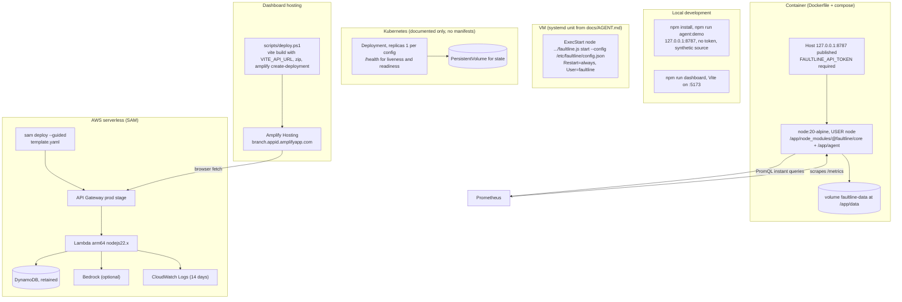

**What this shows.** Two independent deployables: **the agent** (container, VM, or K8s; single replica) and **the demo stack** (SAM + Amplify). They share no infrastructure. Only the Docker/compose path, the SAM template, and the Amplify script are backed by files in the repository. The systemd unit is a documentation snippet, and **Kubernetes is 🔗 referenced only**: no manifests or Helm chart exist.

### 16.2 Details

| Topic | Current state | Evidence |
|---|---|---|
| Local development | `npm install` (workspaces), `npm run agent:demo`, `npm run dashboard` (`.claude/launch.json` also defines the dashboard on port 5173) | `package.json`, README |
| Build | No build for the agent or core (plain ESM). Dashboard: `vite build` → `frontend/dashboard/dist`. Lambda: `npm run package` → `dist/function.zip` + SHA-256 | Scripts |
| Environment config | JSON config file + `FAULTLINE_*` env; dashboard `VITE_API_URL` at **build time**; Lambda env from template parameters | §20 |
| Secrets | Env only for the agent's tokens and webhook; the Lambda needs no secrets (IAM role); the dashboard has none | `config.js`, `template.yaml` |
| Docker | Copies `packages/core` into `node_modules/@faultline/core` and `packages/agent` into `/app/agent`; no `npm install`; non-root; `HEALTHCHECK` with the built-in `fetch`; `ENTRYPOINT node bin/faultline.js`, `CMD start` | `Dockerfile` |
| Compose | Loopback publish; required token (`${FAULTLINE_API_TOKEN:?…}`); named volume; runs the **demo** config by default (a real config must be mounted) | `docker-compose.yml` |
| Cloud infrastructure | Agent: ❓ none prescribed. Demo: API Gateway + Lambda + DynamoDB + Bedrock + CloudWatch + Amplify | Template, script |
| Networking | Agent binds `127.0.0.1:8787` by default; container binds `0.0.0.0` inside its own namespace | Config, Dockerfile |
| Domains | ❓ None configured; Amplify default domain; API Gateway default `execute-api` URL | Outputs |
| TLS | Agent: optional built-in, or terminate at the ingress. API Gateway and Amplify: AWS-managed TLS | `server.js` |
| CDN | 🔎 Amplify Hosting serves through AWS's CDN (not configured in the repo) | — |
| Production config | `faultline.config.example.json`: Prometheus, `historyWindows: 60`, `baselineWindows: 15`, sigma floors, two service rules, a nightly batch silence, stdout + webhook + file notifiers, `host: 0.0.0.0` with auth | Example file |
| Rollbacks | ❌ No versioned images or releases, so rollback means rebuilding an older commit. SAM relies on CloudFormation's automatic rollback of failed stack updates (🔎 generic behaviour, not configured). Amplify keeps previous deployments (🔎 platform behaviour) | — |
| Scaling rule | "Do not scale beyond one replica per config" (replicas would alert independently) | `docs/AGENT.md` |

> **Section assessment.** Score **5/10** · Priority **P1**
>
> | Good | Weak | Missing | Why it matters | Next step |
> |---|---|---|---|---|
> | Secure-by-default compose; reproducible Lambda artifact; parameterised IaC | EOL base image; no registry or versioning; PowerShell-only dashboard deploy | Published images, K8s manifests, release process | Adopters need `docker pull faultline/agent:1.x` and a manifest, not a clone | Publish signed images to GHCR on tags; add a minimal K8s manifest with separate liveness and readiness |

---

## 17. DevOps & CI/CD

### 17.1 Pipeline

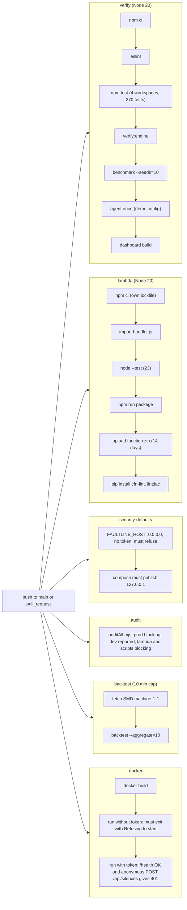

**What this shows.** Six parallel jobs, all **verification**. There is no deployment, publishing, or release job; CD does not exist.

### 17.2 Automation inventory

| Automation | What it proves | Gaps |
|---|---|---|
| `verify` | Lint, all workspace tests, the reference assertion, the benchmark runs, the agent boots, the dashboard builds | The benchmark is not asserted against thresholds (it only has to run); single Node version (EOL 20) |
| `lambda` | Independent install; declared dependencies suffice; tests; reproducible artifact; template lint | The artifact is not deployed or signed |
| `security-defaults` | The exposure guard at process level; compose loopback | Uses `sleep 5` (timing-based) |
| `audit` | Production dependencies clean across all trees | Dev advisories never block, and 6 of 7 are unassessed |
| `backtest` | A real-data run completes in 10 min | **No quality assertion**: a regression in precision or recall would pass |
| `docker` | The image refuses without a token; serves `/health`; blocks anonymous writes | Image not pushed or scanned (no Trivy/Grype) |

| DevOps topic | State |
|---|---|
| Type checking | ❌ None (plain JS) |
| Formatting | Deliberately none |
| Environment promotion | ❌ None (no staging or production pipeline) |
| Secrets in CI | None needed (all tests hermetic; the SMD fetch is public) ✅ |
| Versioning | All packages `1.0.0`; `VERSION` hard-coded in `agent.js`; **no git tags**; no changelog |
| Releases | ❌ None |
| Rollbacks | ❌ Not automated |
| Monitoring and alerts for CI | GitHub defaults only |
| CI history (queried) | All 6 jobs green on the audited commit. Of the last 15 runs on `main`, 4 failed. Three consecutive commits (`9e76a6f`, `5542915`, `bccd17a`) failed the dashboard build on Linux until `506974b` fixed the cross-platform lockfile. `713ce2d` failed unit tests and the backtest until `d269532` fixed the shutdown grace period and the dataset fetch. So `main` was red for about a day while features kept landing on top |
| Dependency updates | ❌ No Dependabot or Renovate config |

> **Section assessment.** Score **6.5/10** · Priority **P1**
>
> | Good | Weak | Missing | Why it matters | Next step |
> |---|---|---|---|---|
> | CI asserts *security behaviour*, not just unit tests | Verification only; quality not gated | CD, tags, changelog, image publishing, Dependabot, benchmark/backtest thresholds | Detection regressions can merge silently | Gate the backtest on `precision ≥ 0.13 && recall ≥ 0.75` for machine-1-1; add a release workflow on `v*` tags |

---

## 18. Testing strategy

### 18.1 Existing suites (all run and passing in this audit)

| Suite | Runner | Tests | What it tests | Why | What it does **not** test |
|---|---|---:|---|---|---|
| `packages/core/test` | `node:test` | 34 | Baseline math, floors, z, qualification, R formula, confidence bounds, reference cascade, MAD robustness, per-metric thresholds, `minSignals`, baseline comparators, counterfactual properties, CSV parsing and aliases | The engine is the product's core claim | Property-based invariants (scale invariance, monotonicity); missing-value handling in the engine itself |
| `packages/agent/test` | `node:test` | 186 | Config and effective profiles (33), auth and security (31), no-data and freshness (21), detector (13), silences (14), restart (8), shutdown (10), sources (12), alerts (9), server (9), ranking (6), service config (12), buffer (5), e2e (3) | Operational correctness under failure | Notification delivery semantics (F-02); CORS/Content-Type behaviour (F-01); hydrate revalidation (F-04); eviction (F-05); exposition lint (F-06); flush concurrency (F-08); global `statistic` (F-13); correlated-storm latency (F-14); state size ceiling (F-15) |
| `packages/benchmark/test` | `node:test` | 29 | Scenario generation, segment scoring, causality (no future leakage), rolling vs fixed baseline, the SMD helpers | The evidence must itself be correct | Real-data quality thresholds |
| `frontend/dashboard/test` | Vitest + jsdom | 21 | Hypothesis path parsing and provenance labelling; `HypothesisCard` rendering | Prevent presenting sample text as AI output | 20 of 21 components untested; live mode (F-03); CSV panel; counterfactual panel; accessibility |
| `backend/lambda/…/test` | `node:test` | 23 | Validation, pagination, truncation, Bedrock success/timeout/malformed/schema rejection, live gaps, naming of 4XX | Guardrails around the LLM and AWS | Real AWS; the CORS header; caching |
| `scripts/verifyEngine.mjs` | CI assertion | — | Trigger W8, outage W12, W7 not triggered, SLO lead > 0, counterfactual outcomes | Regression anchor for the headline claim | — |

**Test quality observations.** Test names state behaviour ("a failing notifier never stops detection or crashes the agent") and several tests encode past bugs. Injection of the clock, env, and clients keeps them hermetic and fast (the agent suite runs in ~0.6 s). But several confirmed defects sit right next to tested behaviour: the notifier test proves the agent *survives* a dead webhook, not that the failure is *recorded*. The suite optimises for "does not crash" more than "tells the truth".

### 18.2 Coverage by test type

| Type | Present? | Notes |
|---|---|---|
| Unit | ✅ Extensive | |
| Integration | ✅ | Real HTTP servers on ephemeral ports; real files in temp directories |
| End-to-end | ✅ (agent) | `e2e.test.mjs`: cascade → exactly one alert → real webhook receiver → persisted → resolved |
| API tests | ✅ | `server.test.mjs`, `security.test.mjs`, `auth.test.mjs` |
| AI tests | 🟡 | Schema and fallback with mocks; **no quality evaluation** |
| Security tests | ✅ (authN/Z, exposure) | Missing: CSRF/CORS, rate limit, fuzzing |
| Performance tests | ❌ | Only this audit's ad-hoc probe |
| Regression tests | ✅ | `verifyEngine`, benchmark (unasserted), backtest (unasserted) |
| Frontend E2E | ❌ | No Playwright or Cypress |
| Coverage measurement | ❌ | No `--experimental-test-coverage` or c8 gate |

### 18.3 Critical missing tests

1. **Delivery truthfulness:** a dead webhook leaves `notifiedAt` unset and schedules a retry (F-02).
2. **Cross-origin write rejection:** a `text/plain` POST, and a foreign `Host` or `Origin`, are refused when unauthenticated (F-01).
3. **Hydrate revalidation:** a restored sample missing a current metric is dropped (F-04).
4. **Eviction:** a service unseen for N× grace stops degrading `/health` (F-05).
5. **Exposition lint:** run `promtool check metrics` on `/metrics` in CI (it currently exits 3), and assert every family has `HELP` and `TYPE` (F-06).
6. **Flush serialisation:** concurrent `flush()` + `close()` produce one consistent file (F-08).
7. **Config strictness:** unknown `detector.*` keys are rejected; a global `statistic` is honoured (F-13).
8. **Correlated storm:** 50 simultaneous incidents with a 5 s webhook do not stall the tick (F-14).
9. **Dashboard live mode** with a Lambda-shaped payload (F-03).
10. **Backtest quality gate** in CI.

> **Section assessment.** Score **7/10** · Priority **P1**
>
> | Good | Weak | Missing | Why it matters | Next step |
> |---|---|---|---|---|
> | 293 behaviour-named, hermetic, fast tests; e2e and failure-injection coverage | Tests assert survival more than truthfulness; frontend thin | Coverage gate; performance, CSRF, and strict-parser tests | Every confirmed defect in this audit was untested | Add the 10 tests above before fixing the bugs (red first) |

---

## 19. Observability

### 19.1 Logs

JSON lines to stdout (`{ts, level, event, …fields}`) or pretty text (`--pretty`). Levels: `debug`, `info`, `warn`, `error`. **Event catalogue** (✅ extracted from code):

| Area | Events |
|---|---|
| Lifecycle | `store.loaded`, `store.load_failed`, `state.restored`, `state.warming_up`, `server.listening`, `server.unauthenticated`, `server.plaintext`, `agent.started`, `agent.shutdown`, `agent.shutdown_tick_abandoned`, `agent.stopped`, `agent.shutdown_failed`, `agent.unhandled_rejection` |
| Tick | `agent.tick` (debug), `agent.tick_skipped`, `agent.tick_failed`, `agent.collect_failed`, `agent.collect_empty`, `sample.incomplete` |
| Incidents | `incident.opened`, `incident.resolved`, `incident.suppressed`, `incident.silenced` |
| Delivery | `notify.failed`, `notify.webhook_sent` (debug); the stdout notifier logs the **formatted alert text as the event name**, which breaks event-name stability for log queries |
| Silences | `silence.added`, `silence.removed` |
| API | `server.unauthorized`, `server.request_failed` |
| Persistence | `store.flush_failed` |
| Sources | `source.incident_injected`, `source.query_failed`, `source.empty_response`, `source.cloudwatch_collected` (debug) |
| Lambda | `LIVE_TELEMETRY_ERROR`, `TIMELINE_QUERY_ERROR`, `TIMELINE_TRUNCATED`, `DETECTION_TRIGGER`, `FALLBACK_ACTIVATED{reason}`, `BEDROCK_RESPONSE` |

Not logged: successful API requests (no access log), who created a silence (beyond the self-reported `createdBy`), and request IDs.

### 19.2 Metrics (`GET /metrics`)

| Series | Type | Meaning |
|---|---|---|
| `faultline_up` | gauge | Always `1` when served (not informative) |
| `faultline_ticks_total` | counter | Collection cycles completed |
| `faultline_collect_errors_total` | counter | Failed collections |
| `faultline_empty_collections_total` | counter | Successful but empty collections |
| `faultline_incomplete_samples_total` | counter | Samples rejected for missing metrics |
| `faultline_telemetry_healthy` | gauge | 1 if `/health` is `ok` |
| `faultline_seconds_since_data` | gauge | Seconds since the last complete sample (−1 before start) |
| `faultline_risk_score{service}` | gauge | Current R (evaluated services only) |
| `faultline_qualified_signals{service}` | gauge | Current qualified signal count |
| `faultline_service_firing{service}` | gauge | 1 if an incident is open |
| `faultline_service_silenced{service}` | gauge | 1 if a silence matches |
| `faultline_service_stale_seconds{service}` | gauge | Seconds since the last complete sample for the service |
| `faultline_silences_active` | gauge | Active silences |
| `faultline_incidents_total` | gauge (sic) | Incidents in history (capped at `maxIncidents`, so not a true counter) |
| `faultline_incidents_open` | *(no TYPE)* | Firing incidents in history |

**Verified against real tooling:** a real Prometheus scrapes this endpoint without error (with the read token in `authorization.credentials`), and the per-service series are queryable. `promtool check metrics` exits 3 on two lint errors: `faultline_incidents_open` has no help text, and `faultline_incidents_total` is a non-counter with a `_total` suffix.

**Missing metrics:** notification attempts, failures, and latency per notifier; tick duration histogram; source latency; flush duration and state size; API request count and latency.

### 19.3 Traces, error tracking, health, alerts, audit

| Capability | State |
|---|---|
| Distributed tracing | ❌ Agent. ⚙️ X-Ray on API Gateway only |
| Error tracking (Sentry etc.) | ❌ None (by design: no dependencies, no phone-home) |
| Health checks | ✅ `/health` (anonymous, reasons); Docker `HEALTHCHECK` |
| Alert rules | 🔗 One example in `docs/AGENT.md` (`increase(faultline_ticks_total[5m]) == 0`); no rules file shipped |
| Audit logs | ❌ No record of who did what; `silence.added` logs `id`, `match`, and `until` only |

### 19.4 "Production broke at 3 AM" runbook

1. **Is the agent alive and trustworthy?** `curl -s host:8787/health | jq '.status, .reasons, .staleServices, .secondsSinceData'`.
2. **`collection_failing`:** `grep agent.collect_failed` in the logs → check the source URL, credentials, and PromQL (`source.query_failed` carries the query).
3. **`telemetry_stale` with no collect errors:** look for `agent.tick_skipped` (a wedged source, likely CloudWatch; F-16) or `agent.collect_empty` (exporter renamed a label?) or `sample.incomplete` (one metric series missing).
4. **`service_telemetry_stale` listing a service you removed:** F-05. Stop the agent for more than `restoreMaxAgeSeconds`, or delete `detectionState` from the state file.
5. **"We should have been paged but weren't":** `curl /api/incidents?service=X` → an incident exists with `notifiedAt` set? Then grep `notify.failed` around `startedAt` (F-02). `silencedBy` set? Then `curl /api/silences?active=true` (check for forged or `*` silences: F-01, S-04). No incident? Then `curl /api/windows?service=X` and inspect `qualified_signals` and `R_score` against `triggerThreshold`; check whether it was suppressed by cooldown (`incident.suppressed`).
6. **Too many alerts:** `GET /api/state` → check each `profile`; raise `minSustain` to 3 (the strict profile); set `sigmaFloorAbs`.
7. **After a restart, a spurious incident:** did the config's metric list change? (F-04). Check `state.restored` in the logs.

**Honest gap:** without request IDs, an access log, or per-notifier metrics, steps 5 and 6 depend on log retention and grep.

> **Section assessment.** Score **6/10** · Priority **P2**
>
> | Good | Weak | Missing | Why it matters | Next step |
> |---|---|---|---|---|
> | Stable event names; health with reasons; freshness metrics | Exposition format; no delivery metrics; no audit | Traces (optional OTel), access log, shipped alert rules | "Was the page sent?" must be answerable from metrics | Add `faultline_notifications_total{notifier,outcome}` and ship `alerts.yml` |

---

## 20. Configuration & environment variables

### 20.1 Environment variables

Values shown are formats only; no real secrets appear here.

| Name | Component | Purpose | Required | Example format | Where used | If missing | Sensitive |
|---|---|---|---|---|---|---|---|
| `FAULTLINE_API_TOKEN` | Agent | Read-write token (name configurable via `server.auth.tokenEnv`) | Required for any non-loopback bind | 64 hex chars (`openssl rand -hex 32`) | `auth.js` | Loopback: open API (F-01). Otherwise: **refuses to start** | **Secret** |
| `FAULTLINE_READ_TOKEN` | Agent | Read-only token (`readOnlyTokenEnv`) | Optional | 64 hex chars | `auth.js` | Scrapers need the full token or `allowAnonymousRead` | **Secret** |
| `FAULTLINE_WEBHOOK_URL` | Agent | Adds or overrides the webhook notifier URL | Optional | `https://hooks.slack.com/services/…` | `config.js` `applyEnvOverrides()` | No webhook | **Secret** (a URL is a credential) |
| *custom* via `urlEnv` | Agent | Per-notifier webhook URL | Optional | as above | `notifiers/index.js` | Startup error if referenced but unset | **Secret** |
| `FAULTLINE_HOST` | Agent | Bind address | Optional | `127.0.0.1`, `0.0.0.0` | `config.js` | `127.0.0.1` | No |
| `FAULTLINE_PORT` | Agent | Bind port | Optional | `8787` | `config.js` | 8787 (a non-numeric value is silently ignored) | No |
| `FAULTLINE_LOG_LEVEL` | Agent | Log level | Optional | `debug\|info\|warn\|error` | `config.js` | `info` (an invalid value falls back to `info` silently) | No |
| `FAULTLINE_LOG_PRETTY` | Agent | Human-readable logs | Optional | `true` / `false` | `config.js` | JSON | No |
| `FAULTLINE_INTERVAL_SECONDS` | Agent | Tick interval | Optional | `60` | `config.js` | 60 | No |
| `FAULTLINE_STORAGE_PATH` | Agent | State file path | Optional | `/app/data/faultline-state.json` | `config.js` | `./data/faultline-state.json` | Path to sensitive data |
| `FAULTLINE_SOURCE_TYPE` | Agent | Source override | Optional | `prometheus` | `config.js` | From file | No |
| `AWS_REGION` | Agent (CloudWatch), Lambda, scripts | AWS region | Optional (agent) | `us-east-1` | `cloudwatch.js`, `handler.js`, scripts | Agent defaults to `us-east-1` | No |
| AWS credential chain | Agent (CloudWatch), scripts | SDK authentication | Required for AWS paths | Standard SDK chain | AWS SDK | Collection errors | **Secret** |
| `NODE_ENV` | Docker | Set to `production` | — | — | Dockerfile | Not read by the code | No |
| `TABLE_NAME` | Lambda | DynamoDB table | Required | `Faultline-DriftSignals` | `handler.js` | Query fails → 502 | No |
| `BEDROCK_MODEL_ID` | Lambda | Enables Bedrock | Optional | `anthropic.<model-id>` | `handler.js` | Fallback always served | No (cost-sensitive) |
| `LIVE_API_NAME` | Lambda | API Gateway name for live mode | Optional | `prod-api` | `handler.js` | Falls back to `'Faultline-API'` (not "disabled") | No |
| `NODE_OPTIONS` | Lambda | `--enable-source-maps` | — | — | Template | — | No |
| `VITE_API_URL` | Dashboard (build time) | Lambda base URL | Optional | `https://<id>.execute-api.<region>.amazonaws.com/prod` | `timelineApi.js`, `FaultlineDashboard.jsx` | Offline mode (fixture + CSV) | Public (baked into the bundle) |
| `DATASET_BUCKET` | `scripts/seed.js` | S3 bucket with `faultline_windows.json` | Required for seeding | bucket name | `seed.js` | Crash | No |
| `FAULTLINE_APP_ID`, `FAULTLINE_REGION`, `FAULTLINE_BRANCH` | `scripts/deploy.ps1` | Amplify target | App ID required | `d1abc…`, `ap-south-1`, `production` | `deploy.ps1` | Throws | No |
| `CFN_LINT_PYTHON` | `scripts/lintTemplate.mjs` | Python interpreter override | Optional | `/usr/bin/python3` | `lintTemplate.mjs` | Tries candidates | No |

### 20.2 Config-file keys (agent)

| Key | Default | Validation | Notes |
|---|---|---|---|
| `agent.name` | `faultline-agent` | — | Appears in logs, health, and webhooks |
| `source.type` | `synthetic` | enum of 4 | |
| `source.options` | `{}` | per source, at construction | See §4 cards B–E; `headers` may hold secrets (F-12) |
| `detector.intervalSeconds` | 60 | ≥ 1 | Agent-wide; not per-service overridable |
| `detector.historyWindows` | 40 | integer ≥ 5; ≥ baseline + sustain | Rolling buffer size |
| `detector.baselineWindows` | 10 | integer ≥ 2 | Oldest N form the baseline |
| `detector.zThreshold` | 2.0 | ≥ 0 | |
| `detector.minSustain` | 2 | integer ≥ 1 | Raise to 3 for noisy fleets (the strict profile) |
| `detector.minSignals` | 2 | integer ≥ 1, ≤ metric count | Convergence rule |
| `detector.triggerThreshold` | 3.0 | ≥ 0 | |
| `detector.criticalityWeight` | 1.0 | ≥ 0 | `W` in the formula |
| `detector.sigmaFloorRatio` | 0.1 | ≥ 0 | |
| `detector.sigmaFloorAbs` | null | object or null | "The single most important setting for real deployments" (`AGENT.md`) |
| `detector.noDataGraceSeconds` | 300 | ≥ 0 | |
| `detector.metrics` | 3 defaults | non-empty, unique strings | |
| `detector.statistic`, `detector.zThresholdPerMetric` | — | **Accepted, then ignored** (F-13) | Only work inside `services[]` |
| `services[]` | `[]` | `match` required and unique; only overridable keys; effective profile validated | 11 overridable keys |
| `silences[]` | `[]` | `validateSilence()` | Recurring windows; UTC |
| `alerting.cooldownSeconds` | 300 | ≥ 0 | |
| `alerting.resolveAfterWindows` | 3 | integer ≥ 1 | |
| `alerting.notifiers` | `[{type:'stdout'}]` | types `stdout`, `webhook`, `file`; webhook needs `url` or `urlEnv`; file needs `path` | Webhook: `timeoutMs`, `headers` |
| `server.enabled` | true | — | `--no-server` |
| `server.host` / `server.port` | `127.0.0.1` / 8787 | port 0–65535 | |
| `server.corsOrigin` | `*` | ❌ not validated | Change it (F-01) |
| `server.auth` | env-based | no literal `token` or `readOnlyToken`; `allowAnonymousRead` boolean | |
| `server.tls` | null | `certFile` + `keyFile` | `caFile` has no effect (S-11) |
| `storage.path` | `./data/faultline-state.json` | — | Relative to the working directory |
| `storage.maxIncidents` | 200 | integer ≥ 1 | |
| `storage.restoreMaxAgeSeconds` | 900 | ≥ 0 | 0 disables restore |
| `storage.snapshotEveryTicks` | 10 | integer ≥ 1 | Detection-state RPO |
| `logging.level` / `logging.pretty` | `info` / false | — | |

> **Section assessment.** Score **7/10** · Priority **P2**
>
> | Good | Weak | Missing | Why it matters | Next step |
> |---|---|---|---|---|
> | Env-only secrets for auth; exhaustive startup validation | Silent ignores (F-13, the port, the log level); secrets possible in headers | JSON Schema; strict unknown-key rejection; `*Env` for every secret | Silent acceptance breaks the "fail loudly" promise | Reject unknown keys under `detector`, `server`, and `storage`; pass `statistic`/`zThresholdPerMetric` through `detectorParams()` |

---

# Part IV — Decisions, Trade-offs & Debt

## 21. Design decisions (ADR-style) and decision-quality ratings

Each ADR states whether its rationale is **documented** (quoted or paraphrased from the repository) or a **reconstructed architectural rationale** (🔎). Every decision is then rated for quality: was it reasonable, is it still reasonable, would we make it again, and should it be revisited?

### ADR-01 — One pure detection engine shared by every runtime
- **Problem:** The agent, the dashboard, and the demo backend must agree on every number.
- **Chosen:** `@faultline/core`, a dependency-free ESM module with no I/O, imported by the agent, bundled by Vite, and used to precompute the DynamoDB dataset.
- **Why (documented):** "Everything that renders a number … computes it with the same engine. There is no second implementation to drift." (`ARCHITECTURE.md`)
- **Alternatives:** Separate implementations per runtime; a server-side-only engine with the UI calling an API.
- **Why rejected:** Drift between implementations; the UI would need a backend even for teaching mode.
- **Trade-offs:** The engine is window-array-shaped (batch), not streaming, so the agent re-scores its whole buffer every tick.
- **Consequences:** Excellent consistency and testability. The engine also carries demo-only concepts (`outageThreshold`, `MITIGATIONS`).
- **Migration path:** Add a streaming API (`update(state, sample) → verdict`) beside `runDetection`, proved equivalent by property tests.
- **Decision quality: 9/10.** Reasonable then and now; would repeat. Revisit only the batch shape.

### ADR-02 — Statistical z-scores, not machine learning
- **Problem:** Detect degradation earlier than static thresholds, explainably.
- **Chosen:** Rolling mean/σ (optionally median/MAD) z-scores with sustain and convergence rules.
- **Why (documented):** "Three equations. No trained model in the detection path — every alert can be re-derived by hand." (README); the invariant in `CONTRIBUTING.md`.
- **Alternatives:** Isolation forest; LSTM or USAD autoencoders (the literature SMD comes from); vendor AIOps.
- **Why rejected (🔎):** Training and serving complexity; opacity; per-service data requirements; the zero-dependency goal.
- **Trade-offs:** Auditability over accuracy. The backtest shows the limit is the signal, not the arithmetic.
- **Consequences:** 14.1% real precision; it is trusted *because* it is transparent.
- **Migration path:** Keep z-scores as the auditable detector and research correlation structure offline in the benchmark package.
- **Decision quality: 7/10.** Reasonable, and consistent with the product's value. Revisit *what* is measured (correlation) rather than *how*.

### ADR-03 — Convergence scoring `R = mean_z · ln(1+n) · W` with `minSignals`
- **Problem:** Single-metric alerts are noisy.
- **Chosen:** A log-breadth bonus plus a hard minimum of 2 qualified signals.
- **Why (documented):** "Three metrics at 3σ score far higher than one metric at 9σ … cascades announce themselves through convergence." Commit `e74ce50` added "require signal convergence to trigger".
- **Alternatives:** Max z; a sum of z; Mahalanobis distance or Hotelling T² (accounts for correlation); a learned combiner.
- **Why rejected (🔎):** Simplicity; hand-derivability.
- **Trade-offs:** Treats all metric pairs as independent evidence, which is exactly the weakness the backtest exposed (with 38 channels, 2 moving together is weak evidence).
- **Consequences:** Doubles precision over a single-metric threshold on real data; the sweep shows raising `minSignals` *reduces* precision.
- **Migration path:** Weight convergence by historical correlation (🗓️ roadmap item 4), for example Mahalanobis on qualified channels.
- **Decision quality: 6/10.** A good first step with the right intuition, empirically weak. Revisit, but only through the backtest.

### ADR-04 — Rolling baseline = the oldest `baselineWindows` entries of the buffer
- **Problem:** Services change; a fixed baseline alerts forever after a deploy.
- **Chosen:** Re-derive the baseline from the head of a bounded ring buffer on every tick.
- **Why (documented):** "Services legitimately change behaviour; a frozen baseline would alert forever after a deploy." (`ARCHITECTURE.md`)
- **Alternatives:** EWMA or EWMV baselines; seasonal baselines (same hour last week); a fixed training period.
- **Trade-offs:** A step change still fires before it is absorbed (`deploy-step-change` fires on 100% of runs); long incidents self-absorb after roughly `historyWindows − baselineWindows` windows; the baseline is stale by up to `historyWindows` windows.
- **Consequences:** Documented and tunable; the benchmark measures the *rolling* detector honestly.
- **Migration path:** EWMA with an incident freeze (do not update the baseline while firing) would fix self-absorption.
- **Decision quality: 6/10.** Reasonable; an incident freeze is a cheap improvement worth benchmarking.

### ADR-05 — Zero runtime dependencies in the agent and engine
- **Why (documented):** "No supply chain to audit, no install step in the container, and the whole thing stays readable." (`ARCHITECTURE.md`)
- **Alternatives:** Fastify, pino, prom-client, better-sqlite3, the OpenTelemetry SDK.
- **Trade-offs:** Hand-rolled HTTP, exposition, and persistence, which is where F-01, F-06, and F-08 live.
- **Consequences:** A tiny, auditable image; a `docker build` with no network install.
- **Migration path:** Keep it. Use Node built-ins where they exist (for example `node:sqlite` in Node 22.5+) rather than adding packages.
- **Decision quality: 8/10.** Still sound; the cost is borne in edge-case correctness, not features.

### ADR-06 — Plain JavaScript, no TypeScript
- **Rationale:** 🔎 Reconstructed: no build step; the engine runs verbatim in three runtimes; hackathon speed.
- **Alternatives:** TypeScript; JSDoc + `// @ts-check`.
- **Trade-offs:** Shape contracts (sample, window, hypothesis, Lambda payload) are unchecked, and F-03 is precisely such a drift.
- **Decision quality: 5/10.** Acceptable at 9k lines. JSDoc typedefs with `checkJs` would keep "no build step" and catch contract drift. Revisit now.

### ADR-07 — Persistence as one atomically replaced JSON document
- **Why (documented):** "Writes are atomic (temp file + rename) so a crash mid-write cannot corrupt the state file, and are debounced so a fast tick interval does not turn into a write storm." (`store.js`)
- **Alternatives:** SQLite; an append-only JSONL log with compaction; an external DB.
- **Trade-offs:** Simplicity and zero deps, versus O(state) writes, a ~53k-service hard ceiling (F-15), no queries, and no concurrent writers.
- **Decision quality: 6/10 now; 3/10 at scale.** Right for v1; plan the swap before the fleet size reaches the thousands.

### ADR-08 — Single process, single replica, pull-based collection
- **Why (documented):** "Do not scale beyond one replica per config: replicas keep independent buffers and would alert independently. Shard by running separate deployments." (`AGENT.md`)
- **Alternatives:** Active/passive with a lease; sharded workers; push ingestion (remote-write, OTLP).
- **Trade-offs:** A single point of failure; manual sharding; no ingestion back-pressure concerns.
- **Decision quality: 6/10.** Right for an MVP; HA is required before anyone depends on it for paging.

### ADR-09 — Hand-rolled API; static env tokens; fail-closed exposure; open on loopback
- **Why (documented):** "A warning that does not stop the request is not a control" (`agent.js`); tokens only via env because "config files get committed".
- **Alternatives:** mTLS; OIDC; per-user tokens; always requiring a token.
- **Trade-offs:** Zero-friction local demo versus the browser-reachable loopback hole (F-01).
- **Decision quality: 7/10 for the token design; 4/10 for the loopback-open default.** Revisit the default: generate a token on first run.

### ADR-10 — "Missing is not zero": the complete-sample contract
- **Why (documented):** "A scrape that lost its error-rate series would report a perfectly healthy 0% error rate, quietly suppress a multi-signal incident." (`detector.js`)
- **Alternatives:** Zero-fill; last-value carry-forward; per-metric partial evaluation.
- **Trade-offs:** A service with one broken metric is not evaluated at all (visible as `incomplete_sample`), rather than evaluated on the rest.
- **Decision quality: 9/10.** Among the best decisions in the codebase. Finish applying it (F-04, and the engine's `Number(x) || 0`).

### ADR-11 — LLM explanation via Bedrock, in the Lambda only, validated with a fallback
- **Why (documented):** "It is the reference for adding an LLM explanation layer without letting the model influence detection." (`ARCHITECTURE.md`)
- **Model choice:** ❓ Not documented. The example is `anthropic.claude-3-haiku-20240307-v1:0` (`iam-policy.json`).
- **Alternatives:** No LLM; an LLM in the agent's notifier path; a local model; template-generated text.
- **Trade-offs:** A hackathon requirement (🔎 the AIdeas challenge was AWS/AI-themed) versus product value. It lives where operators are not.
- **Decision quality: 6/10.** The guardrail design is excellent; the placement and lack of caching are weak; the model choice should be refreshed and evaluated.

### ADR-12 — API Gateway + Lambda + DynamoDB as the demo backend
- **Rationale:** 🔎 Reconstructed: the original hackathon architecture on AWS; serverless is cheap to idle.
- **Trade-offs:** A second backend that shares no data with the agent; the dashboard uses only the hypothesis from it.
- **Decision quality: 5/10 today.** It made sense for v1. Now it is legacy weight. Either make it a real "agent → DynamoDB → dashboard" pipeline or reduce it to a documented reference.

### ADR-13 — Triage-first positioning
- **Why (documented):** "A ranked list costs a glance to be wrong about where a page costs a night." (README; `agent.js` `ranking()`)
- **Alternatives:** Keep claiming early-warning paging; tune to the benchmark.
- **Consequences:** Honest claims; `/api/ranking` becomes the primary interface, yet it has no UI.
- **Decision quality: 8/10.** The correct response to the evidence. Next, validate it with users.

### ADR-14 — Measure, then reject: a real-data backtest with removal of failed ideas
- **Why (documented):** "Ideas that lose on measurement are documented and removed rather than left in the codebase behind a flag." (`CONTRIBUTING.md`)
- **Consequences:** Three ideas rejected with evidence; the per-machine reporting norm; the matched-alert-volume norm.
- **Gap:** The backtest is not a CI *gate*.
- **Decision quality: 9/10.** Exemplary. Keep it.

### ADR-15 — React + Vite + Recharts + Tailwind; engine in the browser; no state library
- **Rationale:** 🔎 Mainstream, fast, adequate for a single-page analysis tool.
- **Trade-offs:** A 507 kB chunk; React state only (fine at this size).
- **Decision quality: 7/10.** Fine. Code-split Recharts; do not add a state library.

### ADR-16 — npm workspaces, with the Lambda and scripts on separate lockfiles
- **Why (documented):** "The deployment artifact contains exactly the dependencies the handler declares and nothing from the dashboard or agent trees." (`DEPLOY.md`)
- **Trade-offs:** Four trees to audit (handled by `auditAll.mjs`).
- **Decision quality: 8/10.**

### ADR-17 — `node:test` + Vitest; lint for defects; no formatter; no coverage gate
- **Why (documented):** "A lint run that mostly reports formatting is a lint run people stop reading." (`eslint.config.js`)
- **Decision quality: 7/10.** Good; add a coverage report (not a hard gate) to reveal untested truthfulness paths.

### ADR-18 — Silences suppress paging, not detection; UTC only
- **Why (documented):** "An agent that silently follows a server's local timezone will eventually mute the wrong hours after a DST shift"; "A silence never loses an incident." (`AGENT.md`)
- **Decision quality: 9/10.** Excellent semantics. Add bounds and identity (S-04).

### ADR-19 — Inline, synchronous-in-tick notification delivery (implicit decision)
- **Rationale:** 🔎 Simplicity; never written down as a decision.
- **Trade-offs:** Delivery failures are invisible (F-02), and slow receivers stall detection (F-14).
- **Decision quality: 3/10.** Revisit first: an outbox and an async worker.

### ADR-20 — Dashboard hosting via Amplify with a PowerShell script
- **Rationale:** 🔎 The author's Windows environment; the hackathon deadline.
- **Decision quality: 4/10.** Works, but it is manual and platform-specific. Move it to a CI job, or document it as optional.

### ADR-21 — Node 20 as the baseline runtime
- **Rationale:** 🔎 Current LTS when the project started.
- **What changed:** Node 20 reached end of life on 2026-04-30; the SAM template already moved to `nodejs22.x`.
- **Decision quality: 3/10 today.** Revisit immediately (F-07).

---

## 22. Trade-off analysis

| Trade-off | What the project chose | What it sacrificed | Assessment |
|---|---|---|---|
| **Auditability vs accuracy** | Hand-derivable z-scores | Real-world precision (14%) | Deliberate and defended; the core identity |
| **Early vs precise** | Alert at `minSustain = 2` | Step changes page before they are recognised as a new normal (`BACKTEST.md`: "It cannot have both") | Stated plainly; the strict profile offers the other point on the curve |
| **Simplicity vs scalability** | Single process, JSON file | HA; >50k services; queryable history | Right for v1 |
| **Zero dependencies vs correctness at the edges** | Hand-rolled HTTP, exposition, persistence | Framework-hardened CORS and body handling; a metrics client library | Mostly worth it; F-01, F-06, and F-08 are the bill |
| **Security vs usability** | Fail closed off loopback; open on loopback | Local cross-origin safety (F-01) | Tilt further toward security: a token by default |
| **Speed of development vs maintainability** | No types, no build | Contract checking | Add JSDoc typedefs; keep no-build |
| **Cost vs capability (AI)** | Bedrock only in the Lambda, only on request | LLM help in the agent's alerts | Cheap now, but uncached, so cost scales with page views |
| **Managed vs control (demo)** | AWS-managed serverless | Portability (DynamoDB, Bedrock lock-in) | Acceptable for a demo |
| **Freshness vs trust on restart** | Restore only if under 15 min old | A warm-up after long outages | Correct |
| **One incident per cascade vs visibility** | Dedup + cooldown | Re-occurrences inside the cooldown are not recorded | Worth recording as `suppressed` entries |
| **Honesty vs marketing** | Measured numbers, negative results | "Wow" factor | A real strength for trust |

---

## 23. Technical debt

### 23.1 Ranked register

| Rank | Severity | Debt | Why it exists (🔎) | Impact | Remediation | Effort |
|---:|---|---|---|---|---|---|
| 1 | **Critical** | Inline notification with invisible failure (F-02, F-14) | Built as a demo loop | Lost pages; stalled detection during storms | Persisted outbox + async worker with retries; truthful `notifiedAt` | M |
| 2 | **Critical** | Forgeable unauthenticated loopback API (F-01) | "Frictionless demo" | Fleet-wide muting from a web page | No CORS by default, JSON-only writes, `Host` check, token by default | S |
| 3 | **High** | EOL runtime (F-07) | Time | Unpatched CVEs | Node 22 or 24 everywhere | S |
| 4 | **High** | Whole-document persistence with a flush race and a ceiling (F-08, F-15) | Zero-dependency simplicity | Failed shutdowns; no persistence beyond ~53k services | Serialise flushes now; SQLite or a log later | S → L |
| 5 | **High** | Incomplete application of the missing-≠-zero rule (F-04, the engine's coercion, F-03) | The contract was added to the agent after the engine and the UI existed | False incidents after config changes; a fabricated series in live mode | Revalidate on hydrate; make the engine NaN-aware; fix `LIVE_PARAMS` | S |
| 6 | **High** | No service eviction (F-05) | Staleness semantics added without a lifecycle | Permanent 503; K8s restart loops | TTL + a DELETE endpoint; separate liveness from readiness | S |
| 7 | **Medium** | Silently ignored config (F-13) | `detectorParams()` was written before per-service keys existed | Operators think MAD is on when it is not | Pass the keys through; reject unknown keys | S |
| 8 | **Medium** | No static types | Hackathon origin | Contract drift | JSDoc + `checkJs` | M |
| 9 | **Medium** | Documentation drift (F-10) | Hand-maintained numbers | Misleading operators (AGENT.md says zero-coercion) | Fix now; generate counts from CI output | S |
| 10 | **Medium** | Dashboard disconnected from the agent; scripted narratives keyed to window indices | Legacy of the demo | The production path has no UI | An "Agent" data mode; retire or isolate the scripted panels | M |
| 11 | Medium | Lambda: uncached Bedrock, ignored CORS parameter, a static "deterministic" fallback that contradicts the scope | Hackathon code | Cost; confusing claims | Cache; env-driven CORS; generate the fallback from signals | S |
| 12 | Medium | `/metrics` format (F-06) | Hand-rolled exposition | `promtool` lint fails (exit 3); stricter consumers may reject it | Add HELP and TYPE everywhere; correct counter semantics; group by family | S |
| 13 | Low | Duplicated helpers (`mulberry32`, `median`, `isPlainObject`, `silentLogger`, `DEFAULT_METRICS`) | Organic growth | Divergence risk | A `core/util` module | S |
| 14 | Low | Legacy scripts (`seed.js`, `verify.js`, hard-coded table name, "All 12 windows" message) beside CI-critical ones | v1 remnants | Confusion | Move to `scripts/legacy/` with a README | S |
| 15 | Low | Hard-coded `VERSION`; no tags or changelog | No release process | Unclear what is deployed | Read from `package.json`; tag releases | S |
| 16 | Low | Module-level mutable state (`corsOrigin` in `server.js`; ID counters) | Convenience | Cross-instance leakage in tests or embedding | Scope to the server instance | S |
| 17 | Low | Unasserted benchmark and backtest in CI | Runtime concerns | Silent detection regressions | Threshold assertions | S |

### 23.2 Technical debt score

**Technical debt: 6/10** (10 = extremely low debt). The codebase is small, tidy, and well tested, so most of the debt is **design debt concentrated in a few load-bearing places** (delivery, persistence, defaults) rather than widespread code rot.

**Top 10 in recommended fix order:** 2 (F-01, small, high impact) → 1 (delivery) → 3 (runtime) → 5 (contract) → 6 (eviction) → 7 (config) → 9 (docs) → 4 (flush serialisation now, storage swap later) → 12 (exposition) → 8 (types).

> **Section assessment.** Score **6/10** · Priority **P0** for items 1–2
>
> | Good | Weak | Missing | Why it matters | Next step |
> |---|---|---|---|---|
> | Little code rot; debt is visible and local | Load-bearing debt in delivery and defaults | A debt register in the repo | Debt in alerting paths is operational risk, not just maintenance cost | Track this register as GitHub issues with the P-labels used here |

---

## 24. Current state vs ideal state

### 24.1 Current architecture (what exists)

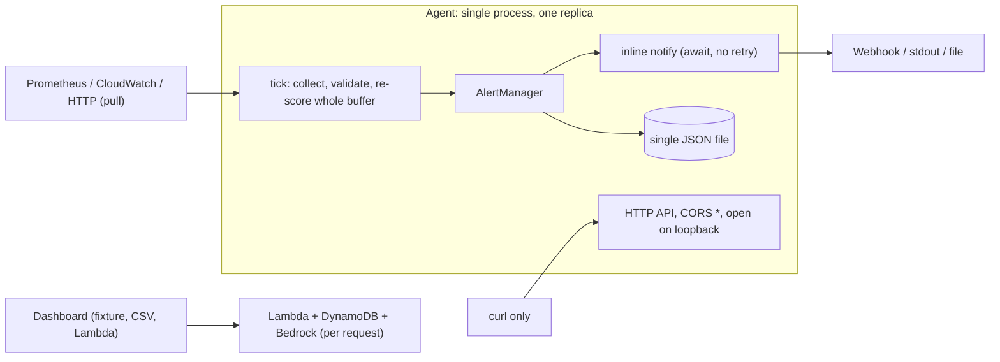

### 24.2 Recommended future architecture (production-grade)

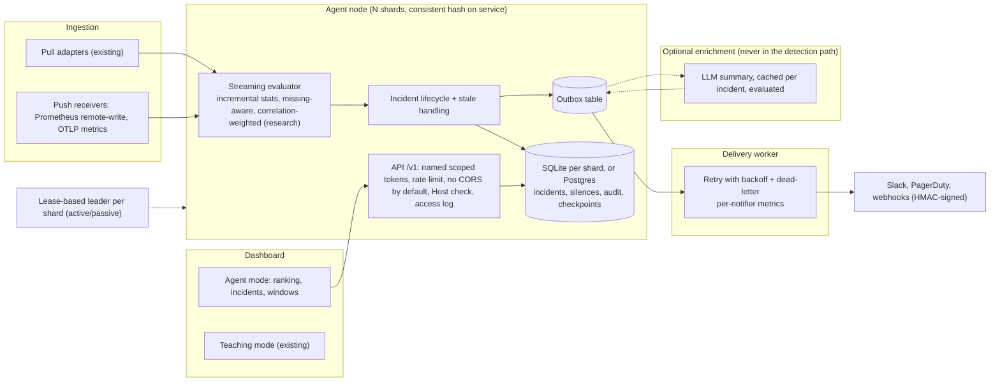

### 24.3 Differences, and why

| Area | Current | Recommended | Why |
|---|---|---|---|
| Delivery | Inline await; failure invisible | Outbox + worker + retries + dead-letter + metrics | F-02, F-14; the product's core promise |
| API defaults | CORS `*`; open on loopback | No CORS by default; token by default; JSON-only writes; `Host` validation | F-01 |
| Persistence | One JSON document | SQLite per node (built-in `node:sqlite`) or Postgres for shared state | F-08, F-15; queryable history; audit |
| Evaluation | Full recompute of the buffer per tick | Incremental statistics; same verdicts, proved by property tests | Scale (100×) |
| Service lifecycle | Never forgotten | TTL eviction + DELETE API | F-05 |
| Health | One endpoint for liveness and telemetry | `/livez`, `/readyz`, plus `/health` telemetry status | Avoid K8s restart loops |
| Scale-out | Manual config sharding | Consistent-hash shards + per-shard leader lease | HA and >50k services |
| Ingestion | Pull only | Pull + push (remote-write, OTLP) | Fit modern pipelines; avoid N sequential queries |
| UI | Not connected to the agent | Agent mode over `/v1` | Triage needs a view, not `curl` |
| AI | Per-request Bedrock in the Lambda | Cached enrichment of incidents in the agent's outbox; evaluated | Value where operators look; bounded cost |
| Types | None | JSDoc typedefs + `checkJs` | Contract drift |
| Runtime | Node 20 (EOL) | Node 22/24 LTS, digest-pinned | Security |
| Release | None | Tagged releases, signed images, changelog | Adoptability |

**What should stay exactly as it is:** the pure engine and its formula (until the backtest says otherwise), the complete-sample contract, the effective-profile validation, fail-closed exposure, UTC silences with late announce, the "AI explains, never decides" invariant, and the measure-then-reject research practice.

> **Section assessment.** Score n/a (target design) · Priority guides the roadmap in §25.

---

# Part V — Roadmap & Leadership Views

## 25. Roadmap (future implementation plan)

Effort: **S** ≤ 3 days · **M** ≤ 3 weeks · **L** ≤ 2 months · **XL** > 2 months, for one engineer familiar with the codebase. 🔎 These are audit estimates, not commitments.

### 25.1 How the phases depend on each other

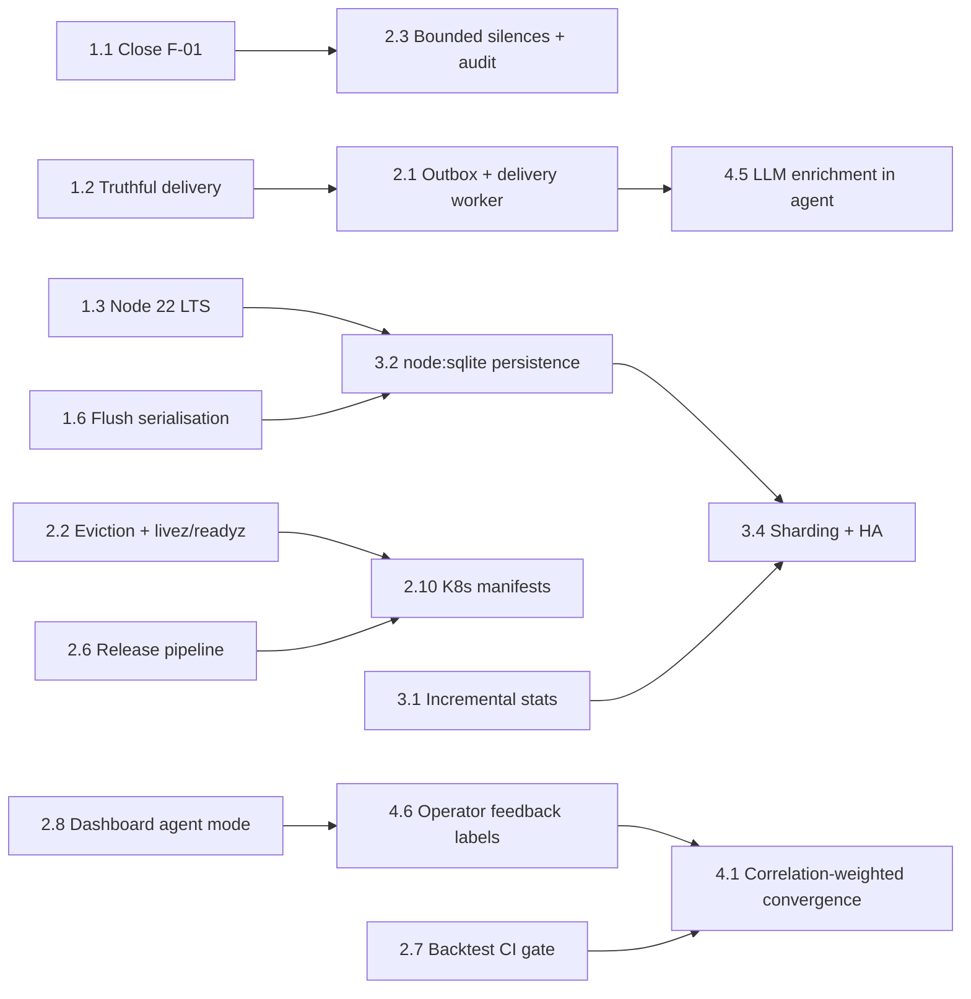

**What this shows.** The delivery and security fixes unlock everything operational. The **feedback loop (4.6)** and the **backtest gate (2.7)** unlock the only research direction the evidence supports (4.1).

### Phase 0 — Current (what exists)

A single-node, zero-dependency agent with four sources, a rolling detector, incident lifecycle, silences, per-service profiles, a token-scoped API, ranking, JSON persistence with resume, and bounded shutdown. Plus a teaching dashboard, an AWS demo backend with a guarded Bedrock summary, a synthetic benchmark, a real-data backtest, six CI jobs, and 293 tests. Detection precision on real data is 14.1%.

### Phase 1 — Immediate stabilisation (weeks 0–2)

| # | What | Why | How | Priority | Complexity | Depends on | Benefit | Risk if not done |
|---|---|---|---|---|---|---|---|---|
| 1.1 | Close the cross-origin write hole (F-01) | Any web page can mute alerting on a default agent | No CORS header by default; require `application/json` on writes; validate `Host` on loopback; generate and print a token on first run (opt-out flag) | **P0** | S | — | Removes the only realistic remote attack | Silent fleet-wide muting |
| 1.2 | Truthful delivery (F-02) | Pages are silently lost | `notify()` returns per-sink outcomes; set `notifiedAt` only if at least one paging sink succeeded; in-memory retry with backoff for `incident.opened`; `faultline_notifications_total{notifier,outcome}` | **P0** | S–M | — | Alerts are either delivered or visibly failed | Missed incidents |
| 1.3 | Node 22/24 LTS everywhere (F-07) | EOL runtime | `node:22-alpine@sha256:…`; CI matrix 22+24; `engines >=22.12` | **P0** | S | — | Security patches | Unpatched CVEs |
| 1.4 | Finish missing-≠-zero (F-04; engine coercion) | False incidents after config changes | `hydrateBuffers()` → `normalizeSample()`; the engine treats non-finite as missing, not 0 | P1 | S | — | Contract holds everywhere | Spurious pages |
| 1.5 | Strict config (F-13) | Settings silently ignored | Pass `statistic`/`zThresholdPerMetric` through `detectorParams()`; reject unknown keys | P1 | S | — | Fail-loudly promise kept | Operators misconfigure unknowingly |
| 1.6 | Safe flush (F-08, S-09) | Shutdown race; world-readable state | Promise-chained flushes; unique temp names; `fsync`; `mode: 0o600`; quarantine a corrupt file | P1 | S | — | Durable, private state | Failed shutdowns; data exposure |
| 1.7 | CloudWatch timeout (F-16) | A wedged tick blinds the agent | `requestHandler: { requestTimeout }` on the SDK client, or an `AbortSignal` | P1 | S | — | Bounded collection | Silent stall |
| 1.8 | Fix dashboard live mode (F-03) | Fabricated zero series | `LIVE_PARAMS.metrics = ['p99_latency','client_error_rate','error_rate']`; fix the copy | P2 | S | — | Honest live view | Misleading demo |
| 1.9 | Documentation drift (F-10) | AGENT.md contradicts the code | Fix; generate test counts and benchmark numbers from CI artifacts | P2 | S | — | Trustworthy docs | Wrong operator decisions |
| 1.10 | Regression tests for all of the above | Every finding was untested | Write them red first (§18.3) | **P0** | S | — | Prevent recurrence | Regressions |

### Phase 2 — Production readiness (months 1–2)

| # | What | Why | How | Priority | Complexity | Depends on | Benefit | Risk if not done |
|---|---|---|---|---|---|---|---|---|
| 2.1 | Outbox + delivery worker | Decouple delivery from detection (F-14) | Persisted outbox (`pending → sent → failed`), backoff with jitter, dead-letter, HMAC-signed webhooks, per-severity routing | **P0** | M | 1.2 | Reliable paging under storms | Detection stalls when it matters most |
| 2.2 | Service lifecycle + probe split | F-05; K8s restart loops | TTL eviction; `DELETE /api/services/:name`; `/livez` (process), `/readyz` (collecting), `/health` (telemetry status) | P1 | S–M | — | Correct orchestration semantics | Permanent 503; restart loops |
| 2.3 | Bounded, attributable silences | S-04 | Required `until` with a max duration; no bare `*` without `force`; `createdBy` from a named token; access log for writes | P1 | M | 1.1 | Abuse resistance; audit | Undetectable muting |
| 2.4 | API protection | S-06 | Per-client token bucket; cache `snapshot()` once per tick | P2 | S | — | Predictable CPU | Self-inflicted DoS |
| 2.5 | Observability polish | F-06 | Grouped exposition; TYPE on every family; true counters; tick, source, and flush histograms; ship `deploy/prometheus/alerts.yml` | P2 | S | 1.2 | Real meta-monitoring | Silent agent failure |
| 2.6 | Release engineering | Nothing is versioned | Tag-triggered workflow: changelog, GHCR image (signed, SBOM), SHA-pinned actions, Dependabot, image scan | P1 | M | 1.3 | Adoptable, auditable releases | "Clone main" is the only install path |
| 2.7 | CI quality gates | Detection regressions can merge | Assert benchmark and backtest bounds; coverage report; Node matrix | P1 | S | — | Protects the core claim | Silent precision loss |
| 2.8 | Dashboard "Agent mode" | Triage has no UI | Read `/api/ranking`, `/api/incidents`, `/api/windows` with a read token; keep teaching mode | P1 | M | 1.1 | The primary use case gets an interface | Adoption friction |
| 2.9 | Type contracts | Contract drift | JSDoc typedefs + `// @ts-check` for `Sample`, `Window`, `Evaluation`, `Incident`, `Hypothesis` | P2 | M | — | Catches F-03-class bugs | Recurrence |
| 2.10 | K8s manifests / Helm | Documented but absent | Deployment + PVC + Secret + ServiceMonitor | P2 | M | 2.2, 2.6 | Standard deployment | DIY deployments get probes wrong |
| 2.11 | Secret indirection everywhere | F-12 | `headersEnv`; reject literal `Authorization` headers | P2 | S | — | No secrets in git | Credential leaks |
| 2.12 | Stale incidents | F-11 | After the grace period, emit `incident.stale`; optionally auto-resolve as `unknown` | P2 | S | 2.1 | Honest lifecycle | Zombie incidents |

### Phase 3 — Scale

| # | What | Why | How | Priority | Complexity | Depends on | Benefit | Risk if not done |
|---|---|---|---|---|---|---|---|---|
| 3.1 | Incremental statistics | O(S·H·M) per tick | Streaming engine API with ring-buffer sums (or Welford); property-test equivalence with `runDetection` | P2 | M | — | ~40× less CPU per tick | CPU at very large fleets |
| 3.2 | Embedded DB persistence | F-15 ceiling; queries; audit | `node:sqlite` (built in, keeps zero deps); tables for incidents, silences, outbox, audit, checkpoints | P2 | M–L | 1.3, 1.6 | No ceiling; queryable history | Hard failure beyond ~53k services |
| 3.3 | Parallel and push ingestion | Sequential PromQL; pull limits | Parallel per-metric queries with partial results; Prometheus remote-write receiver and OTLP metrics endpoint | P2 | L | — | Fits modern pipelines | Collection latency |
| 3.4 | Sharding + HA | Single point of failure | Consistent hashing on service; a lease per shard (K8s Lease or DB row); an aggregated ranking endpoint | P2 | L | 3.2 | Survives node loss; >100k services | Blind monitoring during agent outages |
| 3.5 | Cardinality controls | `/metrics` size | Per-service series opt-in; top-N risk export | P3 | S | — | Cheap scrapes | Prometheus load |

### Phase 4 — Product expansion

| # | What | Why | How | Priority | Complexity | Depends on | Benefit | Risk if not done |
|---|---|---|---|---|---|---|---|---|
| 4.1 | Correlation-weighted convergence (research) | The only roadmap item that changes the *signal* (`BACKTEST.md`) | Learn a per-service channel correlation matrix on healthy data; weight or discount co-moving channels (for example Mahalanobis over qualified channels). **Ship only if it moves the curve per machine at matched alert volume** | P1 (strategic) | L | 2.7 | Possible precision gain | The product stays at ~14% precision |
| 4.2 | Deploy-event ingestion | Deploys are a major false-positive class | `POST /api/events {service, type: deploy}` → auto-annotate, optionally auto-silence or rebaseline for N windows | P1 | M | 2.3 | Directly targets the top FP source | Deploy noise persists |
| 4.3 | Seasonality awareness | Daily and weekly cycles look like drift | Same-time-last-week baseline blend; benchmark with seasonal datasets | P2 | L | 3.1 | Fewer periodic FPs | Noisy on cyclical services |
| 4.4 | Native integrations | Webhook-only today | PagerDuty Events v2, Opsgenie, Slack Block Kit; routing by service or severity | P2 | M | 2.1 | Fits real on-call stacks | Glue code per team |
| 4.5 | LLM enrichment in the agent | AI value where operators look | Worker consumes outbox events; reuse `buildPrompt`/`isValidHypothesis`; cache per incident; offline eval set | P3 | M | 2.1 | Readable incident summaries | None (optional) |
| 4.6 | Operator feedback labels | No way to measure real precision in the field | `POST /api/incidents/:id/label {useful\|noise\|deploy\|batch}`; precision@k dashboards; export for backtests | P1 | M | 2.8 | Ground truth for tuning and research | Flying blind on value |

### Phase 5 — Advanced / long-term

| # | What | Why | How | Priority | Complexity | Depends on | Benefit | Risk if not done |
|---|---|---|---|---|---|---|---|---|
| 5.1 | Trace-derived dependency graph | Cross-service causality is explicitly out of scope today | OTel trace ingestion → service graph → temporal ordering of per-service detections | P3 | XL | 3.3 | Real cascade attribution | Stays per-service |
| 5.2 | Feedback-driven auto-tuning | Manual tuning burden | Suggest per-service `minSustain`/`sigmaFloorAbs` from labels, with a per-service worst-case guard (the lesson of the learned-threshold rejection) | P3 | L | 4.6 | Lower toil | Tuning stays manual |
| 5.3 | Learned ranker behind the deterministic detector | Better ordering of the triage list | A model reorders already-qualified services only (never triggers or suppresses) | P4 | XL | 4.6 | Better precision@k | — |
| 5.4 | Hosted / multi-tenant offering | Commercial path | Tenant isolation, SSO, billing | P4 | XL | Phases 2–3 | Revenue | — |

> **Section assessment.** Score n/a · The roadmap is **evidence-gated**: Phase 4.1 ships only if the backtest improves per machine at matched alert volume, which is the repository's own standard.

---

## 26. Business & management view

| Topic | Assessment |
|---|---|
| **Problem** | Teams find out about failing services too late (SLO alerts) or drown in noise (per-metric alerts) |
| **Solution** | A small self-hosted program that notices when several of a service's health numbers go bad together, pages once, and ranks services by risk |
| **Target user** | On-call engineers and platform teams at small-to-mid organisations running Prometheus or CloudWatch without an AIOps product (🔎) |
| **Value proposition** | "Where do I look first?" with explainable evidence; free, private (no data leaves your network), and tiny |
| **Differentiation** | Radical transparency (every number reproducible, published negative results); zero dependencies; safe-by-default posture. 🔎 Commercial observability platforms offer anomaly detection built into products teams already pay for, which is FAULTLINE's main competitive pressure |
| **Product risks** | Real-world precision (14%) may be too low even for triage; no validated users; overlap with features teams already own |
| **Technical risks** | Lost pages (F-02), forgeable local API (F-01), EOL runtime (F-07), single point of failure, scale ceiling (~53k services) |
| **Operational risks** | Single maintainer; no releases; no support channel beyond GitHub; docs drifting from code |
| **Cost drivers** | Self-hosted agent: negligible compute. Demo stack: Bedrock per page view (unbounded without auth), API Gateway, Lambda, DynamoDB (tiny). Engineering time is the real cost |
| **Scalability** | Fine to ~1k services; needs rework beyond ~10k; hard limit ~53k |
| **Competitive moat** | 🔎 **Weak.** The algorithm is simple and public. The defensible assets are the evaluation harness, the trust earned by honest reporting, and the operational care (contract, fail-closed, restart semantics) |
| **KPIs to adopt** | Field precision (from operator labels, 4.6); precision@3 of the ranking during real incidents; median time from first qualified signal to operator acknowledgement; alert delivery success rate (target ≥ 99.9%); lead time versus the team's existing SLO alert; alerts per service per week; worst-case per-service F1 on the backtest (not just the aggregate); adoption (installs, stars, active agents; ❓ currently unmeasured) |
| **Success criteria (next 6 months, suggested)** | Zero known P0 defects; tagged releases with images; ≥ 3 external teams running it for ≥ 30 days; field precision@3 ≥ 50% during labelled incidents; a published result on correlation weighting (positive or negative) |

---

## 27. CEO view

**What are we building?** A free, self-hosted early-warning and triage tool for software services. It watches each service's key health numbers and flags services where several of them worsen together.

**Why does it matter?** Outages cost money and trust. Today's alerts are either late (users already affected) or noisy (engineers ignore them). An earlier, explainable "look here first" signal shortens incidents.

**Who needs it?** Engineering teams running their own services, especially those without expensive monitoring suites.

**What has been built?** A working monitoring program (tested with 293 automated tests), a visual demo, an AWS-hosted demo with an optional AI-written summary, and an honest evaluation on real production data.

**What makes it valuable?** Transparency and safety. Every alert can be explained with simple math, it runs privately, and the project publishes its own weaknesses.

**Biggest risks?**
1. **Accuracy.** On real data, roughly 6 of 7 alerts are not incidents operators cared about. Useful for ranking, not for waking people up.
2. **Two serious bugs found in this review.** Alerts can fail silently, and a malicious website can mute alerts on a developer's machine. Both are fixable in days.
3. **No users yet**, and a single maintainer.

**What would prevent scaling?** Technically: single-machine design and whole-file storage (fine to ~1,000 services, breaks near ~50,000). Commercially: no differentiation strong enough against features customers already pay for, unless accuracy improves or the transparency angle wins users.

**What resources are needed?** 🔎 One engineer for about 2 months to reach production-ready (Phases 1–2); then a user pilot with 3–5 teams; research time for the accuracy question (Phase 4.1), which may or may not pay off.

**What should leadership care about?** Whether real teams find the ranking useful. That is the one unknown that decides everything else. Fund the pilot and the feedback loop (4.6) before funding scale.

---

## 28. CTO view

**Architecture.** A pure detection library shared by three runtimes; a zero-dependency Node daemon (composition root, pluggable sources and notifiers, state machine, atomic JSON store, token-scoped API); a teaching SPA; a legacy serverless demo. Clean, acyclic, small (~9.5k source lines, 4.3k test lines).

**Stack.** Node (EOL 20 in the image; 22 in the Lambda), plain ESM JavaScript, npm workspaces, `node:test`, React 18/Vite 8/Recharts/Tailwind 3, AWS SAM (API Gateway, Lambda arm64, DynamoDB, Bedrock, CloudWatch), Docker, GitHub Actions.

**Technical maturity.** Engineering practice is strong (tests, CI security assertions, reproducible artifacts, measured claims). Operational maturity is beta (no releases, HA, or delivery guarantees). Detection maturity is research-grade (real precision 14%).

**Major architectural decisions.** A shared pure engine (keep); z-score convergence (keep; research the signal); rolling baseline (add an incident freeze); zero dependencies (keep; use Node built-ins such as `node:sqlite`); a JSON store (replace before ~10k services); a single replica (add a lease-based HA pair before paging use); an open loopback API (change now).

**Scalability.** CPU is not the constraint (242 ms per tick at 10k services). Persistence is (0.9 s blocking flushes at 10k; hard failure at ~53k), followed by inline delivery under correlated storms.

**Security.** Good fail-closed instincts; one high-severity default (F-01); an EOL runtime; unbounded silences; no rate limiting; the Lambda's Bedrock cost is exposed if deployed with `none` auth.

**Reliability.** Excellent degradation semantics, undermined by invisible delivery failure (F-02) and no HA.

**Technical debt.** 6/10, concentrated in delivery, persistence, and defaults; low code rot.

**Infrastructure and cost.** Negligible for the agent. The demo's cost is dominated by uncached Bedrock calls.

**Major risks.** Lost pages; muted alerting; the precision ceiling; bus factor of one.

**Recommended next steps.** Phase 1 (two weeks) → the outbox and release pipeline → a dashboard agent mode → a user pilot with feedback labels → correlation-weighting research behind the backtest gate.

### 28.1 If I were CTO

**What I would keep:**
- The pure, shared engine and its hand-derivable formula.
- The complete-sample contract and the telemetry-aware `/health`.
- Effective-profile validation and fail-closed startup.
- UTC silences with late announce; one incident per cascade.
- Zero runtime dependencies.
- The measure-then-reject research culture, per-machine reporting, and matched-volume comparisons.
- "AI explains, never decides."

**What I would change immediately:** F-01 (defaults), F-02 (truthful delivery), F-07 (runtime), F-04 and F-13 (contract and config), F-08 (flush), F-16 (timeout), and docs drift, each with a regression test.

**What I would change eventually:** the outbox architecture; `node:sqlite` persistence; incremental statistics; sharding with leases; an agent-backed dashboard; JSDoc types; tagged releases with signed images; the feedback-label API.

**What I would NOT build:**
- A general ML platform or deep-learning detector. The evidence says the signal, not the estimator, is the limit.
- Cross-service "root cause" claims without traces.
- A multi-tenant SaaS before users validate the single-tenant tool.
- A state-management framework for a dashboard this small.
- More statistical tweaks of the existing signal (MAD, change-point, learned thresholds have already been measured as neutral or negative).
- An always-on LLM in the detection path.

**My top 10 recommendations, in priority order:**
1. Close F-01: no CORS by default, JSON-only writes, `Host` validation, token by default.
2. Make delivery truthful (F-02), then move it to an outbox with retries (F-14).
3. Upgrade to Node 22/24 LTS across the image, CI, and `engines`.
4. Enforce missing-≠-zero everywhere (hydrate, engine) and fix dashboard live mode.
5. Make config strict (F-13) and serialise flushes (F-08).
6. Add eviction and split `/livez`, `/readyz`, and `/health`.
7. Ship a release pipeline (tags, signed images, changelog, SHA-pinned actions, Dependabot) and CI quality gates on the benchmark and backtest.
8. Build a dashboard agent mode around `/api/ranking`: the primary use case needs a screen.
9. Add operator feedback labels and measure field precision@k with 3–5 pilot teams.
10. Research correlation-weighted convergence and deploy-event annotation, shipping only on per-machine, matched-volume evidence.

---

# Part VI — Practitioner Guides

## 29. Developer onboarding guide

### 29.1 What the project does (for you, on day one)

A Node daemon (`packages/agent`) polls metrics, runs a pure statistics engine (`packages/core`) per service, and turns sustained multi-metric drift into incidents it sends to webhooks. It also serves a small HTTP API. Everything else (the dashboard, the Lambda, the benchmark) orbits that loop.

### 29.2 Prerequisites

| Tool | Needed for | Version |
|---|---|---|
| Node.js + npm | Everything | `engines` says `^20.19.0 \|\| >=22.12.0`; **use 22 LTS or newer** (20 is EOL) |
| git | Clone | any |
| Docker (optional) | Container path | any recent |
| Python + `pip install cfn-lint` (optional) | `npm run lint:iac` | — |
| AWS CLI + SAM CLI (optional) | Lambda deployment | — |
| PowerShell (optional) | `scripts/deploy.ps1` (Amplify) | 5.1+ |

### 29.3 Install

```bash
git clone https://github.com/Harshith029/faultline.git
```

```bash
cd faultline
```

```bash
npm install
```

The root install covers core, agent, benchmark, and dashboard (workspaces). The Lambda and scripts have their own lockfiles:

```bash
npm --prefix backend/lambda/timelineHandler ci
```

```bash
npm --prefix scripts ci
```

### 29.4 Environment setup

None is needed for the demo. For a real source, set secrets in the environment, never in config:

```bash
export FAULTLINE_API_TOKEN=$(openssl rand -hex 32)
```

```bash
export FAULTLINE_WEBHOOK_URL=https://hooks.slack.com/services/XXX/YYY/ZZZ
```

Dashboard (optional): copy `frontend/dashboard/.env.example` to `.env.local` and set `VITE_API_URL` to a deployed Lambda stage.

### 29.5 Run locally

```bash
npm run agent:demo
```

About 15 seconds in, `checkout-api` starts a synthetic cascade and you will see `incident.opened`. In another terminal:

```bash
curl localhost:8787/api/ranking
```

```bash
curl localhost:8787/health
```

```bash
curl -X POST "localhost:8787/api/inject?service=payments"
```

One-shot mode prints one tick's snapshot and exits:

```bash
node packages/agent/bin/faultline.js once --config packages/agent/faultline.demo.json
```

The dashboard runs at http://localhost:5173:

```bash
npm run dashboard
```

> **Windows PowerShell 5.1:** it has no `&&`. Run commands one per line (the README was fixed for this in commit `600ff7a`).

### 29.6 Repository structure

See [§7](#7-repository--codebase-architecture). The short version: `packages/core` is the math, `packages/agent/src` is the product, and everything else is support.

### 29.7 The first request to understand

Read these in order and you will understand 80% of the system:

1. `packages/agent/src/agent.js` → `tick()` (the loop)
2. `packages/agent/src/detector.js` → `normalizeSample()`, `ingest()` (the contract, the buffer, evaluation)
3. `packages/core/detectionEngine.js` → `computeBaseline()`, `runDetection()` (the math)
4. `packages/agent/src/alerts.js` → `evaluate()` (the state machine)
5. `packages/agent/src/agent.js` → `maybeNotify()`, `stop()` (delivery, shutdown)
6. `packages/agent/src/server.js` + `auth.js` (the API)

### 29.8 Important files and services

See the file map in [§32](#32-file-by-file-implementation-map). The services at runtime are the agent process (port 8787), optionally a Prometheus to scrape, and optionally a webhook receiver. For tests, the suites spin up throwaway HTTP servers on ephemeral ports.

### 29.9 Database setup

None. The agent writes `./data/faultline-state.json` (or `FAULTLINE_STORAGE_PATH`). **To reset state, stop the agent and delete that file.** DynamoDB exists only for the Lambda demo: `sam deploy --guided`, then `node scripts/generateDataset.mjs` → upload `dataset/faultline_windows.json` to S3 → `DATASET_BUCKET=… node scripts/seed.js` → `node scripts/verify.js`.

### 29.10 Tests

| Command | Runs |
|---|---|
| `npm test` | core (34), agent (186), benchmark (29), dashboard (21) |
| `npm --prefix backend/lambda/timelineHandler test` | Lambda (23) |
| `npm run verify:engine` | Reference cascade assertions |
| `npm run benchmark` | Synthetic precision/recall (add `-- --seeds=10` to go faster) |
| `npm run fetch:dataset` then `npm run backtest` | Real-data backtest (~3.5 min for 4 machines) |
| `npm run lint` | ESLint |
| `npm run audit:all` | All four dependency trees |

A single agent test file: `node --test packages/agent/test/alerts.test.mjs`.

### 29.11 Debugging

- `--pretty --log-level debug` gives human-readable logs, including `agent.tick` and `source.cloudwatch_collected`.
- `GET /api/state` shows every service's status, profile, `missingMetrics`, and `windowsRequired`.
- `GET /api/windows?service=X` shows the full engine output (z per window, qualified signals, baselines, params). This is the fastest way to answer "why did or didn't it fire?".
- `node --inspect packages/agent/bin/faultline.js start --config …` attaches a debugger.
- Reproduce detection offline: paste the series into the dashboard's CSV panel, or call `runDetection()` in a Node REPL.

### 29.12 Common errors

| Symptom | Cause | Fix |
|---|---|---|
| `Refusing to start: the API would bind to 0.0.0.0 with no authentication token` | Non-loopback bind without `FAULTLINE_API_TOKEN` | Set the token, or bind `127.0.0.1` |
| `Invalid FAULTLINE configuration:` + list | Validation | Fix every listed item |
| `Cannot read config file at …` / `is not valid JSON` | Path or JSON syntax | — |
| `cloudwatch source requires "targets"` / `cannot supply configured metrics` | CloudWatch config | Add targets; align `detector.metrics` (CloudWatch emits `client_error_rate`, not `retry_rate`) |
| `The cloudwatch source needs the AWS SDK` | Optional SDK not installed | `npm install @aws-sdk/client-cloudwatch` |
| `EADDRINUSE` | Port taken (often a previous demo) | Kill it, or use `--port` |
| Services stuck in `warming_up` | Fewer than `baselineWindows + minSustain` complete samples | Check for `sample.incomplete` logs; label consistency |
| `/health` 503 `service_telemetry_stale` for a removed service | F-05 | Delete the state file while the agent is stopped |
| `No SMD data found` | Dataset not fetched | `npm run fetch:dataset` |
| `docker compose up` fails with "set FAULTLINE_API_TOKEN" | Compose requires a token by design | Export one first |
| Setting `detector.statistic` has no effect | F-13 | Put it inside a `services[]` rule (for example `{"match":"*", "statistic":"median_mad"}`) |

### 29.13 How to add a feature

**A new telemetry source** (the most common extension):
1. Create `packages/agent/src/sources/<name>.js` exporting `create<Name>Source(options, ctx)`, returning `{ name, collect(), state() }` and optionally `inject`/`close`.
2. `collect()` returns `[{ service, timestamp, <metric>: number }]`. **Leave missing metrics absent. Never write `0` for "unknown".**
3. Register it in `sources/index.js` `FACTORIES` **and** in `config.js` `KNOWN_SOURCES` (two registries; easy to miss one).
4. Validate at construction and throw on configurations that could never supply `detector.metrics` (copy the CloudWatch pattern).
5. Tests: add to `sources.test.mjs` and a missing-data case to `noData.test.mjs`.
6. Document it in the README configuration section and `docs/AGENT.md`.

**A new notifier:** add to `BUILDERS` in `notifiers/index.js` and `KNOWN_NOTIFIERS` in `config.js`, with validation for required fields. Once the outbox exists (roadmap 2.1), `send()` must throw on failure so the outcome is recorded truthfully.

**A new API route:** add a branch in `server.js`. If it changes state, add it to `WRITE_ROUTES` (otherwise a read token can call it). Add tests in `server.test.mjs` and, for writes, `security.test.mjs`.

**A new detector parameter:** `DEFAULT_CONFIG.detector` → `NUMERIC_RULES` → `detectorParams()` → (if per-service) `OVERRIDABLE` + `validateEffectiveProfile()` → the engine. Missing the `detectorParams()` step is exactly how F-13 happened.

### 29.14 How to modify detection behaviour

Follow `CONTRIBUTING.md` and the PR template: include `npm run benchmark` **and** `npm run backtest` numbers before and after, compared at **matched alert volume**, reported **per machine**. Keep `scripts/verifyEngine.mjs` passing (trigger at W8, outage at W12), or update it consciously together with the scripted dashboard narratives, which assume those windows.

### 29.15 How to deploy

- **Container:** `FAULTLINE_API_TOKEN=… docker compose up -d` (mount a real config at `/app/agent/faultline.config.json` and change the `command`).
- **VM:** the systemd unit from `docs/AGENT.md`. **Add** `Environment=FAULTLINE_API_TOKEN=…` even on loopback (F-01).
- **Lambda demo:** `sam deploy --guided --template backend/lambda/timelineHandler/template.yaml`.
- **Dashboard:** `npm run build` (then any static host), or `scripts/deploy.ps1` for Amplify.

### 29.16 What NOT to change casually

| Do not casually change | Because |
|---|---|
| The engine formula or the defaults (`zThreshold`, `minSustain`, `minSignals`, `triggerThreshold`) | Every published number, the benchmark, the backtest, and `verifyEngine` depend on them |
| The complete-sample contract (`normalizeSample`) | It is the defence against silent muting |
| `assertSafeExposure`, `authorize`, constant-time compare | Security invariants, asserted in CI |
| `notifiedAt` / late-announce / cooldown semantics | They prevent double pages and lost pages across silences and restarts |
| `Store` temp + rename | Crash safety |
| UTC-only silences | DST correctness |
| Provenance fields (`generated_by`, `scope`) and `SampleDataNotice` | They stop sample text from being presented as AI output |
| `RAW_TELEMETRY` | The scripted dashboard narratives are keyed to its window numbers |

---

## 30. "Build it from scratch" guide

This assumes the repository is gone and a competent engineer must rebuild an equivalent system. The order minimises rework: prove the math, then wrap it operationally, then secure it, then add surfaces.

| Step | What to build | Why | How | Depends on | Expected result | Verify by |
|---|---|---|---|---|---|---|
| 1 | **Requirements** | Fix scope | Adopt FR-01…FR-28 and the NFRs (§3); write the invariants: missing ≠ zero; AI never decides; fail closed; one incident per cascade | — | A one-page spec | Review |
| 2 | **Architecture** | Avoid rework | Pure engine library + daemon with source/notifier registries + incident state machine + persistence + API; optional UI | 1 | A module list (§7) | Review |
| 3 | **Project init** | Tooling | npm workspaces `packages/core`, `packages/agent`, `packages/benchmark`; ESM; ESLint flat config; `node:test`; Node 22 LTS | 2 | `npm test` runs (empty) | CI green |
| 4 | **Engine** | The core claim | `computeBaseline` (mean/σ with floors; optional median/MAD), `zScore`, run-length qualification, `riskScore = mean(z)·ln(1+n)·W`, the trigger rule; missing-aware from day one | 3 | `runDetection(windows, params)` | Unit tests; reproduce the reference cascade (trigger at W8 on `RAW_TELEMETRY`); property tests |
| 5 | **Benchmark first** | Evidence before features | Scenario generator (5 cascades, 7 non-incidents), baseline detectors, precision/recall/F1/delay | 4 | A benchmark table | Stable numbers across seeds |
| 6 | **Real-data backtest** | Avoid self-deception | SMD loader, 5-minute aggregation, causal replay (120-window history), segment-wise scoring, per-machine reports | 4 | ~14% precision / ~80% recall at defaults | Matches the published numbers |
| 7 | **Agent core** | The product | Config loader (defaults → file → overrides → env → validate all errors at once); `WindowBuffer`; `RollingDetector` with the complete-sample contract and freshness; `AlertManager`; a tick loop with an overlap guard | 4 | `faultline once` prints a snapshot | Unit + e2e with the synthetic source |
| 8 | **Sources** | Integrations | Synthetic (seeded), Prometheus (instant queries grouped by label), HTTP (mapping), CloudWatch (lazy SDK, **with a timeout**) | 7 | Samples from each | Fake servers in tests; a NaN or missing value stays missing |
| 9 | **Delivery** | Paging | **An outbox from the start**: persisted pending events, an async worker, backoff, dead-letter; stdout, webhook (Slack `text`, HMAC), and file sinks; silences with UTC windows and late announce | 7 | One page per cascade, reliably | Dead-webhook test leaves `pending` and retries; storm test does not stall ticks |
| 10 | **Persistence** | Restarts | `node:sqlite` (or atomic JSON with serialised flushes for v1): incidents, silences, outbox, checkpoints of buffers + alert state; restore if fresh; **revalidate on restore** | 7, 9 | Resume without a double page | Restart tests |
| 11 | **API** | Integration | `/v1/health` (+ `/livez`, `/readyz`), `/v1/ranking`, `/v1/state`, `/v1/incidents`, `/v1/windows`, `/v1/silences` (bounded), `/v1/metrics` (grouped exposition); OpenAPI spec | 7 | curl-able API | Contract tests |
| 12 | **Auth** | The API can mute paging | Named scoped tokens from env; constant-time compare; token by default (even on loopback); no CORS by default; JSON-only writes; `Host` validation; refuse non-loopback without a token; optional TLS failing closed; access log | 11 | Secure defaults | Security tests incl. cross-origin `text/plain` POST → rejected |
| 13 | **Frontend** | Triage view + teaching | React + Vite: an Agent mode (ranking, incidents, windows) and a Teaching mode (engine replay, CSV, counterfactual clearly labelled illustrative) | 11 | UI over the agent | Component tests; live-shape contract tests |
| 14 | **AI (optional)** | Readable summaries | Enrichment worker on outbox events: a single-service prompt, strict JSON schema, grounding checks against qualified signals, fallback generated from signals, cache per incident, offline eval set | 9 | Summaries attached to incidents | Eval: faithfulness rate; validator rejection metrics |
| 15 | **Testing** | Confidence | Unit, integration, e2e, restart, shutdown, security, storm, property, and a backtest gate in CI | all | Green CI with gates | Coverage report |
| 16 | **Security** | Hardening | Threat model (§13), dependency audit across trees, pinned actions and images, SBOM | 12 | No known P0/P1 | Audit job |
| 17 | **Deployment** | Distribution | Dockerfile (non-root, digest-pinned LTS base, `.dockerignore`), compose (loopback + token), Helm chart, tagged releases to GHCR | 15 | `docker run ghcr.io/…:1.0.0` | CI docker job asserts the refusal and the 401 |
| 18 | **Monitoring** | Meta-monitoring | Delivery, tick, source, and flush metrics; shipped Prometheus alert rules; structured logs with request IDs | 11 | "Was the page sent?" is answerable | Alert-rule unit tests (promtool) |

**The engine in pseudocode**, to rebuild step 4 faithfully:

```js
function runDetection(windows, p) {
  const out = windows.map(() => ({ qualified: [] }))
  for (const m of p.metrics) {
    const xs = windows.map(w => w[m])                  // missing stays NaN: never coerce to 0
    const base = xs.slice(0, p.baselineWindows)
    const mu = mean(base)
    const sd = Math.max(stdev(base, mu), Math.abs(mu) * p.sigmaFloorRatio, p.sigmaFloorAbs?.[m] ?? 0, 1e-9)
    let run = 0
    xs.forEach((x, i) => {
      const z = (x - mu) / sd
      run = z >= (p.zThresholdPerMetric?.[m] ?? p.zThreshold) ? run + 1 : 0
      if (run >= p.minSustain) out[i].qualified.push({ metric: m, z })
    })
  }
  return out.map(o => {
    const n = o.qualified.length
    const R = n ? mean(o.qualified.map(q => q.z)) * Math.log(1 + n) * p.criticalityWeight : 0
    return { ...o, R, triggered: n >= p.minSignals && R >= p.triggerThreshold }
  })
}
```

> **Section assessment.** This guide rebuilds the system *with* the audit's fixes designed in (outbox, token-by-default, revalidated restore, timeouts). Rebuilding the current code verbatim would reproduce F-01, F-02, and F-14.

---

## 31. End-to-end example

**Journey:** the demo agent detects a cascade on `checkout-api`, pages, and resolves it. Everything below comes from `faultline.demo.json`, `sources/synthetic.js`, and the recorded demo state file (`data/faultline-demo-state.json`: `triggerR: 4.12`, `triggerSignalCount: 2`, `peakR: 8.6`, `peakSignalCount: 3`).

### 31.1 Startup

```mermaid
sequenceDiagram
    autonumber
    participant CLI as bin/faultline.js
    participant CFG as loadConfig()
    participant AG as FaultlineAgent
    participant ST as Store
    participant SRV as HTTP server
    CLI->>CFG: path = faultline.demo.json, overrides from argv
    CFG->>CFG: deepMerge(defaults, file, overrides), applyEnvOverrides, validateConfig
    CFG-->>CLI: config (interval 1 s, baselineWindows 8, history 60)
    CLI->>AG: new FaultlineAgent(config): source, detector, alerts, notifiers, silences, store
    CLI->>AG: start()
    AG->>ST: load() then silences.hydrate() then syncSilences()
    AG->>AG: restoreDetectionState(): restored if savedAt is under 900 s old
    AG->>AG: assertSafeExposure(): 127.0.0.1 with no token is allowed
    AG->>SRV: listen(8787, 127.0.0.1)
    AG->>AG: warn server.unauthenticated
    AG->>AG: await first tick (raced against stop)
    AG->>AG: setInterval(tick, 1000), unref
```

### 31.2 The cascade

| Phase | Ticks (approx.) | What happens | Where |
|---|---|---|---|
| Warm-up | 1–9 | Each tick `collect()` returns 3 samples (checkout-api, payments, inventory). All complete → buffered. `status: warming_up` until `baselineWindows + minSustain = 10` samples | `synthetic.js` `collect()`; `detector.js` `ingest()` |
| Steady | 10–12 | Evaluated; z-scores near 0; `R = 0`; `/api/ranking` lists three services with `R_score: 0` | `runDetection()` |
| Onset | from tick 12 | `intensity()` ramps 0 → 1 over 8 windows. Latency climbs first (delay 0), retries after 2 windows, errors after 4 | `synthetic.js` `DEFAULT_RAMP` |
| Qualification | a few ticks later | Latency sustains z ≥ 2 for 2 windows → qualified (n = 1, no trigger: `minSignals = 2`). Retries then qualify → n = 2 | `qualifyMetric()` |
| **Trigger** | first tick with n ≥ 2 and R ≥ 3 | **R = 4.12**, 2 signals → `triggered: true` | `riskScore()` |
| Open | same tick | `AlertManager.evaluate()`: no cooldown → incident `inc_checkout-api_<base36>` opened | `alerts.js` |
| Notify | same tick | `maybeNotify('incident.opened')`: no silence → stdout notifier logs `[FAULTLINE] WARNING checkout-api — cascade detected. R=4.12 (threshold crossed) with 2 converging signal(s): p99_latency z=…, retry_rate z=…` (severity `warning`, since `peakR` < 6 at open); `notifiedAt` set | `notifiers/index.js` `formatIncidentText()` |
| Persist | ≤ 2 s later | `upsertIncident()` → debounced atomic flush to `data/faultline-demo-state.json` | `store.js` |
| Escalate | following ticks | `updated`: `lastR`, `peakR` (up to 8.6), `peakSignalCount` 3 (errors qualify), `windowsFiring++` | `alerts.js` |
| Hold, then recover | ~8 hold + 6 recover windows | Intensity decays to 0; z-scores fall below 2; `triggered: false` | `synthetic.js` |
| Resolve | 3rd consecutive clean window | `resolved`: `endedAt`, `durationMs`; resolve notification sent because the open was | `alerts.js`; `agent.js` |
| Cooldown | 20 s | A re-trigger would be `suppressed` | `alerting.cooldownSeconds: 20` |
| Snapshot | every 10 ticks, and on Ctrl-C | `detectionState` persisted; the next start resumes | `agent.js` |

### 31.3 The tick that opens the incident

```mermaid
sequenceDiagram
    autonumber
    participant T as setInterval
    participant AG as FaultlineAgent.tick()
    participant S as synthetic.collect()
    participant D as RollingDetector.ingest()
    participant E as core runDetection()
    participant AM as AlertManager
    participant SM as SilenceManager
    participant N as Notifiers
    participant ST as Store
    T->>AG: tick (not stopping, not ticking)
    AG->>S: collect()
    S-->>AG: 3 samples with timestamps
    AG->>D: ingest(samples)
    D->>D: normalizeSample() for each: complete
    D->>D: buffer.push(), lastCompleteSampleAt
    D->>E: runDetection(buffer windows for checkout-api, params)
    E-->>D: last window R 4.12, 2 qualified, triggered true
    D-->>AG: results (evaluated x3)
    AG->>AG: lastDataAtMs = now
    AG->>AM: evaluate(checkout-api, evaluation)
    AM-->>AG: opened, incident
    AG->>SM: matching(checkout-api)
    SM-->>AG: null
    AG->>N: notify(incident.opened), allSettled
    N-->>AG: results (failures only logged, see F-02)
    AG->>AG: incident.notifiedAt = now
    AG->>ST: upsertIncident(), markDirty()
    AG->>AG: every 10th tick: snapshotDetectionState()
```

### 31.4 What each surface shows during the incident

- `GET /api/ranking` → `checkout-api` at rank 1 with `firing: true`.
- `GET /api/incidents?status=firing` → the incident record.
- `GET /api/windows?service=checkout-api` → per-window z, qualification, and R for charting.
- `GET /metrics` → `faultline_service_firing{service="checkout-api"} 1`, `faultline_risk_score{…}` rising.
- `GET /health` → `ok` (telemetry is healthy even though a service is failing; health describes the *agent*, not the fleet).

---

## 32. File-by-file implementation map

| File | Responsibility | Important functions | Called by | Calls | Business purpose |
|---|---|---|---|---|---|
| `packages/core/detectionEngine.js` | Detection math | `computeBaseline`, `zScore`, `riskScore`, `confidenceFromRisk`, `runDetection`, `runBaselineDetectors`, `compareDetectors`, `applyMitigation`, `runCounterfactual`, `metricMeta` | Agent detector, dashboard, benchmark, scripts | — | The core claim: auditable convergence detection |
| `packages/core/parseTelemetry.js` | CSV → windows | `parseTelemetryCsv`, `EXAMPLE_CSV` | `BringYourOwnPanel` | — | Bring-your-own-data analysis |
| `packages/core/fixtures/rawTelemetry.js` | Reference cascade | `RAW_TELEMETRY` | Dashboard, `verifyEngine`, `generateDataset` | — | Canonical demo and regression anchor |
| `packages/core/index.js` | Public API | re-exports | All consumers | — | Library surface |
| `packages/agent/bin/faultline.js` | CLI | `parseArgs`, `buildOverrides`, `main` | User, Docker, systemd | `loadConfig`, `FaultlineAgent` | Operability |
| `packages/agent/src/agent.js` | Orchestration | `assertSafeExposure`, `FaultlineAgent.{start, tick, maybeNotify, health, snapshot, ranking, restoreDetectionState, snapshotDetectionState, syncSilences, stop}` | CLI, tests, `server.js` (as a parameter) | Every agent module | The monitoring loop |
| `packages/agent/src/config.js` | Configuration | `DEFAULT_CONFIG`, `loadConfig`, `validateConfig`, `applyEnvOverrides`, `detectorParams` | CLI, agent, tests | `serviceConfig`, `silences` | Fail-loudly setup |
| `packages/agent/src/serviceConfig.js` | Per-service profiles | `globToRegExp`, `OVERRIDABLE`, `compileServiceRules`, `matchRule`, `validateEffectiveProfile`, `validateAllProfiles`, `createParamsResolver` | Config, agent, silences | — | Heterogeneous fleets |
| `packages/agent/src/detector.js` | Rolling evaluation | `RollingDetector.{normalizeSample, ingest, freshness, dataQuality, exportBuffers, hydrateBuffers, windowsFor, detectionFor}` | Agent, benchmark | `WindowBuffer`, `runDetection` | Trustworthy per-service verdicts |
| `packages/agent/src/buffer.js` | Ring buffer | `WindowBuffer.{push, get, size, services, clear}` | Detector | — | Bounded rolling history |
| `packages/agent/src/alerts.js` | Incident lifecycle | `AlertManager.{evaluate, snapshot, exportState, hydrate}` | Agent | — | One page per cascade |
| `packages/agent/src/silences.js` | Muting | `validateSilence`, `SilenceManager.{add, remove, hydrate, prune, isActive, matching, list, persistable}` | Agent, config, server | `globToRegExp` | Maintenance without lost incidents |
| `packages/agent/src/notifiers/index.js` | Delivery | `createNotifiers`, `formatIncidentText`, stdout/webhook/file builders | Agent | `fetch`, `fs` | Paging |
| `packages/agent/src/sources/index.js` | Source registry | `createSource` | Agent | Source factories | Pluggability |
| `packages/agent/src/sources/synthetic.js` | Demo telemetry | `createSyntheticSource` (`collect`, `inject`, `clear`, `state`) | Registry | PRNG | Zero-infrastructure demo and tests |
| `packages/agent/src/sources/prometheus.js` | PromQL | `createPrometheusSource` | Registry | `fetch` | Prometheus integration |
| `packages/agent/src/sources/http.js` | Generic JSON | `createHttpSource` | Registry | `fetch` | Integrate anything |
| `packages/agent/src/sources/cloudwatch.js` | CloudWatch | `createCloudWatchSource` | Registry | AWS SDK (lazy) | AWS integration |
| `packages/agent/src/store.js` | Persistence | `Store.{load, upsertIncident, getIncidents, getIncident, stats, markDirty, flush, close}` | Agent, server | `fs/promises` | Durable history and resume |
| `packages/agent/src/server.js` | HTTP API | `createApiServer`, `renderPrometheusMetrics`, `readJson`, `json`, `text` | Agent | `auth`, agent state | Integration and control plane |
| `packages/agent/src/auth.js` | AuthN/Z | `extractToken`, `isLoopbackHost`, `createAuthenticator().authorize` | Server, agent | `crypto` | Protect the control plane |
| `packages/agent/src/logger.js` | Logging | `createLogger`, `silentLogger` | Everything | stdout | Operability |
| `packages/agent/faultline.config.example.json` | Production-shaped config | — | Humans | — | Onboarding |
| `packages/agent/faultline.demo.json` | Demo config | — | `npm run agent:demo`, CI, Docker | — | 30-second demo |
| `packages/benchmark/src/scenarios.js` | Synthetic scenarios | `generateScenario`, `generateAll`, `SCENARIOS`, `BASELINE` | Evaluate, tests | PRNG | Regression evidence |
| `packages/benchmark/src/detectors.js` | Detectors under test | `faultlineRollingDetector`, `faultlineFixedBaselineDetector`, `staticSloDetector`, `singleMetricDetector`, `sustainedSingleMetricDetector`, `DETECTORS` | Evaluate | Core, agent `RollingDetector` | Fair comparison |
| `packages/benchmark/src/evaluate.js` | Scoring | `evaluate`, `leadTimeComparison` | `bin/benchmark.js` | Detectors, scenarios | Precision/recall/lead time |
| `packages/benchmark/src/backtest.js` | Real-data replay | `smdParams`, `learnThresholds`, `rollingDetect`, `scoreDetections`, `backtestMachine`, `DETECTORS` | `bin/backtest.js` | Core, SMD loader | Honest field estimate |
| `packages/benchmark/src/datasets/smd.js` | Dataset I/O | `availableMachines`, `loadMachine`, `loadTrainMachine`, `labelSegments` | Backtest | `fs` | Data access |
| `frontend/dashboard/src/App.jsx` | Routing | `App`, `BootScreen` | `main.jsx` | `LandingPage`, lazy `FaultlineDashboard` | Entry |
| `frontend/dashboard/src/components/FaultlineDashboard.jsx` | Dashboard shell | `FaultlineDashboard` (mode, active window, fetches) | App | Core, `timelineApi`, ~15 panels | Analysis UI |
| `frontend/dashboard/src/timelineApi.js` | HTTP client | `fetchTimeline`, `fetchLiveTelemetry` | Dashboard | Lambda API | Backend access |
| `frontend/dashboard/src/lib/hypothesis.js` | Provenance | `parsePath`, `provenanceOf`, `cleanText`, `isSingleService` | `HypothesisCard`, `IncidentChatAgent` | — | Honest AI labelling |
| `frontend/dashboard/src/components/CounterfactualPanel.jsx` | What-if | `CounterfactualPanel` | Dashboard | `runCounterfactual` | Illustrate early action |
| `frontend/dashboard/src/components/BringYourOwnPanel.jsx` | CSV analysis | `BringYourOwnPanel` | Dashboard | `parseTelemetryCsv`, `runDetection` | Run on your data |
| `frontend/dashboard/src/components/{AIInsightPanel,IncidentChatAgent}.jsx` | Scripted narrative | — | Dashboard | `SampleDataNotice` | Demo storytelling (labelled) |
| `backend/lambda/timelineHandler/handler.js` | Serverless API | `createHandler`, `handler`, `queryAllWindows`, `liveTelemetry`, `explainWithBedrock`, `buildPrompt`, `isValidHypothesis` | API Gateway | DynamoDB, CloudWatch, Bedrock | Demo backend + LLM reference |
| `backend/lambda/timelineHandler/template.yaml` | IaC | — | `sam deploy` | AWS | Reproducible infrastructure |
| `backend/lambda/timelineHandler/scripts/package.mjs` | Artifact build | — | `npm run package`, CI | npm, zip | Verifiable deployable |
| `scripts/verifyEngine.mjs` | Reference assertions | — | CI | Core | Guards the headline claim |
| `scripts/fetchDataset.mjs` | SMD download | `main` | Humans, CI | GitHub raw | Backtest input |
| `scripts/generateDataset.mjs` | Fixture → DynamoDB JSON | — | Humans | Core | Demo data |
| `scripts/seed.js`, `scripts/verify.js` | Legacy seeding and check | — | Humans | S3, DynamoDB | v1 demo provisioning |
| `scripts/auditAll.mjs` | Multi-tree audit | — | CI | npm | Supply-chain policy |
| `scripts/lintTemplate.mjs` | cfn-lint wrapper | — | CI, humans | Python | IaC correctness |
| `scripts/deploy.ps1` | Amplify deploy | — | Humans | Vite, AWS CLI | Host the dashboard |
| `scripts/buildWordmark.mjs` | Brand SVGs | `wordmarkWidth` | Humans | fs | Assets |
| `Dockerfile`, `docker-compose.yml` | Container | — | CI, humans | — | Deployment |
| `.github/workflows/ci.yml` | CI | 6 jobs | GitHub | Everything | Quality and security gates |

---

## 33. Dependency graph

### 33.1 System-level dependencies

```mermaid
flowchart TB
    subgraph FE["Frontend"]
        DASHX["Dashboard SPA"]
    end
    subgraph BE["Backends"]
        AGX["Agent daemon"]
        LX["Lambda handler"]
    end
    subgraph LIB["Shared library"]
        COREX["@faultline/core"]
    end
    subgraph DATA["Data stores"]
        JSONX[("Agent JSON state")]
        DDBX[("DynamoDB")]
        FIXX[("RAW_TELEMETRY fixture")]
        DSX[("dataset/faultline_windows.json")]
    end
    subgraph AIX["AI"]
        BRX["Amazon Bedrock"]
    end
    subgraph EXTX["External"]
        PROMY["Prometheus / CloudWatch / HTTP"]
        HOOKY["Webhooks"]
        SMDX["SMD on GitHub"]
    end
    subgraph INFRA["Infrastructure"]
        DOCK["Docker / compose"]
        SAMX["SAM / CloudFormation"]
        AMPX["Amplify"]
        GHA["GitHub Actions"]
    end
    DASHX --> COREX
    DASHX --> FIXX
    DASHX -- "HTTP, untyped JSON contract" --> LX
    AGX --> COREX
    AGX --> JSONX
    AGX --> PROMY
    AGX --> HOOKY
    LX --> DDBX
    LX --> BRX
    LX --> PROMY
    DSX -- "generated from" --> FIXX
    DDBX -- "seeded from" --> DSX
    GHA --> SMDX
    DOCK --> AGX
    SAMX --> LX
    AMPX --> DASHX
```

**Circular dependencies:** none at module level (✅ verified).

**Hidden couplings** (no import edge, but a break in one silently breaks the other):

| Coupling | Between | How it breaks | Evidence |
|---|---|---|---|
| Payload shape | Lambda live path ↔ dashboard `LIVE_PARAMS` | A rename (`retry_rate` → `client_error_rate`) made the dashboard analyse a zero series | 🐞 F-03 |
| Window numbers | `RAW_TELEMETRY` ↔ scripted narratives (`AIInsightPanel` `WINDOW_INSIGHTS`, `IncidentChatAgent` answers, `ServiceArchitectureMap` "`activeWindow < 8`", `verifyEngine` W8/W12) | Changing the fixture desynchronises every narrative | Hard-coded indices |
| Fallback text | `scripts/generateDataset.mjs` `FALLBACK_HYPOTHESIS` ↔ `isValidHypothesis()` scope rule | The fallback asserts the multi-service causality the validator forbids for the model | §12.3 |
| Parameter plumbing | `DEFAULT_CONFIG.detector` ↔ `detectorParams()` ↔ `OVERRIDABLE` | A key present in one and missing in another is silently ignored | 🐞 F-13 |
| Registries | `sources/index.js` `FACTORIES` ↔ `config.js` `KNOWN_SOURCES` (same for notifiers) | A new source rejected by validation, or accepted without a factory | Duplicate lists |
| Deep import | `packages/benchmark` → `@faultline/agent/src/detector.js` | Refactoring agent internals breaks the benchmark | Not in the agent's exports |
| Numbers in docs | README, `ARCHITECTURE.md`, `AGENT.md`, `CONTRIBUTING.md` ↔ test and benchmark output | Drift | F-10 |

> **Section assessment.** Score **7/10** · Priority **P2**. Clean import graph; the fragility is in untyped cross-component contracts. Next step: JSDoc typedefs shared from `@faultline/core` plus a contract test in the dashboard fed with a recorded Lambda payload.

---

## 34. Data flow

### 34.1 Data lifecycle

```mermaid
flowchart LR
    A["Metrics backend<br/>(Prometheus, CloudWatch, HTTP)"] -- "pull each interval" --> B["Raw sample<br/>service, timestamp, metrics"]
    B -- "normalizeSample()" --> C{"complete?"}
    C -- "no" --> X["Rejected: counted, logged, never stored"]
    C -- "yes" --> D["Ring buffer<br/>last historyWindows samples"]
    D -- "runDetection()" --> E["Evaluation<br/>z, qualified signals, R, triggered"]
    E -- "latest per service" --> F["In-memory latest map<br/>served by /api/state, /api/ranking, /metrics"]
    E -- "AlertManager" --> G["Incident record"]
    G --> H["Notification event<br/>text + incident JSON"]
    H --> I["Webhook / stdout / JSONL file"]
    G --> J[("State file: incidents, newest 200")]
    D -- "every 10 ticks and at shutdown" --> K[("State file: detectionState")]
    K -- "restart, if under 15 min old" --> D
    D -- "oldest sample evicted" --> Z1["Discarded"]
    J -- "beyond maxIncidents" --> Z2["Discarded"]
```

**What this shows.** Telemetry **enters** only through sources and **leaves** only through notifiers (incident summaries), the API, and the state file. Raw values are retained only inside the bounded rolling buffer; no long-term telemetry storage exists. The rejection branch never touches storage, which is the contract.

### 34.2 Per-entity flow

| Entity | Origin | Transformation | Storage | Retrieval | Processing | Output | Sensitivity |
|---|---|---|---|---|---|---|---|
| **Telemetry sample** | Source adapter | Field mapping (HTTP), scaling ×100 (CloudWatch rates), NaN → absent | Ring buffer (memory); snapshot in the state file | `/api/windows` (`raw`) | Engine | Evaluation | Operational metrics; service names may reveal architecture |
| **Evaluation** | `runDetection()` | Rounded z (2 decimals), qualified z (1 decimal), R | `detections` map (memory only) | `/api/state`, `/api/ranking`, `/api/windows`, `/metrics` | AlertManager | Incidents; metrics | Low |
| **Incident** | `AlertManager.evaluate()` | Updated per tick; `structuredClone` into the store | State file (≤ `maxIncidents`), alert state | `/api/incidents` | Notifiers | Webhook payload | Low–medium (names, timing) |
| **Silence** | Config file or `POST /api/silences` | Validation; ID assignment | Runtime silences in the state file | `/api/silences` | `matching()` per notification | Suppression; `silencedBy` | `reason` and `createdBy` are free text (possibly personal names) |
| **Notification** | `maybeNotify()` | `formatIncidentText()` + JSON body | JSONL file (if configured); receiver's system | — | — | **Leaves the system** to the webhook host | Moderate: goes to a third party (for example Slack) |
| **Detection state** | `snapshotDetectionState()` | Buffers + alert states | State file | `restoreDetectionState()` | `hydrateBuffers()` (no revalidation, F-04) | Resumed buffers | As telemetry |
| **Hypothesis** | Bedrock or the stored fallback | Regex JSON extraction, validation, tagging | Not stored (recomputed per request) | `/timeline` | Dashboard `provenanceOf()` | UI card | Service ID and metric names go to Bedrock |
| **CSV upload** | User's browser | `parseTelemetryCsv()` | React state only | — | Engine in the browser | Charts | **Never leaves the browser** ✅ |
| **SMD dataset** | GitHub (OmniAnomaly) | 5-sample aggregation | `data/datasets/smd` (gitignored) | Backtest | Engine | Reports | Public data |

### 34.3 Sensitive-data boundaries

1. **Agent → webhook receiver:** incident JSON (service, R, signals, z-scores, timestamps) crosses to a third party.
2. **Lambda → Bedrock:** service ID, window number, metric names, and z-scores cross to AWS's model service.
3. **Dashboard bundle → public:** `VITE_API_URL` is embedded in the JavaScript.
4. **State file on disk:** all of the above at rest, unencrypted, default file mode (S-09).

> **Section assessment.** Score **7/10** · Priority **P3**. Minimal data retention and a clear ingress/egress model. Next step: document retention explicitly and set `0600` on the state file.

---

## 35. State management

### 35.1 State inventory

| State | Where | Source of truth | Persisted? | Lifetime | Why it exists |
|---|---|---|---|---|---|
| Config | `agent.config` | Config file + env at startup | No (re-read on restart) | Process | Behaviour |
| Rolling buffers | `RollingDetector.buffer` | Memory | Snapshot every N ticks + at shutdown | Forever per service (F-05) | Baseline and evaluation |
| Latest evaluation per service | `agent.latest`, `detector.detections` | Memory | No | Process | API reads |
| Freshness | `detector.lastCompleteSampleAt` | Memory (seeded on restore) | Indirectly (via sample timestamps) | Forever per service | Health |
| Incident lifecycle | `AlertManager.states` | Memory | Snapshot | Process + restore | Dedup, cooldown |
| Incident history | `Store.incidents` | Memory, mirrored to disk | Yes (debounced 2 s) | Capped at 200 | API, postmortems |
| Silences | `SilenceManager.config` + `runtime` | Config file / API | Runtime ones only | Until expiry | Muting |
| Counters | `ticks`, `collectErrors`, `emptyCollections`, … | Memory | No (reset on restart) | Process | Health, metrics |
| Parameter resolution cache | `createParamsResolver()` `Map` | Memory | No | Process | Performance |
| Dashboard UI state | React `useState` (`mode`, `activeWindow`, `apiHypothesis`, `liveRaw`, CSV text) | Browser | No | Page | Interaction |
| Lambda | — | DynamoDB | — | Stateless per invocation (one lazily built client set per container) | — |

There is **no global state library** in the dashboard and **no session state** anywhere (no user sessions exist).

### 35.2 Incident state machine (per service)

```mermaid
stateDiagram-v2
    [*] --> OK
    OK --> Firing: triggered and not in cooldown / opened (notify unless silenced)
    OK --> OK: not triggered / none
    Firing --> Firing: triggered / updated (peakR, windowsFiring++)
    Firing --> Recovering: not triggered / clearStreak = 1
    Recovering --> Recovering: not triggered and clearStreak below resolveAfterWindows
    Recovering --> Firing: triggered / updated, clearStreak = 0
    Recovering --> Cooldown: clearStreak reaches resolveAfterWindows / resolved (notify only if the open was notified)
    Cooldown --> Cooldown: triggered within cooldownSeconds / suppressed (no record)
    Cooldown --> OK: cooldown elapsed
    Firing --> Firing: service stops reporting / no transition (F-11)
```

**What this shows.** `Recovering` and `Cooldown` are not stored as distinct statuses. Recovering is `status: 'firing'` with `clearStreak > 0`; Cooldown is `status: 'ok'` with a recent `lastResolvedAt`. The notification overlay (not drawn) is `notifiedAt`: set after `notify()` on open, or on a later `updated` tick once a silence has lifted. Because of F-02 it is set even when delivery failed.

### 35.3 Agent process lifecycle

```mermaid
stateDiagram-v2
    [*] --> Constructed: new FaultlineAgent(config)
    Constructed --> Loading: start()
    Loading --> Refused: assertSafeExposure() or TLS load throws
    Refused --> [*]
    Loading --> Listening: store loaded, silences hydrated, state restored or warming
    Listening --> Running: first tick awaited, interval scheduled
    Running --> Running: tick every intervalSeconds (overlap-guarded)
    Running --> Stopping: stop() via SIGINT or SIGTERM
    Stopping --> Stopping: await in-flight tick up to graceMs
    Stopping --> Stopped: server closed, source closed, snapshot once, store flushed
    Stopped --> [*]
    Constructed --> OneShot: CLI once
    OneShot --> Stopped: one tick, print snapshot, stop()
```

### 35.4 Per-service evaluation status

```mermaid
stateDiagram-v2
    [*] --> WarmingUp: first complete sample
    WarmingUp --> WarmingUp: fewer samples than baselineWindows + minSustain
    WarmingUp --> Evaluated: enough samples
    Evaluated --> Evaluated: complete sample each tick
    Evaluated --> IncompleteSample: a metric is missing this tick
    WarmingUp --> IncompleteSample: a metric is missing this tick
    IncompleteSample --> Evaluated: next complete sample (enough buffered)
    IncompleteSample --> WarmingUp: next complete sample (not enough buffered)
    Evaluated --> Stale: no complete sample for noDataGraceSeconds (health overlay)
    Stale --> Evaluated: data resumes
    Stale --> Stale: never evicted (F-05)
```

### 35.5 Agent health

```mermaid
stateDiagram-v2
    [*] --> OK
    OK --> Degraded: stopped, 3+ collect errors, no data past grace, or any service stale
    Degraded --> OK: all reasons cleared
    note right of Degraded
        HTTP 503 on /health
        faultline_telemetry_healthy 0
    end note
```

> **Section assessment.** Score **7/10** · Priority **P2**. Explicit, testable state machines with persistence of exactly the right state. Gaps: no stale transition for incidents (F-11); no eviction (F-05); counters reset on restart (so `*_total` metrics reset too, which Prometheus handles as counter resets).

---

## 36. External integrations

| Service | Purpose | API | Auth | Data sent | Data received | Failure behaviour | Rate limits | Cost | Dependency risk | Replacement difficulty |
|---|---|---|---|---|---|---|---|---|---|---|
| **Prometheus-compatible TSDB** | Telemetry | `GET /api/v1/query` (instant) | Optional `headers` (inline only, F-12) | PromQL strings | Instant vectors | Any query failure fails the whole tick; 10 s timeout per query | Backend-dependent; 3 queries per interval | None extra | Low (a standard API) | Easy (Thanos, Mimir, VictoriaMetrics are compatible) |
| **Generic HTTP endpoint** | Telemetry | `GET url` → JSON array or `{samples}` | Optional `headers` | — | Rows | Tick fails; 10 s timeout | Endpoint-dependent | — | Operator-owned | Trivial |
| **Amazon CloudWatch** (agent) | Telemetry | `GetMetricData` | AWS SDK credential chain | Metric queries (targets × metrics) | Latest datapoints | Tick fails; **no explicit timeout** (F-16) | AWS API quotas | Per metric requested (see §37) | AWS lock-in for this source | Moderate |
| **Webhook receiver** (Slack, Mattermost, Discord, custom) | Alerts | `POST` JSON `{text, event, severity, agent, incident}` | The secret URL; optional headers | Incident JSON | Status code | Logged; **treated as delivered** (F-02); 5 s timeout | Slack enforces per-webhook limits (🔎 check the receiver's docs) | Free | Moderate: paging depends on it | Easy (`text` field is widely compatible) |
| **Local filesystem** | State + JSONL | fs | OS permissions | All state | — | `flush_failed` logged | — | — | Disk full | — |
| **DynamoDB** (Lambda) | Demo windows | `Query` | IAM role | Key condition | Items | 502 | On-demand | Negligible | AWS | Moderate |
| **Amazon Bedrock** (Lambda) | Explanation | `InvokeModel` (Anthropic messages format) | IAM role | Prompt (service, signals, z) | JSON text | Fallback | Account/model quotas | Per token (see §37) | Model availability and retirement; region support | Easy (any JSON-capable model) |
| **CloudWatch** (Lambda live path) | Live demo data | `GetMetricData` | IAM (namespace-conditioned) | 3 queries | 60 datapoints each | 502 | AWS quotas | Negligible | AWS | Moderate |
| **API Gateway** | Front door | REST | `none` / API key / IAM | — | — | 429 on throttle | 10 rps, burst 20; API-key quota 10k/day | Per request | AWS | Moderate |
| **AWS Amplify Hosting** | Dashboard hosting | AWS CLI `create-deployment`, `start-deployment` | AWS credentials | Zipped `dist/` | Job status | Script throws | — | Small | AWS | Easy (any static host) |
| **S3** (`seed.js`) | Seed input | `GetObject` | AWS credentials | — | JSON | Crash | — | Negligible | Legacy | Trivial |
| **GitHub raw (SMD)** | Backtest data | HTTPS GET | None | — | Text files | Script throws | GitHub limits | Free | Upstream repo availability | Moderate (the data could be mirrored) |
| **npm registry, GitHub Actions** | Build and CI | — | — | — | Packages | CI fails | — | Free tier | Supply chain | — |

> **Section assessment.** Score **6/10** · Priority **P1**. Integrations are minimal and operator-controlled. The weak link is the one that matters most, alert delivery. Next step: outbox, retries, and native PagerDuty Events v2 support.

---

## 37. Cost analysis

> Exact bills are **not determinable** from the repository. Below are the cost drivers, formulas, and rough scenarios. Prices marked 🔎 are long-standing public list prices quoted for scale only; **verify current AWS pricing** before relying on them.

| Driver | Formula | Scenario estimates |
|---|---|---|
| **Agent compute** | One Node process; CPU ≈ tick time / interval; memory ≈ 50 MB base + ~75 KB per service at defaults (measured heap growth) | 100 services: a fraction of a vCPU and ~60 MB. 1k: ~130 MB. 10k: ~300 MB+ and ~0.4% of a core per tick, plus flush spikes. **Effectively free** on existing infrastructure |
| **Agent storage** | ~10 KB per service (pretty JSON), rewritten every 10 ticks + incidents | 1k services → ~10 MB file, written ~6 times an hour at 60 s |
| **Agent network** | Prometheus: M queries per interval; webhooks per incident; scrapes of `/metrics` (~234 bytes per service) | Negligible |
| **CloudWatch source** | targets × metrics × (86,400 / interval) × 30 per month × price per 1,000 metrics requested (🔎 $0.01) | 1 target, 3 metrics, 60 s → 129,600 per month → ~$1.30 per target per month; 100 targets → ~$130 per month |
| **Bedrock (Lambda)** | calls × (input tokens × input price + output tokens × output price). Calls = **page views of a triggered timeline** (no cache) | 🔎 Claude 3 Haiku launch pricing ($0.25 / $1.25 per million input/output tokens), ~450 input + ≤300 output tokens ≈ **$0.0005 per call**. 100 views a day ≈ $0.05. **Worst case with `ApiAuthMode=none`:** 10 rps × 86,400 s ≈ 864k calls a day ≈ **$430 a day (~$13k a month)**, bounded only by the throttle |
| **API Gateway (REST)** | requests × price per million (🔎 ~$3.50) | 864k requests a day ≈ $3 a day |
| **Lambda** | invocations × duration × memory (256 MB arm64) | Negligible at demo scale; up to 2.5 s per call when Bedrock is invoked |
| **DynamoDB** | On-demand reads; 12 items | Negligible; PITR adds a small storage charge |
| **Amplify** | Hosting + transfer | Small |
| **Monitoring** | Agent: none (self-reported). Lambda: CloudWatch Logs (14-day retention), X-Ray traces | Small |
| **Engineering** | The dominant cost | See the roadmap efforts in §25 |

**Cost control gaps:** no Bedrock caching; no AWS Budget or alarm in the template; `ApiAuthMode=none` + Bedrock is allowed. **Cheapest fix:** cache the hypothesis per `(service_id, window_number, model_id)` in the same DynamoDB table. That turns Bedrock cost from O(page views) into O(distinct detections), roughly a one-time cost of cents.

> **Section assessment.** Score **7/10** for the agent (near-zero) · **3/10** for Lambda cost safety · Priority **P1**. Add caching, a budget alarm, and a template rule rejecting `none` + Bedrock.

---

## 38. Reliability & disaster recovery

### 38.1 Single points of failure

| SPOF | Effect | Current mitigation | Recommendation |
|---|---|---|---|
| The agent process | No detection, no paging | systemd `Restart=always` / Docker `restart: unless-stopped`; state resume | Active/passive pair with a lease; external meta-alert on `up == 0` |
| The state volume | Loss of history and warm state | Atomic writes | Backups; persistent volume; move to SQLite with WAL |
| The metrics backend | No data | `/health` degrades; no false "all clear" | Alert on `faultline_telemetry_healthy == 0` from a *different* system |
| The webhook receiver | Lost pages | None (F-02) | Outbox + retries + a secondary notifier |
| Bedrock | No model summary | Fallback | — |
| The maintainer | Project stalls | Excellent docs | Co-maintainers |

### 38.2 Failure-specific recovery

| Scenario | What happens | Recovery |
|---|---|---|
| **Agent crash (hard)** | Up to `snapshotEveryTicks` (10) windows of buffer lost; incidents flushed within ~2 s survive | Restart; resume if under 15 min old; otherwise a 12-minute warm-up |
| **Agent clean restart** | Nothing lost | Immediate resume |
| **"Database" failure (disk)** | `store.flush_failed`; memory state continues; a restart would lose unflushed data | Fix the disk; the next mutation flushes |
| **Corrupt state file** | Starts empty; corrupt file overwritten | Restore from backup (none built in) |
| **Source failure** | Detection pauses; health 503 | Automatic |
| **External provider (webhook) failure** | Pages lost | None today |
| **AI provider failure** | Fallback | Automatic |
| **Deployment failure** | No release artefacts; roll back by redeploying an older commit or image | Manual |
| **Lambda / DynamoDB** | AWS-managed; PITR on the table; `Retain` policy | Point-in-time restore |

### 38.3 RTO and RPO

**Not defined anywhere in the repository.** Derived from the code at default settings:

| Component | RTO (derived) | RPO (derived) |
|---|---|---|
| Agent detection | Process restart (seconds) **+ 0** if state is under 15 min old; **+ ~12 min** warm-up otherwise | ≤ 10 ticks (10 min) of rolling buffer |
| Incident history and silences | Process restart | ~2 s (debounce), subject to F-08 |
| Alert delivery | n/a | **Unbounded**: failed notifications are never retried |
| Lambda timeline | AWS-managed | DynamoDB PITR (🔎 per-second granularity within the retention window) |

**Recommendation:** adopt explicit targets. For example: detection RTO ≤ 2 min with an HA pair, alert-delivery RPO = 0 (outbox), state RPO ≤ 1 tick.

> **Section assessment.** Score **5/10** · Priority **P0** (delivery), **P1** (HA). Graceful degradation is excellent; recovery depends on one process and on delivery that is never retried.

---

## 39. Privacy & data governance

> No compliance claims are made or implied (GDPR, SOC 2, HIPAA, and similar are ❓ not addressed anywhere in the repository).

| Topic | Current state |
|---|---|
| **Data collected** | Service names; numeric operational metrics with timestamps; incident records; silence metadata (`reason`, `createdBy` free text, which may contain people's names, as in the docs example `"createdBy":"harsh"`); logs. No end-user PII is collected by design |
| **Where stored** | Agent state file (local disk, unencrypted, default file mode); optional JSONL alert file; stdout logs (wherever the platform ships them); DynamoDB (demo; SSE on); CloudWatch Logs (14 days) |
| **Who can access** | Anyone with read access to the API (read or full token; everyone on loopback without a token; anyone anonymously for `/health`'s service names); anyone with filesystem access to the state file; webhook recipients |
| **What is sensitive** | Tokens and webhook URLs (env only); service topology (names); free-text silence reasons |
| **Third parties** | Webhook receivers (for example Slack) get incident summaries; Bedrock gets service ID, metric names, and z-scores (Lambda only); GitHub serves the SMD dataset (inbound only) |
| **AI data exposure** | Minimal and non-personal by construction (§12.3). 🔎 Review your AWS account's Bedrock data-handling terms for your context |
| **Logging concerns** | Logs contain service names, silence reasons, `createdBy`, and PromQL; the HTTP source may log a credential-bearing URL (S-15); tokens are never logged ✅ |
| **Retention** | Incidents: newest `maxIncidents` (200). Runtime silences: pruned after `until`, **kept forever if they have no `until`**. Detection buffers: rolling. JSONL alert file: **unbounded growth**. Lambda logs: 14 days. DynamoDB: retained |
| **Deletion** | No API to delete incidents or services; delete or edit the state file while the agent is stopped. No per-person data deletion mechanism (none needed unless free-text fields hold personal data) |

> **Section assessment.** Score **6/10** · Priority **P3**. Recommended: `0600` state file, a retention setting for the JSONL file, required `until` on silences, token-derived `createdBy`, and a documented data inventory.

---

## 40. Edge cases

| Area | Edge case | Current behaviour | Recommended behaviour |
|---|---|---|---|
| Samples | Empty collection `[]` | Counted as empty; health degrades after grace | ✅ Keep |
| Samples | A metric is `null`, `""`, `"abc"`, or `NaN` | Sample rejected; counted | ✅ Keep |
| Samples | A sample without `service` | Silently skipped (not counted as incomplete) | Count it as malformed |
| Samples | Duplicate samples for one service in one tick (HTTP source) | Both buffered, which compresses time | Deduplicate by service (keep the latest timestamp) |
| Samples | Timestamps in the future | Freshness capped at receipt time ✅ | Keep; also log clock skew |
| Samples | Out-of-order or old timestamps (replay) | Buffered in arrival order; freshness uses sample time ✅ | Reject samples older than the last accepted one |
| Samples | Negative values | Accepted; z works | Validate against `min` per metric if configured |
| Samples | Metrics where "lower is worse" (hit rate, throughput) | Never qualify (one-sided detection) | Documented; add a `direction: 'down'` option |
| Engine | Constant baseline (σ = 0) | Floored by the ratio or 1e-9, so a huge z unless `sigmaFloorAbs` is set | Warn at startup when `sigmaFloorAbs` is unset for non-default metrics |
| Engine | Baseline mean 0 with ratio floor | σ floor = 0 → 1e-9 → z explodes | Same; the backtest uses an absolute floor for this reason |
| Engine | Library use with missing values | Coerced to 0 | NaN-aware skip |
| Config | Unknown key / global `statistic` | Silently ignored (F-13) | Reject / honour |
| Config | `minSignals` > metrics | Rejected ✅ | Keep |
| Config | Non-numeric `FAULTLINE_PORT` | Silently falls back to the file value | Reject |
| Restart | Config metric list changed within the restore window | Zero-filled baseline → false incident (F-04) | Revalidate; drop incompatible buffers |
| Restart | State older than 15 min | Warm-up ✅ | Keep |
| Restart | Two agents sharing one state file | Silent mutual overwrite | Lock file |
| Incidents | Incident longer than the buffer | Self-absorbed into the baseline, then resolves while still broken (documented) | Freeze baseline updates while firing |
| Incidents | The service stops reporting mid-incident | Stays `firing` forever (F-11) | `incident.stale` after the grace period |
| Incidents | Re-trigger during cooldown | Suppressed, not recorded | Record as `suppressed_retrigger` |
| Incidents | More than `maxIncidents` newer incidents while one is still firing | The firing record falls off history (still in alert state) | Never evict firing incidents |
| Delivery | Webhook returns 500 or times out | Logged; marked notified (F-02) | Retry; mark failed |
| Delivery | 100 incidents in one tick with a slow webhook | Serialised; tick overruns (F-14) | Async outbox |
| Silences | `until` in the past | 201, then pruned immediately | Reject with 400 |
| Silences | `until` < `from` | Accepted; never active | Reject |
| Silences | `match: "*"` with no `until` | Accepted; mutes everything forever | Require an explicit flag and a duration |
| Silences | DST changes | UTC, so unaffected ✅ | Keep |
| Silences | A daily window crossing midnight | Handled ✅ | Keep |
| API | Concurrent `POST /api/silences` | Single-threaded; both succeed with distinct IDs ✅ | Keep |
| API | Body > 64 KB | Socket destroyed (the client sees a reset, not a 400) | Drain and send 413 |
| API | `limit=-5` on incidents | Returns all but the last 5 | Clamp to ≥ 1 |
| API | Cross-origin simple POST (loopback, no token) | **Accepted** (F-01) | Reject |
| API | Decommissioned service | Permanent 503 (F-05) | Eviction |
| Source | Prometheus returns a series without the service label | Skipped silently | Count and log |
| Source | CloudWatch call hangs | Tick wedged (F-16) | Timeout |
| Source | One Prometheus query fails | All services skipped this tick | Partial results |
| Lambda | `service_id` with unsafe characters | 400 ✅ | Keep |
| Lambda | More than 20 pages of windows | `truncated: true` + log ✅ | Keep |
| Lambda | The model invents a service or evidence | Rejected → fallback ✅ | Keep |
| Lambda | The model writes a confident but wrong `mechanism` | Accepted (free text) | Constrain to an enumerated vocabulary, or score faithfulness |
| Lambda | Live mode disabled in the template | Code falls back to the `Faultline-API` name → IAM denial → 502 | Return 404 "live mode disabled" |
| Dashboard | Live payload shape change | Silent zero series (F-03) | Contract test; derive metrics from `data.metrics` |
| Dashboard | CSV with quoted fields or a BOM | Misparsed or rejected | RFC 4180 parsing; strip the BOM |
| Dashboard | API unreachable | Silently ignored (timeline) | Show a subtle "offline" indicator |

> **Section assessment.** Score **6.5/10** · Priority **P1**. The data-quality edge cases are handled better than in most production systems. The lifecycle edges (stale incidents, eviction, delivery) are where the gaps are.

---

# Part VII — Assessment

## A1. Production readiness

**Production readiness: 4/10**

| Dimension | Score | Rationale |
|---|---:|---|
| Security | 5 | Fail-closed off loopback; F-01 on loopback; EOL runtime; unbounded silences |
| Reliability | 4 | Graceful degradation, but lost pages (F-02), storm stalls (F-14), no HA |
| Monitoring | 6 | `/health` with reasons; freshness metrics; exposition issues; no delivery metrics |
| Error handling | 6 | Contained everywhere; truthfulness gaps |
| Testing | 7 | 293 tests; no gates on detection quality; defect classes untested |
| Performance | 6 | Adequate to ~1k services |
| Scalability | 3 | Single node; hard ceiling ~53k services |
| Deployment | 4 | Dockerfile/compose/SAM exist; no releases or images; K8s only described |
| Backup / recovery | 3 | Restore-on-restart only; no backups; RTO/RPO undefined |
| Documentation | 7 | Excellent depth; some drift |
| Configuration | 7 | Strict validation, except F-13 |
| Secrets management | 7 | Env-only for auth; headers can hold secrets (F-12) |
| Operational readiness | 4 | No runbook beyond docs; no shipped alert rules; no on-call integrations |

### Can it go to production now?

**YES, WITH CONDITIONS, as a non-paging triage and ranking signal.** Conditions:

1. Set `FAULTLINE_API_TOKEN` **even on loopback**, and set `server.corsOrigin` to your dashboard origin or an unused value (mitigates F-01 until it is fixed).
2. Rebuild the image on Node 22+ (F-07).
3. Route the webhook to a **channel**, not a pager. Treat it as advisory until F-02 and F-14 are fixed.
4. Scrape `/metrics` from an **independent** Prometheus and alert on `faultline_telemetry_healthy == 0` and on stalled `faultline_ticks_total`.
5. Use a persistent volume for `storage.path`, a single replica, and a fleet under ~1,000 services.
6. Set `sigmaFloorAbs` for every metric, and prefer `minSustain: 3`.
7. Do not add metrics to the config and restart within 15 minutes without `restoreMaxAgeSeconds: 0` (F-04).

**NO for unattended paging.** Blockers:

- F-02: delivery failures are recorded as successes and never retried.
- F-14: detection stalls during correlated incident storms with a slow receiver.
- Real-world precision of ~14% (≈ 6 false pages per true one).
- No HA: one process is the whole monitoring path.
- F-01 in any loopback-without-token deployment.

---

## A2. MVP completeness

**MVP completion: 85%.** The MVP is the README's own claim (§2.8). Each of 20 items scores 1 (implemented), 0.5 (partial), or 0 (missing): **17 / 20 = 85%.**

| # | MVP item | Status | Points |
|---|---|---|---:|
| 1 | Continuous collection loop | ✅ Implemented | 1 |
| 2 | Prometheus source | ✅ | 1 |
| 3 | CloudWatch source | ✅ | 1 |
| 4 | Generic HTTP source | ✅ | 1 |
| 5 | Deterministic multi-signal scoring | ✅ | 1 |
| 6 | Complete-sample contract | 🟡 Partial (F-04; engine coercion) | 0.5 |
| 7 | Per-service tuning | ✅ | 1 |
| 8 | Incident lifecycle (dedup, resolve, cooldown) | ✅ | 1 |
| 9 | Webhook alerting | 🟡 Partial (F-02) | 0.5 |
| 10 | Silences | ✅ | 1 |
| 11 | Ranking API | ✅ | 1 |
| 12 | State and incident API | ✅ | 1 |
| 13 | Telemetry-aware health | ✅ (F-05 is an edge) | 1 |
| 14 | Self-metrics | 🟡 Partial (F-06) | 0.5 |
| 15 | Safe exposure + auth + TLS | 🟡 Partial (F-01) | 0.5 |
| 16 | Persistence + resume | 🟡 Partial (F-04, F-08) | 0.5 |
| 17 | Graceful shutdown | ✅ | 1 |
| 18 | 30-second runnable demo | ✅ | 1 |
| 19 | Container deployment | 🟡 Partial (EOL base, F-07) | 0.5 |
| 20 | Operator documentation | ✅ (drift is minor) | 1 |

- **Implemented:** items 1–5, 7, 8, 10–13, 17, 18, 20.
- **Partially implemented:** items 6, 9, 14, 15, 16, 19.
- **Not implemented:** none of the MVP items.
- **Not required for the MVP (not counted):** the dashboard, the Lambda/Bedrock variant, the benchmark and backtest, HA, an agent UI, K8s manifests, published releases, the LLM in the agent, correlation weighting, seasonality.

---

## A3. Complete remaining implementation list

Status: ✅ Complete · 🟡 Partially complete · 🔴 Not implemented · 🔵 Planned (in repo roadmap) · ⚫ Blocked · ❓ Unknown

| ID | Task | Area | Status | Priority | Impact | Effort | Dependency |
|---|---|---|---|---|---|---|---|
| R-01 | Close the cross-origin write hole (F-01) | Security | 🔴 | P0 | High | S | — |
| R-02 | Truthful delivery outcome + retry (F-02) | Reliability | 🔴 | P0 | High | S–M | — |
| R-03 | Outbox + async delivery worker (F-14) | Reliability | 🔴 | P0 | High | M | R-02 |
| R-04 | Node 22/24 LTS everywhere (F-07) | Security / DevOps | 🟡 (Lambda done) | P0 | High | S | — |
| R-05 | Regression tests for F-01…F-16 | Testing | 🔴 | P0 | High | S | — |
| R-06 | Revalidate restored samples; NaN-aware engine (F-04) | Correctness | 🟡 | P1 | Medium | S | — |
| R-07 | Strict config; honour global `statistic` (F-13) | Correctness | 🔴 | P1 | Medium | S | — |
| R-08 | Serialised, fsync'd, `0600` flushes (F-08, S-09) | Persistence | 🔴 | P1 | Medium | S | — |
| R-09 | CloudWatch request timeout (F-16) | Reliability | 🔴 | P1 | Medium | S | — |
| R-10 | Service eviction + `/livez` `/readyz` (F-05) | Operations | 🔴 | P1 | Medium | S–M | — |
| R-11 | Bounded, attributable silences + access log (S-04) | Security | 🔴 | P1 | Medium | M | R-01 |
| R-12 | Release pipeline: tags, signed GHCR images, changelog, SBOM | DevOps | 🔴 | P1 | High | M | R-04 |
| R-13 | CI gates: backtest/benchmark thresholds, coverage, Node matrix | CI | 🔴 | P1 | Medium | S | — |
| R-14 | Dashboard agent mode (ranking, incidents, windows) | Frontend | 🔴 | P1 | High | M | R-01 |
| R-15 | Operator feedback labels + field precision@k | Product | 🔴 | P1 | High | M | R-14 |
| R-16 | Deploy-event ingestion / annotation | Detection | 🔴 | P1 | High | M | R-11 |
| R-17 | Correlation-weighted convergence (research) | Detection | 🔵 Planned | P1 | High (uncertain) | L | R-13 |
| R-18 | Seasonality awareness | Detection | 🔵 Planned | P2 | Medium | L | R-17 |
| R-19 | Fix dashboard live mode (F-03) | Frontend | 🔴 | P2 | Low | S | — |
| R-20 | Documentation drift (F-10); generated counts | Docs | 🔴 | P2 | Medium | S | — |
| R-21 | `/metrics` exposition fixes + delivery/tick metrics (F-06) | Observability | 🔴 | P2 | Medium | S | R-02 |
| R-22 | Shipped Prometheus alert rules | Observability | 🔗 Referenced (one example in docs) | P2 | Medium | S | R-21 |
| R-23 | Rate limiting + per-tick snapshot cache (S-06) | Security / Perf | 🔴 | P2 | Medium | S | — |
| R-24 | Secret indirection for headers (F-12) | Security | 🔴 | P2 | Medium | S | — |
| R-25 | Stale-incident handling (F-11) | Correctness | 🔴 | P2 | Low | S | R-03 |
| R-26 | K8s manifests / Helm chart | DevOps | 🔗 Referenced only | P2 | Medium | M | R-10, R-12 |
| R-27 | JSDoc types + `checkJs` | Code quality | 🔴 | P2 | Medium | M | — |
| R-28 | Lambda: hypothesis cache, env CORS, budget alarm, reject `none`+Bedrock (F-09) | AI / Cost | 🔴 | P2 | Medium | S | — |
| R-29 | Deterministic fallback generated from signals | AI | 🔗 Referenced (`provenanceOf` expects it) | P2 | Low | S | — |
| R-30 | LLM enrichment in the agent (cached, evaluated) | AI | 🔵 Planned (README roadmap) | P3 | Medium | M | R-03 |
| R-31 | Explanation evaluation set and metrics | AI | 🔴 | P3 | Low | M | R-30 |
| R-32 | OpenTelemetry source / trace-derived dependency graph | Integrations | 🔵 Planned | P3 | High | XL | R-35 |
| R-33 | Incremental streaming statistics | Performance | 🔴 | P2 | Medium | M | — |
| R-34 | `node:sqlite` persistence | Persistence | 🔴 | P2 | High (at scale) | M–L | R-04, R-08 |
| R-35 | Parallel/partial Prometheus collection; push ingestion | Integrations | 🔴 | P2 | Medium | L | — |
| R-36 | Sharding + lease-based HA | Architecture | 🔴 | P2 | High | L | R-34 |
| R-37 | Native PagerDuty/Opsgenie/Slack Block Kit; routing | Integrations | 🔴 | P2 | Medium | M | R-03 |
| R-38 | Tailwind 4 migration (clears the picomatch advisory) | Dependencies | 🔵 Planned (`DEPENDENCIES.md`) | P3 | Low | M | — |
| R-39 | Assess the 6 unlisted dev advisories | Dependencies | 🔴 | P3 | Low | S | — |
| R-40 | Move legacy scripts; dedupe helpers; `VERSION` from `package.json` | Maintainability | 🔴 | P3 | Low | S | — |
| R-41 | `.dockerignore`, digest-pinned base, SHA-pinned actions, Dependabot | Supply chain | 🔴 | P2 | Medium | S | — |
| R-42 | Frontend tests beyond provenance; accessibility review | Frontend | 🔴 | P3 | Low | M | — |
| R-43 | External user pilot (3–5 teams) | Product | ⚫ Blocked (needs R-01…R-03, R-12, R-14) | P1 | High | M | Phases 1–2 |
| R-44 | Field precision measurement | Product | ⚫ Blocked (needs users + R-15) | P1 | High | — | R-43 |
| R-45 | Business model / support model | Business | ❓ Unknown intent | P4 | — | — | — |
| R-46 | Evidence of any production deployment | Product | ❓ Unknown | — | — | — | — |

---

## A4. What is missing from the original project (CTO lens)

Only items **relevant to this project**; generic enterprise features that would not pay off are listed separately.

| Missing | Why it matters here |
|---|---|
| **Delivery guarantees** (outbox, retries, truthful status) | An alerting tool that can lose alerts silently fails its only job |
| **A secure local default** (token by default; no CORS) | The quickstart is how most people will run it |
| **Operator feedback loop** (label incidents useful or noise) | The only way to measure field precision and to validate the triage pivot |
| **Deploy awareness** | Deploys are a named, dominant false-positive class in the backtest |
| **A UI for the agent's own data** | The recommended primary use (ranking) has no screen |
| **Release engineering** (versions, images, changelog) | Adoption requires `docker pull`, not `git clone` |
| **HA for paging use** | One process is the whole monitoring path |
| **Service lifecycle** (eviction) and a **probe split** | Otherwise orchestrators restart the agent in loops |
| **Detection quality gates in CI** | The core claim can regress silently today |
| **Shipped meta-alert rules** | "Who watches the watcher" is documented but not packaged |
| **Bedrock cost controls** | Uncached per-request invocations |
| **Explanation evaluation** | The AI feature's quality is unmeasured |
| **Type contracts** across components | The recurring defect class (F-03, F-13) |
| **Write audit trail** | Who muted what, and when |
| **Backups / RTO / RPO definitions** | Undefined today |

**Deliberately not recommended:** RBAC/SSO, multi-tenancy, microservices, a message broker (Kafka), an ML platform, GraphQL, a feature-flag service, or a state-management library for the dashboard. None of these is justified by the project's scope or evidence.

---

## A5. 10× / 100× / 1000× analysis

See [§15.4](#154-10--100--1000-analysis). In summary: **10×** needs async delivery and a snapshot cache; **100×** needs incremental statistics and a real embedded database; **1000×** needs sharding, HA leases, push ingestion, and external state. It is a different system.

---

## A6. Risk scorecard

Probability (P) and impact (I) are on a 1–5 scale; **risk score = P × I** (max 25).

| Risk | Category | P | I | Score | Current mitigation | Recommended action |
|---|---|---:|---:|---:|---|---|
| A page is lost when the webhook fails (F-02) | Technical / Operational | 4 | 5 | **20** | Error log | R-02, R-03 |
| Field precision too low for users to keep it | Product | 4 | 4 | **16** | Triage positioning | R-15, R-16, R-17 |
| Single maintainer (bus factor 1) | Business / Operational | 4 | 4 | **16** | Excellent docs | Recruit co-maintainers |
| Detection stalls during a correlated storm (F-14) | Reliability / Scalability | 3 | 5 | **15** | Overlap guard (skips ticks) | R-03 |
| Agent down → fleet blind | Infrastructure | 3 | 5 | **15** | Restart policy, state resume | Meta-alerts (R-22); HA (R-36) |
| Unpatched runtime CVE (F-07) | Security / Dependency | 3 | 4 | **12** | None | R-04 |
| Bundled vendor anomaly detection makes it redundant | Business | 4 | 3 | **12** | Transparency differentiation | Validate the niche via the pilot |
| Alerting muted by cross-origin forgery (F-01) | Security | 2 | 5 | **10** | Docker requires a token | R-01 |
| Decommissioned service causes a restart loop (F-05) | Operational | 3 | 3 | **9** | None | R-10 |
| Config silently ignored (F-13) | Technical | 3 | 3 | **9** | None | R-07 |
| Documentation drift misleads operators (F-10) | Operational | 4 | 2 | **8** | None | R-20 |
| Leaked write token mutes everything (S-04) | Security | 2 | 4 | **8** | Silenced-service metric | R-11 |
| Bedrock cost abuse (F-09) | AI / Vendor / Cost | 2 | 3 | **6** | `ApiAuthMode` has no default; throttle | R-28 |
| Misleading LLM `mechanism` text | AI | 3 | 2 | **6** | Provenance labels | R-31 |
| False incident after a config change (F-04) | Technical | 2 | 3 | **6** | None | R-06 |
| Persistence ceiling hit (F-15) | Scalability | 1 | 4 | **4** | None | R-34 |
| Bedrock model retired or unavailable | Vendor | 3 | 1 | **3** | Fallback | Evaluate a current small model |
| Dev-dependency advisory exploited | Dependency | 1 | 2 | **2** | Not shipped | R-39 |
| AWS lock-in for the demo stack | Vendor | 2 | 1 | **2** | Optional component | None needed |

---

## A7. Development completion

**Development completion: ~55%**, measured against the production-grade target in §24 and roadmap Phases 1–2. Phases 3–5 are growth, not completion, so they are excluded.

| Area | Completion | How it was determined |
|---|---:|---|
| Product | 50% | The core loop and ranking exist; missing validation, a feedback loop, deploy awareness, and a UI for triage |
| Frontend | 45% | Teaching dashboard complete; agent mode absent; live mode buggy; minimal tests |
| Backend (agent) | 75% | Every MVP subsystem exists; delivery guarantees, eviction, stale incidents, and the probe split are missing |
| Database / persistence | 35% | Atomic JSON and resume exist; no serialisation, lock, migrations, backups, or embedded DB |
| AI | 30% | Guarded Lambda explanation exists; no caching, evaluation, or agent integration; the detection signal is still research-grade |
| Security | 60% | Strong primitives; F-01, bounded silences, rate limits, runtime currency, and audit are missing |
| Testing | 70% | Breadth is strong; quality gates, truthfulness, performance, and frontend tests are missing |
| DevOps | 50% | CI and container exist; releases, images, K8s, Dependabot, and pinning are missing |
| Documentation | 80% | Deep and honest; drift and missing ops artefacts (rules, runbooks as files) |
| Production | 45% | Conditional yes for triage; not for paging |

Weighted (backend 20%, others 10%, DevOps and docs 5% each): **≈ 55%**.

---

## 41. Questions this document answers

### Product
- **Why does it exist?** Static SLO alerts are late and per-metric alerts are noisy; convergence of sustained drift is an earlier, explainable signal (§1.2, §2.3).
- **Who is it for?** On-call SREs and platform teams self-hosting Prometheus or CloudWatch (§2.4).
- **What problem does it solve?** "Which service should I look at first, and why?" (§1.4).
- **Why this approach?** Auditability and zero dependencies over opaque accuracy (ADR-02, ADR-05).

### Architecture
- **Why structured this way?** A pure shared engine prevents drift across runtimes; the composition root keeps the daemon small; registries isolate integrations (§5, §8).
- **Why these technologies?** One language everywhere; Node built-ins instead of dependencies; React/Vite for the SPA; SAM for the hackathon backend (§6, §21).
- **What are the boundaries?** Per-service only: no topology, traces, or deploys; the agent and dashboard are unconnected; AI never in the detection path (§5.1, §12.1).

### Engineering
- **How does each component work?** §8.4 audit cards; §29.7 reading order.
- **Where is each behaviour implemented?** §32 file map.
- **How do components communicate?** In-process calls in the agent; HTTP between the dashboard and the Lambda; files for state (§33).

### AI
- **Why this model?** Not documented; a small fast model fits the 2.5 s budget (§12.3 Q6).
- **Why this prompt?** It constrains scope to one service and forces citations of qualified signals (§12.3 Q4).
- **Why this agent architecture?** There is no LLM agent; the design is deliberately single-shot with validation and fallback (§12.4).
- **How are outputs validated?** `isValidHypothesis()`: schema, service name, and grounded evidence (§12.3 Q8).
- **What happens when the AI is wrong?** Structural errors → fallback; free-text errors pass, labelled as model output (§12.3 Q10).

### Security
- **What can go wrong?** Forged silences (F-01), leaked tokens muting the fleet (S-04), an EOL runtime (F-07), Bedrock cost abuse (F-09) (§13.3).
- **How is it protected?** Fail-closed exposure, constant-time scoped tokens, TLS fail-closed, least-privilege IAM (§13.2).

### Scale
- **What happens at 10×, 100×, 1000×?** Delivery first, persistence next, then a distributed redesign (§15.4).

### Operations
- **How is it deployed?** Docker/compose, systemd, SAM, Amplify (§16).
- **How is it monitored?** `/health`, `/metrics`, JSON logs (§19).
- **How is it debugged?** `--pretty --log-level debug`, `/api/state`, `/api/windows`, the 3 AM runbook (§19.4, §29.11).

### Maintenance
- **How does a developer change it safely?** Tests first; follow the extension recipes; respect the do-not-change list; detection changes need per-machine, matched-volume evidence (§29.13–29.16).

### Business
- **What drives value?** Earlier, explainable triage and operator trust (§26).
- **What drives cost?** Engineering time; Bedrock per page view in the demo (§37).
- **What are the major risks?** Lost pages, low field precision, bus factor, competition (A6).

### The final-requirement checklist

| Question | Answered in |
|---|---|
| What is this? Why does it exist? Who is it for? | §1, §2 |
| How does it work? How is it architected? | §5, §8, §11, §12.2, §31 |
| Why was it built this way? Why these technologies? | §6, §21, §22 |
| How do components interact? How does data move? | §5, §33, §34 |
| How does the AI work? | §12 |
| How secure, scalable, and reliable is it? | §13, §15, §38 |
| What is implemented, partial, missing, broken, risky? | Findings table, §4.1, A2, A3, A6 |
| What is the current score? What next? | Scorecard, final dashboard, §25 |
| What changes for 10×/100×/1000×? | §15.4 |
| How do I rebuild it from scratch? | §30 |
| How do I onboard a developer? | §29 |
| How do I explain it to the CEO or the CTO? | §27, §28 |
| How do I maintain it five years from now? | §29.16 (invariants), §21 (decisions and revisit points), §23 (debt register), §24 (target architecture) |

---

## 42. Glossary

| Term | Definition |
|---|---|
| **Agent** | The long-running FAULTLINE monitoring daemon (`packages/agent`). Not an LLM agent |
| **ApiAuthMode** | SAM template parameter selecting API Gateway access control: `none`, `api-key`, or `iam`. It has no default |
| **Baseline** | Mean and σ (or median and scaled MAD) of a metric's oldest `baselineWindows` values in the buffer |
| **Cascade** | The project's term for a failure where several signals degrade in sequence (latency → retries → errors). Detection itself is per-service; cross-service cascades are only in the demo scenario |
| **Complete-sample contract** | A sample is accepted only if every configured metric is present and finite; missing is never treated as zero |
| **Confidence** | `1 − e^(−R/2.5)`, capped at 0.99. A display transform of R; **not** a calibrated probability |
| **Convergence** | Multiple metrics qualifying at the same time; required by `minSignals` |
| **Cooldown** | A period after resolution during which a re-trigger is suppressed (`alerting.cooldownSeconds`) |
| **Counterfactual** | A simulated re-run in which excess over baseline decays geometrically after a chosen window, using assumed mitigation constants. Illustrative only |
| **criticalityWeight (W)** | A multiplier on R, usually set per service |
| **Detection window** | The first window whose verdict is `triggered` |
| **Effective profile** | The global detector params merged with a matching per-service rule; validated as a whole at startup |
| **Evidence** | The three strings in a hypothesis; each must cite a qualified metric |
| **Fallback hypothesis** | Static text stored with the demo's triggered windows, served when Bedrock is off or fails |
| **Firing** | Incident status while its trigger condition holds (including the recovering streak) |
| **Freshness** | Seconds since a service's last complete sample, using the sample's own timestamp |
| **historyWindows** | Rolling buffer capacity per service |
| **Hypothesis** | A structured explanation object `{root_service, mechanism, cascade_path, evidence[3]}` |
| **Incident** | A record from open to resolve for one service's continuous triggered episode |
| **Incomplete sample** | A sample rejected for a missing or non-finite metric or timestamp |
| **Late announce** | Paging an incident that opened during a silence and is still firing when the silence ends |
| **Lead time** | Windows by which FAULTLINE fires before a comparison detector (for example a static SLO) |
| **Loopback** | `127.0.0.1`, `localhost`, `::1`, `::ffff:127.0.0.1`: the binds on which no token is required |
| **MAD** | Median absolute deviation; scaled by 1.4826 to estimate σ (`statistic: 'median_mad'`) |
| **minSignals** | Minimum qualified signals required to trigger (default 2) |
| **minSustain** | Consecutive windows at or above threshold for a metric to qualify (default 2; "strict" = 3) |
| **noDataGraceSeconds** | How long without valid telemetry before health degrades (default 300) |
| **Outage threshold** | A scenario-only R level (9.0) marking "outage" in the demo; disabled in the agent |
| **Outbox** *(proposed)* | A persisted queue of notification events delivered asynchronously with retries |
| **Profile** | The name of the per-service rule that matched (`profile` in the API) |
| **Provenance** | Where content came from (`bedrock`, fallback, or sample), carried in data and shown in the UI |
| **Qualified signal** | A metric whose z has been ≥ threshold for ≥ `minSustain` consecutive windows |
| **R / R_score** | Risk score `mean(qualified z) · ln(1 + n) · W` |
| **Ranking** | Services ordered by current R (`GET /api/ranking`); warming services last with a null score |
| **Read token / write token** | `FAULTLINE_READ_TOKEN` (reads) / `FAULTLINE_API_TOKEN` (reads and writes) |
| **Resolve streak** | `resolveAfterWindows` consecutive non-triggered windows required to resolve |
| **Rolling baseline** | A baseline recomputed from the oldest samples of a bounded, sliding buffer |
| **SAM** | AWS Serverless Application Model (the `template.yaml` IaC format) |
| **Segment-wise scoring** | An incident counts as caught if a detector fires anywhere inside it; each contiguous firing run outside incidents counts as one false positive |
| **Sigma floor** | A minimum σ: `sigmaFloorRatio · |μ|` and/or `sigmaFloorAbs[metric]`, preventing z explosions on quiet baselines |
| **Silence** | A rule suppressing notifications (not detection) for matching services |
| **SMD** | Server Machine Dataset (OmniAnomaly, NetManAIOps): 28 days, 38 channels per machine, operator-labelled anomalies |
| **Static SLO detector** | The baseline comparator that fires when error rate ≥ 2% (reference) or ≥ 3× baseline (benchmark) |
| **Strict profile** | `minSustain: 3`: higher precision, about one window more delay |
| **Sustained 3σ / Single-metric 3σ** | Comparator detectors: any metric ≥ 3σ for 2 windows / for 1 window |
| **Tick** | One collect → evaluate → alert cycle |
| **Triage** | Ordering services by where to look first; the project's current primary positioning |
| **Trigger threshold** | The R level at which a converged window triggers (default 3.0) |
| **Warm-up** | The period before a service has `baselineWindows + minSustain` complete samples |
| **Window** | One sample interval for one service (1 min at the default 60 s interval) |
| **z-score** | `(x − μ) / σ` against the baseline |
| **zThreshold / zThresholdPerMetric** | The sigma level for qualification, globally or per metric (per-metric only works inside `services[]` today, F-13) |

---

## 43. Final "one document to rule them all" summary

### What this system is
A zero-dependency, self-hosted Node.js monitoring agent that ranks and alerts on services whose key metrics drift upward together, built around a pure statistics engine that also powers a teaching dashboard and a small AWS demo backend with a guarded LLM explanation.

### How it works
Every interval: pull samples → reject incomplete ones → append to a per-service rolling buffer → z-score each metric against the oldest windows → keep only sustained excursions → score `R = mean_z · ln(1+n) · W` → trigger when at least two signals converge and R ≥ 3 → open, update, or resolve one incident per episode → notify unless silenced → persist atomically → serve ranking, state, health, and metrics.

### Why it was built this way
Explainability, safety, and minimalism. Every alert must be derivable by hand; missing data must never look healthy; misconfiguration must fail loudly; the tool must run anywhere without a supply chain. The project began as a hackathon "AI" demo and was deliberately rebuilt around honest, measured claims.

### Current architecture
Single process, single replica, pull-based, local JSON persistence, hand-rolled HTTP API with static scoped tokens. A separate static SPA and a separate serverless demo, neither connected to the agent.

### Biggest technical decisions
A shared pure engine (9/10); the complete-sample contract (9/10); measure-then-reject research (9/10); zero dependencies (8/10); triage-first positioning (8/10); z-score convergence (7/10 and 6/10); JSON persistence (6/10, 3/10 at scale); inline delivery (3/10); Node 20 (3/10 today).

### Biggest risks
Lost pages (F-02), low field precision (14%), bus factor of one, detection stalls under correlated storms (F-14), and a forgeable local API (F-01).

### Biggest technical debt
Inline notification delivery with invisible failure; the loopback-open default; whole-document persistence; an incompletely enforced data contract; an EOL runtime.

### What must happen next
Phase 1 (two weeks): F-01, F-02, F-07, F-04, F-13, F-08, and F-16, each with a regression test. Then the outbox, the release pipeline, and the dashboard agent mode. Then a user pilot with feedback labels. Only then, evidence-gated research on correlation weighting and deploy awareness.

### How to rebuild it from scratch
Follow §30: spec → engine (reproduce W8 on the reference cascade) → benchmark → real backtest → agent core with the contract → sources → **outbox-based delivery** → persistence with revalidated restore → versioned API → **token-by-default auth** → UI with an agent mode → optional cached LLM enrichment → gates, security, deployment, meta-monitoring.

### What a new engineer absolutely needs to know
1. Read `agent.js` `tick()` first; the engine is ~300 lines of plain math.
2. **Missing is never zero.** Don't write a source or restore path that fabricates values.
3. **AI explains; it never decides.** Nothing model-generated may influence detection.
4. The synthetic benchmark is circular. Only the SMD backtest (14.1%) reflects reality, and detection changes must be compared at matched alert volume, per machine.
5. The dashboard does **not** show the agent's data.
6. Today, a webhook failure is logged but the incident still looks notified (F-02). Do not trust `notifiedAt` until that is fixed.
7. Secrets live in env, never in config.
8. `npm test` + `npm run verify:engine` must pass; the scripted narratives assume W8 and W12.

---

## Documentation completeness

**Documentation completeness: 9/10.** Every requested section is covered from direct code reading and executed checks. The Docker image, the SAM template lint, CI history, a real Prometheus pipeline, and real webhook delivery were all exercised (see the verification log). The following **remain unknown**, either because the repository does not contain enough information or because access was unavailable:

| Unknown | Why |
|---|---|
| Whether any production deployment or external user exists | No telemetry, issues, or case studies in the repository |
| The original written requirements and model-choice rationale | Not documented; reconstructed and labelled |
| The current state of any AWS deployment (stack, Amplify app, DynamoDB contents, Bedrock model access) | Not inspected: the AWS CLI session had expired, and re-authenticating is the account owner's action |
| Behaviour against real CloudWatch, DynamoDB, and Bedrock | Same: blocked on AWS authentication. Covered only by the repository's mocked Lambda and CloudWatch tests |
| Delivery into a real Slack workspace | No webhook URL available; a Slack-compatible local receiver was used instead |
| Real costs | No billing data |
| Performance on production hardware and real CloudWatch latency | Measured on a laptop, with the synthetic source and a local Prometheus |
| Accessibility | Not audited with assistive technology |
| Legal/compliance posture | Not addressed in the repository; no claims made |
| Intended distribution (npm publishing, image registry) | No configuration present |

---

## Final project health dashboard

| Dimension | Score | Status |
|---|---:|---|
| Product | 5 | Honest positioning; unvalidated with users |
| Architecture | 7 | Clean and right-sized; single-node ceiling |
| Code | 7 | Readable, well commented, untyped; a few load-bearing bugs |
| Security | 5 | Fail-closed instincts; F-01 and EOL runtime |
| AI | 4.5 | Auditable math, weak real-world signal; guarded but off-path LLM |
| Database | 4 | Atomic JSON; not built for scale |
| APIs | 6 | Small and consistent; unversioned; exposition issues |
| Testing | 7 | Broad and hermetic; truthfulness and quality gates missing |
| Performance | 6 | Fine to ~1k services |
| Scalability | 3 | Single process; ~53k-service hard limit |
| Reliability | 5 | Graceful degradation; lost pages possible |
| DevOps | 5 | CI strong; no releases or CD |
| Production readiness | 4 | Yes for triage with conditions; no for paging |
| Maintainability | 7 | Small, modular, documented |
| **Overall** | **5.5** | **A well-engineered open-source beta with an honest, weak detection signal and two P0 defects** |

- **Biggest strength:** Engineering honesty. A pure, auditable engine, a strict data contract, fail-closed defaults, and a real-data backtest whose negative results are published rather than hidden.
- **Biggest weakness:** Real-world detection precision of 14.1%, which three statistical refinements have already failed to move.
- **Biggest risk:** Silent loss of pages (F-02), compounded by stalls under correlated storms (F-14).
- **Biggest missing feature:** A feedback loop plus an agent-backed UI: the means to *see* the ranking and to measure whether it is actually useful.
- **Biggest technical debt:** Inline, synchronous notification delivery inside the detection tick.
- **Highest-ROI improvement:** Fixing F-01 and F-02: roughly a week of work that removes the only realistic remote attack and the silent-failure mode of the core promise.
- **Most important future implementation:** Operator feedback labels (R-15) feeding correlation-weighted convergence and deploy awareness (R-16, R-17), gated by the backtest.
- **Current recommended priority:** **Phase 1 stabilisation (§25)** → outbox + release pipeline → user pilot. Do not scale or add AI before then.
